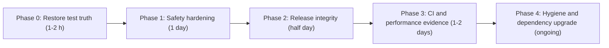

# TrueGaze™ — Full Documentation & Codebase Audit

**Project:** TrueGaze™ — Biological NPC Gaze & Kinematics Engine (Kirk LaSalle / HCEP)
**Workspace:** `D:\Projects\SkyrimTrueGaze` — HEAD `0642b92` (2026-10-04), working tree clean
**Declared version:** 1.0.8 (CMake, `SKSEPluginInfo`, README, STATUS)
**Audit date:** 2026-10-15
**Method:** Static review of all 46 C++ source/header files, the 5 test suites, build/CI/scripts, and the root and `docs/` documentation. Tests were built and **executed** in both Release and Debug. Dependency claims were checked against primary sources (upstream release pages, Microsoft Learn).

> [!IMPORTANT]
> **Bottom line.** The runtime engineering is much stronger than at the 2026-09-15 audit: 9 of its 10 critical/major findings are verifiably fixed in code, and the 10th is partly fixed. **But the automated test signal is not real.** A broken CMake helper compiles out every `assert()` in the Release configuration that CI and the local gate use. Once asserts are actually live, **2 of the 4 assert-based suites fail and a third doesn't compile.** Every "all tests pass", "100% coverage" and "verified" claim that rests on CI is currently unsupported. Fix this first (Phase 0, about one hour).

---

## 1. Executive Summary

### 1.1 What was verified by execution (not just by reading)

| Check | Result | Evidence |
| :--- | :--- | :--- |
| Charter integrity (`verify_charter.py`) | ✅ PASS | 10 Laws + 4 Tenets match across 3 charter docs |
| Standalone build, Release | ✅ builds, warnings | `C5102 ignoring invalid macro '/DNDEBUG'`; 16× `C4189` unused variables |
| `ctest --preset standalone` (Release) | ⚠️ "5/5 passed" | **Not meaningful:** asserts are compiled out (§3, F-01) |
| `KinematicsTests` with asserts live (Debug) | ❌ **FAIL** | `Assertion failed: counts[i] < kSamples*0.25f` — `KinematicsTests.cpp:756` |
| `TraceTests` with asserts live (Debug) | ❌ **FAIL** | `Assertion failed: lines.size() == 5` — `TraceTests.cpp:158` |
| `GeometryTests` with asserts live (Debug) | ❌ **DOES NOT COMPILE** | `C2039: 'agreement' is not a member of PanelHitResult` — `GeometryTests.cpp:300` |
| `ValidationTests` (own check counter, no `assert`) | ✅ PASS | `Checks: 107, failures: 0` |
| `HcepBridgeClientMock` (Debug) | ✅ PASS | Pipe round-trip + privacy minimisation verified |
| Shipped DLL identity | ✅ v1.0.8 strings, 10 exports | `skyrim/SKSE/Plugins/TrueGaze.dll`, 884,736 B, 2026-10-04 19:38 |

### 1.2 Maturity assessment

I've deliberately used qualitative grades rather than percentages. Earlier reports' figures (such as "95.8/100") had no reproducible method behind them, and repeating that would undermine the report.

| Dimension | Grade | Basis |
| :--- | :--- | :--- |
| Kinematics science & math | **Strong** | Main-sequence LUT, VOR split, OU drift, vergence; prior C-04/C-10 fixed |
| Engine integration & hook design | **Strong** | Correct vtable slots (SE/AE `0xAD`, VR `0xAF`); main-thread NPC ticking; per-actor SEH isolation |
| IPC bridge | **Strong / one gap** | Overlapped I/O, shutdown event, CRC + semantic validation, owner-only DACL; no `PIPE_REJECT_REMOTE_CLIENTS` |
| Memory & lifetime safety | **Adequate** | Root-pointer cache invalidation in GazeEngine; constraint table still holds raw bones across frames |
| Concurrency of public surfaces | **Needs work** | OAR cache uses `shared_mutex` ✅; exported C API is unsynchronized ❌ |
| Input robustness | **Needs work** | INI `NaN` survives `Sanitise()` |
| **Test & CI integrity** | **Failing** | Asserts compiled out; 3 of 5 suites broken once enabled; plugin DLL never built in CI |
| Release & version management | **Needs work** | Five different version numbers in the tree; only tag `v1.0.6` exists |
| Documentation truthfulness | **Mixed** | Excellent honesty sections (correction notices); briefing metrics unverifiable or wrong |
| Repo hygiene | **Needs work** | 809 MiB loose objects, 0 packs, tracked binaries and multi-MB screenshots |

---

## 2. Scope & Inventory (measured)

| Area | Measured | Notes |
| :--- | ---: | :--- |
| C++ `src/` + `include/` | 14,065 lines | 46 files; `GazeEngine.cpp` 2,388 lines, `TargetSelector.cpp` 1,502 lines |
| Tests | 2,046 lines | **5** test files / 5 CTest targets |
| Scripts (PS1/Py) | 5,485 lines | Deploy, health, CI gate, NIF tooling |
| Markdown docs | 13,130 lines | 56 files in `docs/`, plus 9 root docs |
| Configurator HTML | 2,882 lines | Root and `skyrim/` copies are byte-identical ✅ |
| Submodule | CommonLibSSE-NG `v7.5.4` | `c542446` |
| Git | 25+ commits since v1.0.4; tag `v1.0.6` only | 809.46 MiB loose objects, 4 garbage tmp objects |

---

## 3. Findings

Severity scale: **Critical** = invalidates a core guarantee or can crash the game; **High** = likely user-visible defect or security/privacy weakness; **Medium** = correctness, performance or maintainability risk; **Low** = hygiene.

### F-01 · CRITICAL · Test harness compiles out every `assert()` in Release (CI's configuration)

- **Where:** [CMakeLists.txt:80-84](file:///d:/Projects/SkyrimTrueGaze/CMakeLists.txt#L80-L84), used by all 5 test targets; CI runs `--preset standalone` = **Release** ([build-test.yml:42-49](file:///d:/Projects/SkyrimTrueGaze/.github/workflows/build-test.yml#L42-L49)); same for [Invoke-CiGate.ps1](file:///d:/Projects/SkyrimTrueGaze/scripts/Invoke-CiGate.ps1).
- **Defect:**
  ```cmake
  target_compile_definitions(${target} PRIVATE $<$<CONFIG:Release>:_DEBUG> $<$<CONFIG:Release>:/DNDEBUG>)
  ```
  `target_compile_definitions` takes macro *names*, so this emits `-D/DNDEBUG`. MSVC rejects it (`C5102 ignoring invalid command-line macro definition '/DNDEBUG'`), and CMake's default `NDEBUG` stays defined. The generated `.vcxproj` confirms it: `NDEBUG;_DEBUG;/DNDEBUG`. The intended flag was **`/UNDEBUG`**.
- **Proof that asserts are dead:** 16× `C4189 'v0'/'d10'/… initialized but not referenced`. Those variables are referenced *only* inside `assert(...)`. The helper's own comment ([L74-79](file:///d:/Projects/SkyrimTrueGaze/CMakeLists.txt#L74-L79)) describes exactly this failure mode as one it prevents.
- **Impact:** `KinematicsTests`, `GeometryTests`, `TraceTests` and most of `HcepBridgeClientMock` verify nothing in CI. Their success lines (for example *"passed (11/11 calibration regions verified with 100% agreement)"*) print unconditionally.
- **Fix:**
  ```cmake
  function(truegaze_force_asserts target)
      target_compile_options(${target} PRIVATE $<$<CONFIG:Release>:/UNDEBUG>)
  endfunction()
  ```
  Better still, migrate the suites to the counting `CHECK()` pattern `ValidationTests` already uses (it ran correctly in both configs). Also add a CI guard that fails if `C5102` appears in the build log.

### F-02 · CRITICAL · With asserts live, 3 of 5 suites are broken

1. **`KinematicsTests` fails** at [KinematicsTests.cpp:756](file:///d:/Projects/SkyrimTrueGaze/tests/KinematicsTests.cpp#L752-L757): *"Neutral weights: every vertex reachable, none dominant (<25%)"*.
   **Likely root cause:** the `[Unreleased]` "Conversational Eye Majority (85%+)" change added `eyeBias = isEye ? 4.0f : 1.0f` in [SocialTriangle.hpp:178](file:///d:/Projects/SkyrimTrueGaze/src/Kinematics/SocialTriangle.hpp#L178). That makes each eye exceed 25% by design, so the test expectation and the new design now contradict each other. Nobody noticed because of F-01. Execution stops at the first failure, so **later assertions (including the new `TestCombatTacticalGlances`) have never run.**
2. **`TraceTests` fails** at [TraceTests.cpp:158](file:///d:/Projects/SkyrimTrueGaze/tests/TraceTests.cpp#L157-L158): 5 events were logged (CGA enter/exit, blink, hit mismatch, calibration) but the JSONL file doesn't contain 5 lines. Either an event is dropped or filtered, or `Flush`/`StopTracing` doesn't drain fully. That's a real defect in the A8 trace logger or its test. The aborted run also left `test_trace_diagnostics.jsonl` in the CWD (I removed it).
3. **`GeometryTests` doesn't compile**: [GeometryTests.cpp:300](file:///d:/Projects/SkyrimTrueGaze/tests/GeometryTests.cpp#L298-L300) asserts `res.agreement`, but [`PanelHitResult`](file:///d:/Projects/SkyrimTrueGaze/src/Visuals/GazeGeometry.hpp#L213-L222) has no such member. It only compiles in Release because the assert expression is discarded.

- **Secondary CI hazard:** In Debug, a failing `assert` opens the CRT modal dialog, so `ctest` **hangs** (observed: both runs had to be killed). Before enabling asserts in CI, add `_CrtSetReportMode(_CRT_ASSERT, _CRTDBG_MODE_FILE); _CrtSetReportFile(_CRT_ASSERT, _CRTDBG_FILE_STDERR);` to each test `main`, or use `CHECK()`.
- **Documentation impact:** CHANGELOG `[Unreleased]` claims *"15th Biomechanical Kinematics Test … under 100% test coverage"*. That isn't true today and should be corrected under Law 7.

### F-03 · HIGH · The exported C API isn't thread-safe

- **Where:** [TrueGazeAPI.cpp:35-66, 88-114](file:///d:/Projects/SkyrimTrueGaze/src/Engine/TrueGazeAPI.cpp#L88-L114) → `GazeEngine::FindActor` → `std::unordered_map` lookup with **no lock**. [GazeEngine.hpp:33-39](file:///d:/Projects/SkyrimTrueGaze/src/Engine/GazeEngine.hpp#L33-L39) states "Game thread only", but [TrueGazeAPI.h](file:///d:/Projects/SkyrimTrueGaze/include/TrueGazeAPI.h) says nothing about threads to third-party callers.
- **Risk:** Third-party SKSE plugins commonly call from Papyrus VM threads, task threads or their own workers. A lookup concurrent with `EndFrame` eviction (`erase`) or an insert that rehashes is undefined behaviour and can crash. `TrueGaze_OverrideActorMode` also writes `hcepMode`, `modeOverrideTimerSec` and `hasModeOverride` from the foreign thread while the game thread reads them (a torn update).
- **Fix:** Serve `TrueGaze_GetActorGaze` from the already-synchronized OAR state cache ([OarConditions.cpp:30](file:///d:/Projects/SkyrimTrueGaze/src/Integrations/OarConditions.cpp#L30), `shared_mutex`). Marshal `OverrideActorMode` onto the game thread via `SKSE::GetTaskInterface()->AddTask(...)` or a lock-free request queue drained in `TickAllActors`. Document the threading contract in the header.

### F-04 · HIGH · `NaN` in `TrueGaze.ini` passes `Sanitise()` into bone matrices

- **Where:** [ConfigManager.cpp:19-30](file:///d:/Projects/SkyrimTrueGaze/src/Engine/ConfigManager.cpp#L19-L30) (`strtof` accepts `nan`/`inf`) and [ConfigManager.cpp:296-307](file:///d:/Projects/SkyrimTrueGaze/src/Engine/ConfigManager.cpp#L296-L307). `value < lo || value > hi` is **false for NaN**, so it's returned unchanged and unlogged. (`inf` is caught.)
- **Impact:** Any NaN weight or speed propagates through the kinematics into `NiMatrix3`. Typical symptoms are invisible or exploded heads or eyes, and possibly faults. Reachable from hand edits, or from any external tool or configurator path that writes `NaN`.
- **Fix:** In `clampReport`, `if (!std::isfinite(value)) { warn; return compiled default; }`. Add a `ValidationTests` case.

### F-05 · HIGH · The catch-all SEH policy continues after any structured exception, with no circuit breaker

- **Where:** [AnimationHook.cpp:87-102, 185-197, 308-321](file:///d:/Projects/SkyrimTrueGaze/src/Engine/AnimationHook.cpp#L87-L102). The filter returns `EXCEPTION_EXECUTE_HANDLER` for **every** code: access violations, but also stack overflow, guard-page, illegal instruction and in-page errors. After 5 reports it goes silent and keeps executing every frame.
- **Why it matters:** An AV inside bone mutation can leave the scene graph half-written. Continuing indefinitely trades a clean crash dump for silent corruption and log silence (Raymond Chen's long-standing guidance; Law 9 "graceful fallback to a stable foundational state").
- **Fix:**
  1. Filter: handle `EXCEPTION_ACCESS_VIOLATION` only, otherwise `EXCEPTION_CONTINUE_SEARCH`.
  2. Circuit breaker: after N faults (for example 3) in a session, set a runtime kill-switch (`enableTrueGaze=false`), `EyeAimConstraint::Reset()` (no deref), post a HUD message, and log once.
  3. Optionally write a minidump on the first fault (`MiniDumpWriteDump`) for field triage.

### F-06 · HIGH (needs in-engine confirmation) · Bone-restore ordering and stale-pointer hazards in `EyeAimConstraint`

- **Where:** [EyeAimConstraint.cpp:133-145, 207-271](file:///d:/Projects/SkyrimTrueGaze/src/Engine/EyeAimConstraint.cpp#L133-L145)
- **(a) Ordering hypothesis.** `BeginFrame()` (called from the player hook) restores every touched bone to the `originalRotate` cached **in the previous frame**, then `FindOrCreate` re-caches whatever is in `local.rotate`. If NPC animation has already written this frame's pose before the player hook runs, the restore **overwrites fresh animation with last frame's pose**, and the stale pose is re-cached. That would show up as dampened or frozen head and neck idle animation (nods, emotes) on gazing NPCs. If animation runs *after* the hook, the restore is redundant. I couldn't confirm the engine's ordering statically. **Test:** with TrueGaze on and then off, log `NPC Head` `local.rotate` before and after `BeginFrame` for an NPC playing a nodding idle.
- **(b) Stale pointer.** `Withdraw`/`WithdrawActor` check only that the actor still has *some* 3D (`Get3D() != nullptr`), not that `slot.bone` belongs to the **current** root. 3D rebuilds (equipment or race changes, `Reset3D`, disable/enable) can free the old skeleton while the form ID persists, which is a use-after-free. `GazeEngine` already does the right thing (`cachedRoot != root` at [GazeEngine.cpp:1852](file:///d:/Projects/SkyrimTrueGaze/src/Engine/GazeEngine.cpp#L1852)). **Fix:** store `root` in `TouchedBone` and require `actor->Get3D() == slot.root` before dereferencing.
- **(c) Doc/code mismatch.** [L19-23](file:///d:/Projects/SkyrimTrueGaze/src/Engine/EyeAimConstraint.cpp#L19-L23) says the raw pointer is "held only for the duration of one frame". It is held across frames.

### F-07 · HIGH · Version identity drift (five different versions in-tree)

| Location | Says |
| :--- | :--- |
| `CMakeLists.txt`, `SKSEPluginInfo`, README, STATUS, `vcpkg.json` | 1.0.8 |
| [`TrueGaze_GetVersion()`](file:///d:/Projects/SkyrimTrueGaze/src/Engine/TrueGazeAPI.cpp#L70-L73) (public ABI) | **`0x01000700` = 1.0.7** |
| [PRD.md:9](file:///d:/Projects/SkyrimTrueGaze/PRD.md#L9), [ROADMAP.md:7](file:///d:/Projects/SkyrimTrueGaze/ROADMAP.md#L7) | 1.0.7 |
| [Package-Release.ps1:4](file:///d:/Projects/SkyrimTrueGaze/scripts/Package-Release.ps1#L4), [PackageMod.ps1:56](file:///d:/Projects/SkyrimTrueGaze/scripts/PackageMod.ps1#L56) | **1.0.5** (packaging defaults) |
| [Invoke-CiGate.ps1:85](file:///d:/Projects/SkyrimTrueGaze/scripts/Invoke-CiGate.ps1#L85) fallback | 1.0.7 |
| Git tags | only `v1.0.6` (no `v1.0.7`/`v1.0.8` despite "Production Release v1.0.8 is Live") |
| `dist/` | newest archive is v1.0.6 |

The shipped "1.0.8" DLL also contains the `[Unreleased]` features (combat glances, vergence, Helgen decoupling, committed in `8aa2874` with the DLL). The binary label no longer identifies its feature set. **Fix:** single-source the version (generate `Version.h` from `project(VERSION)` via `configure_file`), feed packaging scripts from it, bump to **1.0.9** for the unreleased set, and tag every release.

### F-08 · MEDIUM · Named pipe doesn't reject remote (SMB) clients

- **Where:** [NamedPipeServer.cpp:283-291](file:///d:/Projects/SkyrimTrueGaze/src/Bridge/NamedPipeServer.cpp#L283-L291)
- The owner-only DACL `D:(A;;GA;;;OW)` and `FILE_FLAG_FIRST_PIPE_INSTANCE` are good. But Microsoft documents `PIPE_REJECT_REMOTE_CLIENTS` (`0x8`, a **`dwPipeMode`** flag) as the way to make a local-only pipe refuse network connections. Without it, an SMB session authenticated as the same user can reach `\\host\pipe\TrueGazeBridge`. For a biometric channel (Law 6) this is cheap defence in depth.
- **Fix:** `PIPE_TYPE_MESSAGE | PIPE_READMODE_MESSAGE | PIPE_WAIT | PIPE_REJECT_REMOTE_CLIENTS`. (Note: some web summaries place this flag in `dwOpenMode`; that's wrong.)

### F-09 · MEDIUM · Bridge worker busy-polls while connected

- **Where:** [NamedPipeServer.cpp:369-391](file:///d:/Projects/SkyrimTrueGaze/src/Bridge/NamedPipeServer.cpp#L369-L391). `PeekNamedPipe` + `sleep_for(2ms)` gives about 500 wakeups/s for the life of the connection. A lone undersized message also stalls the loop until more bytes arrive.
- **Fix:** Post an overlapped `ReadFile` of `sizeof(packet)` and `WaitForMultipleObjects({shutdown, read, outboundQueued})`. Handle `ERROR_MORE_DATA` by draining and rejecting oversize messages.

### F-10 · MEDIUM · Combat hot path is O(N²) with per-frame heap allocation; the frame budget is still unmeasured

- **Where:** [TargetSelector.cpp:356-380](file:///d:/Projects/SkyrimTrueGaze/src/Engine/TargetSelector.cpp#L356-L380). Each in-combat actor allocates a `std::vector<RE::Actor*>` and scans all `highActorHandles` every frame. A second full scan is at L849.
- **Budget claims:** PRD and briefing assert "< 0.15 ms per frame". [STATUS.md:268](file:///d:/Projects/SkyrimTrueGaze/docs/STATUS.md#L268) marks it "✅ Verified in-engine", yet ROADMAP E2.4 benchmarks are still open, the warn threshold is 10× the budget, and the same STATUS file lists crowd profiling as unchecked (L442).
- **Fix:** Build a per-frame hostile list once in `TickAllActors` and reuse a `static thread_local` / member vector. Publish p50/p95/max from `PerformanceProfiler` in Whiterun market and in a 6v6 battle. Until then, change STATUS to "instrumented, not yet benchmarked".

### F-11 · MEDIUM · CI never builds the actual plugin and skips the local gate's extra stages

- CI runs only the standalone preset. `TrueGaze.dll` (CommonLibSSE-NG, hooks, OAR, visuals) is **never compiled in CI**, so a broken plugin build can merge green.
- The configurator-parity and doc-version stages exist only in `Invoke-CiGate.ps1`, not in GitHub Actions.
- **Fix:** Add a `windows-release` job (vcpkg cache + submodule checkout). Call `Invoke-CiGate.ps1` from Actions. Fail on `C5102`.

### F-12 · MEDIUM · Dependency currency: CommonLibSSE-NG is five major versions behind

- Pinned **v7.5.4**. The upstream releases page (`alandtse/CommonLibVR`) lists **v12.1.0** as latest (v12.0.0, v11.0.0, v10.1.0 before it). v11 includes VR struct-layout and size corrections (`NiAVObject`, process data). That matters directly to TrueGaze's VR support, which walks `NiAVObject` hierarchies.
- **SKSE (primary source):** AE build **2.3.1 for game 1.7.104** (this machine's runtime), GOG 2.2.6 for 1.6.1179, VR 2.0.12 for 1.4.15. The in-engine evidence says v7.5.4 works on 1.7.104 today, so this is a planned upgrade on a branch, not an emergency.

### F-13 · MEDIUM · Repository hygiene

- `git count-objects`: **809.46 MiB in 1,528 loose objects, 0 packs, 4 garbage `tmp_obj_*` files** (from interrupted writes). The briefing's "410 MB" is stale.
- Tracked binaries: `skyrim/SKSE/Plugins/TrueGaze.dll`, `bin/*.exe`, five `dist/*.7z|zip` archives, and about 25 MB of PNG screenshots in a single commit (`0642b92`).
- **Fix:** run `git gc --prune=now` (safe; no history rewrite). Move release archives to GitHub Releases and screenshots to LFS or an external location. Add `bin/`, `dist/*.zip|7z` to `.gitignore` going forward. History rewriting would need your explicit approval and isn't recommended by default.

### F-14 · MEDIUM · Commit traceability

- `0642b92` *"feat(kinematics): combat tactical glances, magnetic focal point lock & binocular vergence"* changes **no source**: only docs and 8 screenshots. The feature code landed in `8aa2874` *"Fix(kinematics): decouple Helgen cart…"* together with the DLL. A future `git bisect` or `git log -- src` reader will be misled (Law 9 audit ledger).
- **Fix (going forward):** one logical change per commit; never commit the DLL alongside source (CI or release artifacts instead).

### F-15 · LOW · Console command slot reclamation can conflict with other plugins

- [ConsoleCommands.cpp:1011-1063](file:///d:/Projects/SkyrimTrueGaze/src/Integrations/ConsoleCommands.cpp#L1011-L1063) reclaims "empty/dead" entries of the global console table. It's careful: it checks markers, refuses a partial set, and never writes out of bounds. Another plugin using the same technique *without* marker checks could still overwrite TrueGaze's entries if it loads later. Document this in the support KB and log the bound opcodes at install (partly done).

### F-16 · LOW · Documentation sprawl and duplication

- 56 files in `docs/`, many of them point-in-time plans or walkthroughs with long, space-laden filenames.
- `truegaze-character-profile.md` and `truegaze-character-profile_a.md` are byte-identical.
- `kinematic_anomalies_and_remediation_guide.md` duplicates the knowledge item.
- `README.md`, `TRUEGAZE_ARCHITECTURE.md` and `docs/ARCHITECTURE.md` still overlap (open since the 09-15 audit).
- CHANGELOG has **three `[Unreleased]` headings** (Keep a Changelog allows one).
- **Fix:** create `docs/archive/` for dated plans and walkthroughs, add a `docs/INDEX.md`, delete the `_a` duplicate, and consolidate `[Unreleased]`.

### F-17 · LOW (governance-relevant) · Unverifiable or incorrect metrics in `.nexus_briefing.md`

| Claim | Measured |
| :--- | :--- |
| "260,486 Lines of Code" | ~14.1k C++; ~37.6k including tests, scripts, docs and HTML |
| "49 automated test files/suites" | 5 |
| "Health Score 95.8/100 (Quality 96)" | No method; quality gate is broken (F-01/F-02) |
| "< 0.15 ms per frame" | Not benchmarked (F-10) |
| "First biological oculomotor engine in gaming history" | Unfalsifiable; risky in public marketing |

Under **Law 7 (truthfulness)** these should be corrected at the source that generates the briefing (I didn't edit the file; it's routed by `.nexus`).

### F-18 · LOW · Smaller code notes

- `ReadFloat` uses `snprintf("%f")` + `strtof`, which is locale-dependent. Harmless under the default "C" locale, but `std::from_chars` is locale-free and faster.
- [Main.cpp:293](file:///d:/Projects/SkyrimTrueGaze/src/Main.cpp#L293) sets `SupportEmail = ""`. Set a support URL or address for crash-log tools that surface it.
- `HcepBridgeClientMock.cpp:98` has an unused `ok` (also a symptom of F-01).
- `EndFrame` has a duplicated comment line ([GazeEngine.cpp:576-577](file:///d:/Projects/SkyrimTrueGaze/src/Engine/GazeEngine.cpp#L576-L577)).

---

## 4. Verification of the 2026-09-15 Audit Findings

| ID | Finding | Status | Evidence |
| :--- | :--- | :--- | :--- |
| C-01 | Pipe shutdown deadlock | ✅ **Fixed** | `FILE_FLAG_OVERLAPPED`, `_shutdownEvent`, `CancelIoEx`, `JoinPolicy::{Join,Abandon}` ([NamedPipeServer.cpp:189-265](file:///d:/Projects/SkyrimTrueGaze/src/Bridge/NamedPipeServer.cpp#L189-L265)) |
| C-02 | Blink wrote anger/fear expressions | ✅ **Fixed** | `modifierKeyFrame.SetValue` with bounds check ([EfmBlinkController.cpp:35-64](file:///d:/Projects/SkyrimTrueGaze/src/Integrations/EfmBlinkController.cpp#L35-L64)) |
| C-03 | Dangling bones on unload | 🟡 **Partly fixed** | `Reset()` clears without deref; liveness check added; same-root check missing (F-06b) |
| C-04 | VOR residual discarded | ✅ **Fixed** | Head chain uses `vor.headYaw/Pitch`, eyes use `vor.eyeLocalYaw + jitter` ([GazeEngine.cpp:1987-2034](file:///d:/Projects/SkyrimTrueGaze/src/Engine/GazeEngine.cpp#L1987-L2034)) |
| C-05 | Ambient gaze "stares East" | ✅ **Fixed** | `sin/cos(heading) * kAmbientForwardUnits` ([TargetSelector.cpp:889-890](file:///d:/Projects/SkyrimTrueGaze/src/Engine/TargetSelector.cpp#L889-L890)) |
| C-06 | `EndFrame` never called | ✅ **Fixed** | Called every player frame ([AnimationHook.cpp:164](file:///d:/Projects/SkyrimTrueGaze/src/Engine/AnimationHook.cpp#L164)) |
| C-07 | HCEP telemetry never consumed | ✅ **Fixed** | `TryGetLatestTelemetry` (GazeEngine.cpp:1018), `SendFeedback` (:2206) |
| C-08 | No downward transform pass | ✅ **Fixed** | `UpdateDownwardPass` ([EyeAimConstraint.cpp:97-102](file:///d:/Projects/SkyrimTrueGaze/src/Engine/EyeAimConstraint.cpp#L97-L102)) |
| C-09 | API mode override overwritten | ✅ **Fixed (logic)** | `modeOverrideTimerSec` honoured; thread safety still open (F-03) |
| C-10 | Saccade quadrature cost | ✅ **Fixed** | 65-entry `constexpr` LUT ([SaccadeGenerator.hpp:130-169](file:///d:/Projects/SkyrimTrueGaze/src/Kinematics/SaccadeGenerator.hpp#L130-L169)) |

---

## 5. Notable Strengths (worth preserving)

- **Honest engineering culture in code comments:** hook history ("slot 0x05 does not exist"), logging-ownership rationale, and the console-table "there is no count" postmortem are exemplary institutional memory.
- **Correct threading model for the scene graph:** NPC ticks are driven from the player's main-thread update instead of Havok worker threads ([AnimationHook.cpp:249-257](file:///d:/Projects/SkyrimTrueGaze/src/Engine/AnimationHook.cpp#L249-L257)).
- **Per-actor fault isolation** (`TickActorSeh`): one bad actor no longer aborts the frame. Narrow the filter per F-05, but keep the structure.
- **Privacy by design at the trust boundary:** `trackedPersonId` is discarded after CRC validation, the connection audit logs image *name* only (no path or username), and the opt-in retention flag is tested (verified passing).
- **OAR integration** follows the upstream example plugin pattern exactly, registers at `kPostLoad`, and guards its cache with `shared_mutex`.
- **Fail-loud build:** the CommonLibSSE-NG presence guard, explicit source list, and `VCPKG_ROOT` check.
- **Charter integrity automation** (`verify_charter.py` + a dedicated workflow) works and passes.

---

## 6. Governance & Permanent Active Directives Compliance

| Law | Status | Notes |
| :--- | :--- | :--- |
| **6 — Privacy / data** | ✅ Compliant, harden | Owner-only DACL, data minimisation verified by test. Add `PIPE_REJECT_REMOTE_CLIENTS` (F-08). |
| **7 — Truthfulness** | ⚠️ Gaps | Test-pass and coverage claims (F-01/F-02), "verified" frame budget (F-10), briefing metrics (F-17), version labels (F-07). The CHANGELOG's own correction-notice practice is the right model: apply it again. |
| **9 — Auditable reasoning, stable fallback** | ⚠️ Partial | Excellent logging; but the catch-all SEH with silence after 5 faults is the opposite of a stable fallback (F-05); commit traceability (F-14). |
| **10 — Operational boundaries** | ✅ | Charter manifest intact; no charter files modified by this audit. |

---

## 7. Web Research Summary (primary sources where possible)

| Topic | Finding | Source |
| :--- | :--- | :--- |
| CommonLibSSE-NG currency | Latest **v12.1.0**; project pins v7.5.4 | github.com/alandtse/CommonLibVR/releases (fetched) |
| SKSE64 runtimes | AE 2.3.1 ↔ game 1.7.104; GOG 2.2.6 ↔ 1.6.1179; VR 2.0.12 ↔ 1.4.15 | skse.silverlock.org (fetched) |
| Local-only pipes | `PIPE_REJECT_REMOTE_CLIENTS` = `0x8`, a `dwPipeMode` remote-client flag | learn.microsoft.com CreateNamedPipeA (fetched) |
| Asserts in MSVC Release | CMake adds `/DNDEBUG` to Release; use `/UNDEBUG` per target to re-enable | CMake docs and community references |
| SEH catch-all | Filter specific codes; don't continue blindly after AVs; preserve crash context | Raymond Chen, *The Old New Thing* (Microsoft DevBlogs) |
| OAR Conditions API | V3 adds non-essential conditions; registration at `kPostLoad`/`kPostPostLoad` | OAR repo / example plugin |

> [!NOTE]
> One web search summary reported CommonLibSSE-NG "v11.0.0" as latest. The fetched releases page shows v12.1.0, so the report uses the primary source.

---

## 8. Remediation Plan



**Phase 0 — Restore test truth (do first)**
1. Replace `truegaze_force_asserts` with `/UNDEBUG` (F-01).
2. Add CRT report-mode setup to test mains so Debug failures exit instead of hanging (F-02).
3. Triage the three broken suites: update the vertex-dominance expectation to the 4× eye-bias design (or revert the design); find the dropped trace event; remove or replace `res.agreement` (F-02).
4. Correct the CHANGELOG coverage claim.

**Phase 1 — Safety hardening**
5. Make the C API thread-safe through the OAR cache and the SKSE task queue; document the contract (F-03).
6. Reject non-finite INI values (F-04).
7. Narrow the SEH filter and add a fault circuit breaker (F-05).
8. Add the same-root check to `TouchedBone`; instrument the restore ordering in-engine (F-06).
9. Add `PIPE_REJECT_REMOTE_CLIENTS` (F-08).

**Phase 2 — Release integrity**
10. Single-source the version; fix `TrueGaze_GetVersion`, PRD, ROADMAP and packaging defaults; bump to 1.0.9; tag `v1.0.7`–`v1.0.9` retroactively at the right commits if desired (F-07).

**Phase 3 — CI & performance evidence**
11. Add a plugin-build CI job; run `Invoke-CiGate.ps1` in Actions; fail on `C5102` (F-11).
12. Hoist the combat hostile scan; benchmark crowd and combat scenes; update STATUS with measured numbers (F-10).
13. Replace the pipe busy-poll with event-driven reads (F-09).

**Phase 4 — Hygiene & upgrades**
14. `git gc`; move binaries and screenshots out of tracked history going forward (F-13).
15. Archive dated docs, add `docs/INDEX.md`, dedupe, consolidate `[Unreleased]` (F-16).
16. Correct the briefing metrics at their generator (F-17).
17. Spike CommonLibSSE-NG v12.x on a branch, prioritising the VR layout fixes (F-12).

---

## 9. Reproduction Commands

```powershell
# Charter
python scripts/verify_charter.py --verbose

# Release (current CI path) — passes, but asserts are compiled out
cmake --preset standalone; cmake --build --preset standalone; ctest --preset standalone --output-on-failure

# Proof: inspect generated defines
Select-String build\standalone\KinematicsTests.vcxproj -Pattern 'PreprocessorDefinitions'   # NDEBUG;_DEBUG;/DNDEBUG

# Asserts live (Debug) — reveals F-02 (expect GeometryTests compile error; run each exe with a timeout)
cmake --build build/standalone --config Debug
bin\Debug\KinematicsTests.exe   # fails at KinematicsTests.cpp:756
bin\Debug\TraceTests.exe        # fails at TraceTests.cpp:158

# Repo state
git count-objects -vH
```

> [!NOTE]
> This audit changed no source or documentation. Side effects were limited to build outputs under `build/standalone` and `bin/{Release,Debug}`. I also deleted one stray file, `test_trace_diagnostics.jsonl`, which the aborted Debug `TraceTests` run had left at the repo root. `git status` is clean.
