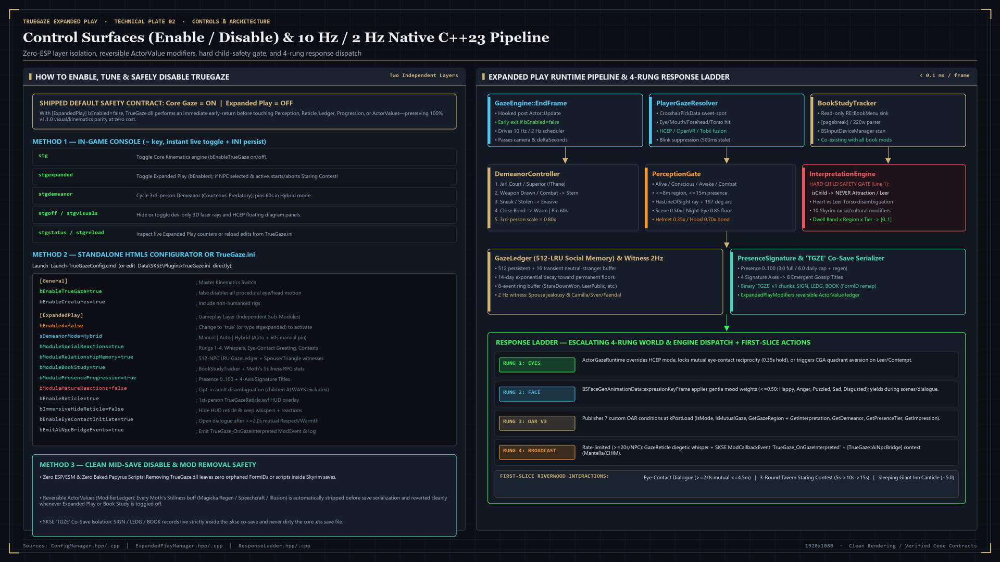
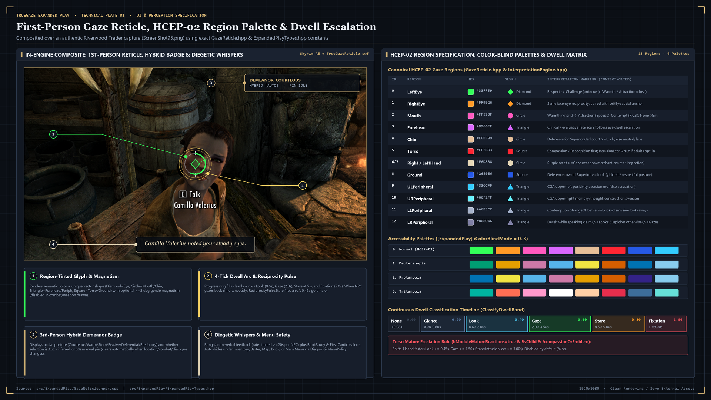
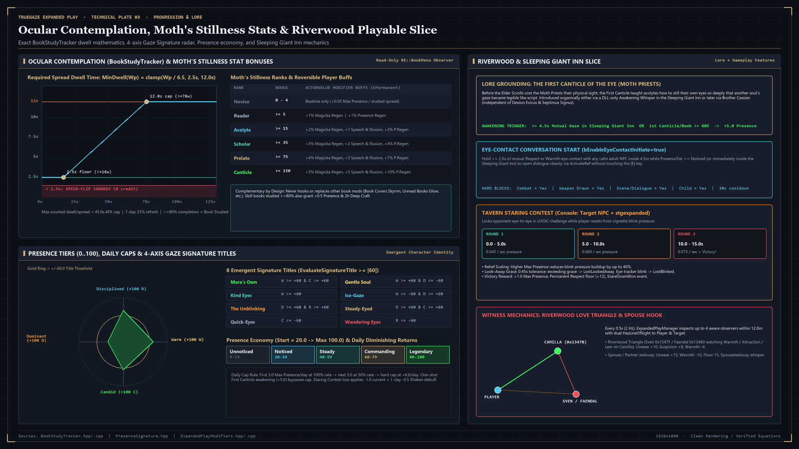
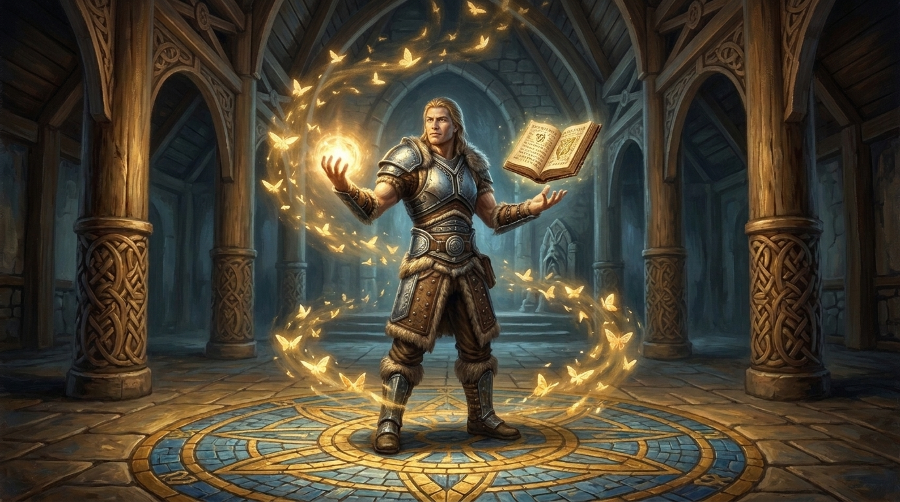
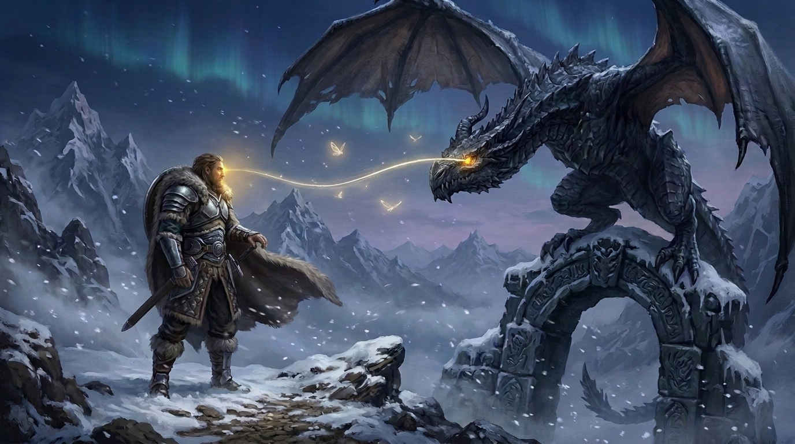

# TrueGaze Expanded Play Guide (v2.0.0 — G0–G3, WP-8, WP-9 & WP-10)

**Product:** TrueGaze™ v2.0.0 — Biological Gaze, Real-Time Persuasion & Expanded Play Gameplay Layer  
**Build Compatibility:** Skyrim SE (`1.5.97`), AE (`1.6.318–1.7.104.0+`), Skyrim VR (`1.4.15`)  
**Packaging:** Single native C++23 SKSE plugin (`TrueGaze.dll` + procedural Flash HUDs `TrueGazeIncoming.swf` & `TrueGazeReticle.swf` — **zero SkyUI/MCM, zero Papyrus scripts**) + **optional ESL-flagged `TrueGaze_ExpandedPlay.esp`** (`Skyrim.esm` only, `0` load-order slots, zero world-cell edits)  
**Lore Companion:** Read **[The First Canticle of the Eye — Origins, Lore & Pilgrimage Chronicle](TRUEGAZE_LORE_AND_STORY.md)** for the complete story behind the Cult of the Ancestor Moth and why each artifact rests in its Sanctuary.

---

## 1. What Expanded Play Adds (Two-Layer Architecture)

TrueGaze ships as two cleanly separated layers inside the same `TrueGaze.dll`:

1. **Layer 1 — Core Biological Gaze Engine (`bEnableTrueGaze=true` by default):**  
   Pure visual and biomechanical immersion: Vestibulo-Ocular Reflex (VOR), Main Sequence ballistic saccades, Brownian micro-drift, saccadic eyelid blinking, Social Triangle scanpaths, 3rd-person player conversational headtracking, and developer diagnostic overlays (`bEnableInGameVisuals=false` by default).
2. **Layer 2 — Expanded Play Gameplay Layer (`[ExpandedPlay] bEnabled=false` by default):**  
   Turns eye contact and reading attention into **diegetic RPG gameplay** grounded in the lore of the **Elder Scrolls Moth Priests** (*The First Canticle of the Eye*):
   - **Perceptual Sightlines (`PerceptionGate`) & Semantic Meaning (`InterpretationEngine`):** NPCs read *where*, *how long*, and *under what context* you look (`Respect`, `Warmth`, `Attraction`, `Challenge`, `Suspicion`, `Deference`, `Contempt`, `Compassion`, `Deceit`, `Recognition`, or adult-only `IntrusionLeer`)—with an unconditional **Hard Child Safety Gate**.
   - **1st-Person Gaze Reticle & 3rd-Person Hybrid Demeanor:** Subtle region-tinted reticle (`TrueGazeReticle.swf`), 4-tick dwell ring, reciprocity pulse, accessibility glyph shapes & 3 color-blind palettes, Telltale-style impression whispers, plus automatic/hybrid 3rd-person body language (`Courteous`, `Warm`, `Stern`, `Evasive`, `Deferential`, `Predatory`).
   - **512-NPC Social Memory (`GazeLedger`) & Witnesses:** Remembers impressions with a 14-day exponential decay toward permanent floors, plus 2 Hz witness detection for **Spouse Jealousy** and the **Riverwood Sven / Camilla / Faendal Love Triangle**.
   - **Ocular Contemplation (`BookStudyTracker`) & *Moth's Stillness*:** A 100% read-only `RE::BookMenu` observer that rewards unhurried, page-by-page reading with Presence, Disciplined/Candid Signature growth, 2-hour *Deep Craft* on skill books, and reversible *Moth's Stillness* RPG stat buffs (`Magicka Regen`, `Speechcraft`, `Illusion`). Compatible with every Skyrim book mod.
   - **4-Rung World Reactions & First-Slice Tavern Mechanics:** HCEP mode overrides (Rung 1), gentle non-dialogue FaceGen expressions (Rung 2), **7 native Open Animation Replacer V3 conditions** (Rung 3), HUD whispers / `TrueGaze_OnGazeInterpreted` SKSE ModEvent / Mantella & CHIM AI-NPC bridge context (Rung 4), **Eye-Contact Conversation Start**, a **3-Round Tavern Staring Contest**, and the **Sleeping Giant Inn *First Canticle* Awakening**.

<p align="center">
  
  <br>
  <em>Figure 1: Enable/disable switchboard and full 10 Hz / 2 Hz C++23 runtime architecture.</em>
</p>

---

## 2. How to Enable, Tune & Safely Disable the Mod

Every switch can be controlled from the **in-game console (`~`)**, the standalone **`TrueGazeConfig.html`** launcher (`Launch-TrueGazeConfig.cmd`), or directly in **`Data\SKSE\Plugins\TrueGaze.ini`**.

### Quick Enable / Disable Cheat Sheet

| Goal | In-Game Console (`~`) | INI Key (`Data\SKSE\Plugins\TrueGaze.ini`) | Effect |
| :--- | :--- | :--- | :--- |
| **Enable Expanded Play** | `stgexpanded` *(until ON)* | `[ExpandedPlay] bEnabled=true` | Activates the full gameplay layer, reticle, memory, book study, and Presence/Signature. |
| **Disable Expanded Play** | `stgexpanded` *(until OFF)* | `[ExpandedPlay] bEnabled=false` | Immediate zero-overhead early exit; strips all temporary *Moth's Stillness* buffs and returns to classic v1.1.0 visual/kinematics parity. |
| **Enable / Disable All TrueGaze Kinematics** | `stg` | `[General] bEnableTrueGaze=true/false` | Toggles core biological eye/head motion across all actors (NPCs revert to vanilla Skyrim AI headtracking when `false`). |
| **Cycle & Pin 3rd-Person Demeanor** | `stgdemeanor` | `[ExpandedPlay] iActiveDemeanor=0..5` | Cycles `Courteous -> Warm -> Stern -> Evasive -> Deferential -> Predatory` (holds a 60s pin in `Hybrid` mode). |
| **Hide Visual Clutter / Rays Only** | `stgoff` / `stgvisuals` | `[Visuals] bEnableInGameVisuals=false` | Disables developer 3D laser beams & floating debug panels while keeping Expanded Play active. |
| **Hide Reticle, Keep Reactions & Whispers** | — *(Configurator / INI)* | `[ExpandedPlay] bImmersiveHideReticle=true` | Hides the crosshair ring overlay while keeping social interpretation, whispers, and Progression active. |
| **Enable Adult Mature Torso Rules (Opt-In)** | — *(Configurator / INI)* | `[ExpandedPlay] bModuleMatureReactions=true` | Enables faster adult Torso escalation (`IntrusionLeer`). **Default is `false`**. Children remain strictly immune under all configurations. |

### Enabling or Disabling Individual Expanded Play Modules

Inside `[ExpandedPlay]` in `TrueGaze.ini` (or the **Expanded Play** section of `TrueGazeConfig.html`), each pillar can be toggled independently:

```ini
[ExpandedPlay]
bEnabled=true                      ; Master Expanded Play switch (shipped default: false)
sDemeanorMode=Hybrid               ; Manual | Auto | Hybrid (Auto + 60s manual pin)
bModuleSocialReactions=true        ; Rung 1-4 reactions, Whispers, Eye-Contact Greeting, Contests
bModuleRelationshipMemory=true     ; 512-LRU GazeLedger + 2 Hz Spouse/Triangle witness detection
bModuleBookStudy=true              ; Ocular Contemplation + Moth's Stillness player stats
bModulePresenceProgression=true    ; Presence (0..100), Signature titles, First Canticle Awakening
bModuleMatureReactions=false       ; Opt-in adult Torso disambiguation (never applies to children)
```

### Clean Mid-Save Disable & Uninstall Guarantee

1. **No ESP/ESM or Papyrus Scripts:** Deleting or disabling TrueGaze removes **zero scripts and zero persistent form records** from your `.ess` save file.
2. **SKSE Co-Save Isolation (`'TGZE'` v1):** Persistent `SIGN`, `LEDG`, and `BOOK` records live exclusively in the companion `.skse` co-save file (`CoSaveSerializer`).
3. **Reversible ActorValues (`ModifierLedger`):** All *Moth's Stillness* stat modifications are tracked per ActorValue delta, **stripped automatically before saving** (`kSaveGame`), re-synced after load (`kPostLoadGame`), and **immediately reverted** if `bEnabled` or `bModuleBookStudy` is turned off.

---

## 3. First-Person Gaze Reticle & HCEP-02 Region Perception

<p align="center">
  
  <br>
  <em>Figure 2: In-engine overlay composite (ScreenShot95.png), all 13 HCEP-02 regions, color-blind palettes, and the 5-band dwell timeline.</em>
</p>

- **4-Tick Dwell Arc:** Around the crosshair center, a lightweight vector arc fills across **Look** (`0.60s`), **Gaze** (`2.00s`), **Stare** (`4.50s`), and **Fixation** (`9.00s`).
- **Accessibility by Shape & Color:** Each region pairs its HCEP-02 color with a distinct geometric glyph (`Diamond` for eyes, `Circle` for mouth/chin/hands, `Triangle` for forehead/peripherals, `Square` for torso/ground) plus 4 palettes (`iColorBlindMode = 0..3`: Normal, Deuteranopia, Protanopia, Tritanopia).
- **Soft Magnetism (`fReticleMagnetismStrength`):** Subtle `<= 2.0 deg` visual attraction inside the face triangle; automatically suspends while a weapon is drawn or in combat.
- **Full-Screen Menu Safety:** Automatically hides whenever `InventoryMenu`, `BarterMenu`, `Book Menu`, `MapMenu`, or `Main Menu` is open.
- **Hard Perception Limits (`PerceptionGate`):** Unconscious, sleeping, ragdolled, or fighting NPCs cannot interpret passive looks. Beyond `8.0 m` (`kRegionRangeMeters`), facial/torso region specificity is blocked; beyond `15.0 m` (`kPresenceRangeMeters`), NPCs stop perceiving passive gaze. Helmets scale facial bond gains (`Warmth`/`Attraction`/`Recognition`) to `0.35x` while hoods scale to `0.70x`.

---

## 4. *Ocular Contemplation*, *Moth's Stillness*, Presence & Riverwood Gameplay

<p align="center">
  
  <br>
  <em>Figure 3: Quantified page-by-page book study math, Moth's Stillness ActorValue bonuses, 4-axis Signature radar, and Riverwood slice interactions.</em>
</p>

### 4.1 Ocular Contemplation (`BookStudyTracker`)
- Watches `RE::BookMenu` open/close and `BSInputDeviceManager` read-only—completely separate from and compatible with *Book Covers Skyrim*, *Unread Books Glow*, and custom book UIs.
- Splits book text on `[pagebreak]` (or 220-word spread chunks) and computes per-spread required reading time:
  $$\mathrm{MinDwell}(W_p) = \mathrm{clamp}\!\left(\frac{W_p}{6.5},\; 2.5\text{ s},\; 12.0\text{ s}\right)$$
- **Anti-Exploit Guards:** Flipping faster than `1.5s` gives `0` credit (`speedFlippedSpreads`); idle AFK time caps at `45.0s` per spread; `uint64_t pagesReadMask` prevents repeat farming within 7 in-game days (allowing a 25% refresh thereafter).
- **Rewards:** `+0.05` Max Presence per newly studied spread (`+0.15` for Canticle / Elder Scroll / Moth / Oghma / Black Book titles), `+0.25` full-book bonus at `>= 80%` spreads read, `+0.5` Presence + 2h *Deep Craft* on skill books, and permanent progression toward **Moth's Stillness** (`Reader` 5+, `Acolyte` 15+, `Scholar` 35+, `Prelate` 75+, `Canticle` 150+ books: up to `+5%` Magicka Regen, `+5` Speechcraft/Illusion, `+10%` Presence Regen).

### 4.2 Lore & Riverwood First-Slice Features
- **First Canticle Awakening (DLL-only fallback):** Sustaining `>= 4.5s` mutual gaze inside the **Sleeping Giant Inn** (or completing your first Canticle/lore book) triggers the awakening whisper and grants a one-time `+5.0` Max Presence boost.
- **Eye-Contact Conversation Start:** When `Presence >= 20` (`Noticed`) or inside the Sleeping Giant Inn tutorial context, holding `>= 2.0s` mutual `Respect` or `Warmth` gaze within `4.5 m` cleanly initiates dialogue without pressing `E` (respects `bEnableEyeContactInitiate`).
- **3-Round Tavern Staring Contest:** Open the console (`~`), click an NPC (e.g., Orgnar or Delphine), and run **`stgexpanded`** (while Expanded Play is ON) to start/abort a 3-round (`5s -> 10s -> 15s`) lock-eyes contest with escalating frost-vignette blink pressure. Winning awards `+1.0` Max Presence and a `+12` permanent Respect floor.
- **Riverwood Love-Triangle & Spouse Witnesses:** Looking warmly/longingly at **Camilla Valerius** (`0x01347B`) while **Sven** (`0x01347F`) or **Faendal** (`0x013480`) has line-of-sight within `12 m` logs a `TriangleWitnessed` memory event and raises rival `unease`/`suspicion` with a whisper. Married spouses react similarly via `PlayerMarriedFaction`.

---

## 5. Complete `[ExpandedPlay]` INI Settings Reference (19 Keys)

| INI Key | Type | Default | Bounds / Options |
| :--- | :--- | :--- | :--- |
| `bEnabled` | `bool` | `false` | `false` / `true` |
| `sUnlockMode` | `string` | `Ritual` | `Ritual` (Staged 4-key pilgrimage) \| `Sandbox` (Immediate Stage 4 unlock) |
| `bEnableStagedAwakening` | `bool` | `true` | Enables Stage 0–4 capability progression (`false` unlocks all capabilities immediately when `bEnabled=true`) |
| `sDemeanorMode` | `string` | `Hybrid` | `Manual` \| `Auto` \| `Hybrid` |
| `iActiveDemeanor` | `int` | `0` | `0`..`5` (`Courteous`, `Warm`, `Stern`, `Evasive`, `Deferential`, `Predatory`) |
| `bModuleSocialReactions` | `bool` | `true` | Enables Rungs 1–4, Greetings, and Contests |
| `bModuleRelationshipMemory` | `bool` | `true` | Enables 512-LRU `GazeLedger` and 2 Hz Witnesses |
| `bModuleBookStudy` | `bool` | `true` | Enables `BookStudyTracker` & *Moth's Stillness* |
| `bModuleMatureReactions` | `bool` | `false` | Adult Torso disambiguation opt-in (children always immune) |
| `bModulePresenceProgression` | `bool` | `true` | Enables Presence `0..100` & 4-axis Signature titles |
| `bEnableReticle` | `bool` | `true` | Renders `TrueGazeReticle.swf` in 1st person |
| `fReticleOpacity` | `float` | `0.22` | `0.00`..`1.00` |
| `fReticleMagnetismStrength` | `float` | `0.35` | `0.00`..`1.00` |
| `iColorBlindMode` | `int` | `0` | `0`=Normal, `1`=Deuteranopia, `2`=Protanopia, `3`=Tritanopia |
| `bImmersiveHideReticle` | `bool` | `false` | Suppresses visible ring while keeping gameplay logic active |
| `bEnableEyeContactInitiate` | `bool` | `true` | Allows hands-free greeting on `>= 2.0s` mutual gaze |
| `bEnableImpressionWhispers` | `bool` | `true` | Displays Telltale-style whispers on `TrueGazeReticle.swf` |
| `fThirdPersonEfficacy` | `float` | `0.80` | `0.50`..`1.00` third-person efficacy scalar |
| `bEmitAiNpcBridgeEvents` | `bool` | `true` | Emits `TrueGaze_OnGazeInterpreted` & `[TrueGaze::AiNpcBridge]` logs |

---

## 6. 5-Minute Riverwood Verification Checklist

1. Launch Skyrim via `skse64_loader.exe`, load a save inside **Riverwood** or the **Sleeping Giant Inn**.
2. Open console (`~`) and type **`stgexpanded`** — confirm `ExpandedPlay = ON`, Presence `20.0`, and Scholarship Rank.
3. Aim at **Camilla Valerius**, **Orgnar**, or **Delphine** (`<= 4.5 m`): watch the HCEP-02 region reticle tint green on their eyes, fill the dwell ring, pulse gold on mutual contact, and trigger a greeting after `2.0s` mutual gaze.
4. Stand inside the Sleeping Giant Inn and hold `>= 4.5s` mutual gaze on an adult patron to awaken **The First Canticle** (`+5.0 Presence`).
5. Target an adult NPC in the console (`~`, click NPC) and type **`stgexpanded`** to test the 3-round **Staring Contest**.
6. Open a 3+ page book (like *The Aetherium Wars* or *Mythic Dawn Commentaries*), dwell `>= 3s` per spread, close it, and run **`stgstatus`** or inspect `TrueGaze.log` to verify `Ocular Contemplation` credits.
7. Run **`stgexpanded`** again to disable Expanded Play cleanly—reticle, whispers, and temporary ActorValue modifiers vanish immediately without affecting your save.

---

## 7. Riverwood -> Rest of Skyrim: Real-Time Persuasion & Multi-Transaction Testing (`WP-8`)

In addition to `WP-1`–`WP-7`, TrueGaze now translates **TES IV: Oblivion's Persuasion Wheel & non-linear Bribe math (`fBribeCostCurve = 1.50`, `fBribeCurve = 0.75`)** into zero-menu 3D real-time gaze across **every NPC in Skyrim**:

### Part A — Riverwood Test Bench (Bespoke Cast Affinities)
1. **Phase 1 Micro-Expression Reading (`0.35s .. 1.99s`):**
   - Approach **Camilla Valerius** (loves `Admire`, hates `Coerce`) or **Delphine** (loves `Coerce`, hates `Joke` & `Plea`). Look briefly at their eyes/mouth before crossing the `2.0s` Dwell tick: receptive `Love`/`Like` cues lock soft eye contact and smile (`Rung 2`), while mismatched `Dislike`/`Hate` probes draw frowns/aversion—letting you look away before committing!
   - Toggle `stgdemeanor` between `Courteous`, `Warm`, `Stern`, and `Predatory`, or inspect live state anytime via `stgstatus` (`persuasion/tx vector=... bribeEst=...g speechMod=...`).
2. **Pre-Barter Rapport with Lucan Valerius:** Hold a steady `2.0s+` `Boast` (`Stern` + high Presence) or polite `Admire` on Lucan before opening barter—your reversible `kSpeechcraftModifier` climbs (`speechMod`), improving buy/sell margins cleanly and stripping automatically before save (`kSaveGame`) or disable.
3. **"Knowing Look" Sly Bribe & `"Guard's Glance"` Witness Test:**
   - Look down briefly (`0.4s..1.2s`) at **Orgnar's** or a Riverwood guard's belt/hand (`Region::RightHand`/`LeftHand`), then lift your gaze directly to their eyes (`< 1.8s` cadence) to signal `SlyBribe`.
   - If a Riverwood Guard has line-of-sight within `12 m`, `EvaluateWitnesses2Hz` spots them (`lawWitnesses > 0`), the NPC breaks contact with a sharp aversion glance and warns *"eyes flick toward the guard—not here"*, blocking covert bribery until sightlines clear.
4. **Stand-Down Grace ("Blood or Coin"):** Draw a weapon while holding `Stern` eye contact (`Coerce`), then **sheathe your weapon while still meeting their eyes** (`<= 2.5s` window) for an immediate de-escalation `StandDownGrace` respect/warmth & Speech boost.

### Part B — Rest of Skyrim (Whiterun, Riften, Solitude & Any Modded NPC)
- Every NPC outside Riverwood automatically resolves a deterministic **6-vector Oblivion-style affinity matrix** from their `ActorBase` FormID (`FNV-1a` seed) layered with **Skyrim Cultural Norms** (`Nord`/`Orc` favor `Boast`, `Khajiit` warm to `Joke`/`SlyBribe`, `Altmer` dislike casual `Joke`), **Guard Ethics**, **Relationship Tier**, and the **unconditional `isChild` safety gate**.
- For full mathematical curves (`fBribeCostCurve`, `fBribeCurve`, `WitnessRisk`) and `WP-8A`–`WP-8D` design details, see [REALTIME_PERSUASION_AND_TRANSACTIONS_GDD.md](REALTIME_PERSUASION_AND_TRANSACTIONS_GDD.md).

---

## 8. Staged Awakening (`WP-9`) & Smart Brandishing, Combat Sight & Creature Sight (`WP-10`)

<p align="center">
  
  <br>
  <em>The six Relics of the First Canticle included in the optional ESL plugin TrueGaze_ExpandedPlay.esp — discovered organically across Skyrim's Seven Sanctuaries or spawned for testing via stgitems.</em>
</p>

### 8.1 Staged Lore Awakening (`WP-9A`–`WP-9D`)
- **Hybrid Architecture:** Runs natively in `TrueGaze.dll` (with vanilla `Skyrim.esm` books, Divine Amulets/Circlets, and 7 base-Skyrim Sanctuaries) and upgrades seamlessly when the optional ESL-flagged **`TrueGaze_ExpandedPlay.esp`** (`Skyrim.esm` only, zero Papyrus scripts, `0` load-order slots, zero world-cell edits) is enabled.
- **Zero-Conflict Sanctuary Relic Discovery & Auto-Learned Spell:** Holding quiet stillness (`1.5 s`) inside each of Skyrim's 7 Sanctuaries cleanly reveals its matching lore relic once per save (Player-owned, never marked *Steal*), and automatically teaches **Sight of the First Canticle** (`Magic → Illusion`, `0` Magicka):
  - *Sleeping Giant Inn* (Riverwood) / *The Arcanaeum* (Winterhold) → **The First Canticle of the Eye** (Book)
  - *Temple of Kynareth* (Whiterun) → **Amulet of the Ancestor Moth** (Player Vessel)
  - *Eldergleam Sanctuary* (Eastmarch) → **Moth-Silk Browband** (Player Vessel)
  - *Temple of Mara* (Riften) → **Ring of Quiet Sight** (Companion Relic)
  - *Temple of the Divines* (Solitude) → **Silver Moth Medallion** (Companion Relic)
  - *High Hrothgar* (Throat of the World) → **Moth-Silk Ribbon** (Companion Relic)
- **4 Order-Independent Keys + Final Sanctuary Ceremony (`Stage 0 → Stage 4`):**
  - **The Word:** Study *The First Canticle of the Eye* (or an Elder Scroll tome) unhurriedly with live non-invasive page-absorption HUD notices and chimes.
  - **The Vessel:** Wear a Moth relic (`Amulet of the Ancestor Moth`, `Moth-Silk Browband`) or vanilla Divine Amulet/Circlet and hold an NPC's gaze for 3 breaths.
  - **Shared Sight:** Trade **or drop** a `Ring of Quiet Sight`, `Silver Moth Medallion`, or `Moth-Silk Ribbon` beside a follower or friendly adult NPC and meet their eyes for `1.5 s`.
  - **The Pilgrimage:** Hold stillness (`3.0 s`) inside 2 of Skyrim's 7 base Sanctuaries.
  - **Sight of the First Canticle (Right-Hand Spell, `0` Magicka):** Visibly suspends the open Canticle book cleanly above your left hand (1st & 3rd person) while your right hand glows with Moth light. Casting before Stage 4 opens a **Skyrim parchment MessageBox checklist** showing completed `[X]` and remaining `[ ]` requirements; casting at a Sanctuary with all 4 keys completes **Stage 4: Canticle Awakened** (`+5.0 Max Presence`, full Signature Resonance, `Predatory` demeanor, and diegetic veil/unveil toggle).

<p align="center">
  
  <br>
  <em>The Final Sanctuary Ceremony: all four keys aligned beneath sacred rafters with the open First Canticle hovering above the left hand and golden Moth light in the right.</em>
</p>

### 8.2 Smart Brandishing, Combat Sight & Creature Sight (`WP-10`)
- **Smart Brandishing:** Distinguishes **Lethal Threat** (drawn melee weapon, bow/crossbow, Destruction/hostile spell) from **Peaceful / Utility** (torches, open Canticle book, *Healing*, *Candlelight*, *Sight of the First Canticle*). Utility items never falsely trigger `Stern` armed coercion, while drawing real steel still drives `Coerce`, pre-combat brandish reads, and `Stand-Down Grace`.
- **Combat Sight (`Stage 2+`):** Instead of going silent in combat, TrueGaze switches cleanly into tactical reading (`3.5 s` reversible modifiers via `ModifierLedger`, automatically stripped on expiry/save):
  - **Weapon Wind-Up Read** (`RightHand` / `Torso` during enemy attack wind-up): temporary `+BlockModifier` & `+DamageResist`.
  - **Spell Charge Read** (enemy casting / hostile spell): temporary `+ResistMagic` ward brace.
  - **Shield Rhythm Read** (`LeftHand` on blocking foe): temporary `+OneHanded`/`+TwoHanded`/`+Marksman` opening bonus.
  - **Footwork Lunge Read** (`Ground` on sprinting/lunging foe): temporary `+DamageResist` & `+StaminaRateMult`.
  - **Kindred Sight Flank Warning (`Stage 3+`):** Followers/allies carrying a Sight Relic warn you when a hostile closes on your flank during combat.
- **Creature Sight & Limb Tracking:** Extended `TargetSelector` with creature jaw/claw/paw/wing/hoof bones and added lore-grounded wildlife reactions:
  - **Prey (*Gentle Sight*, Stage 1+):** Unarmed, non-predatory gaze grants brief `+SneakingModifier` so you don't spook wildlife.
  - **Predators (*Kyne's Stillness*, Stage 2+):** Unarmed steady eye contact rewards a one-time `+0.15 Presence` milestone + brief armor/stamina brace.
  - **Dragons (*Dov's Weight*, Stage 2+):** Meeting a Dragon's eyes for `2 s` without flinching grants a one-time `+0.50 Presence` milestone + `5 s` Magic Ward brace.

<p align="center">
  
  <br>
  <em>WP-10 Creature & Combat Sight: reading enemy wind-ups in steel and meeting a Dragon's eyes in unbroken stillness.</em>
</p>

For the complete story behind Brother Cassian's pilgrimage, all 6 relics, and Skyrim's 7 Sanctuaries, see **[The First Canticle of the Eye — Lore & Story](TRUEGAZE_LORE_AND_STORY.md)**.
