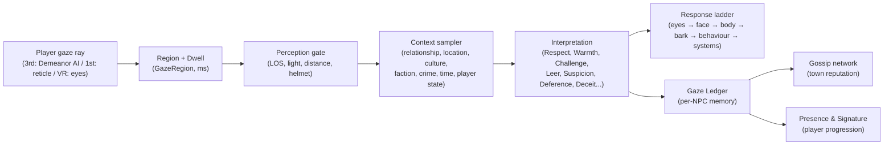
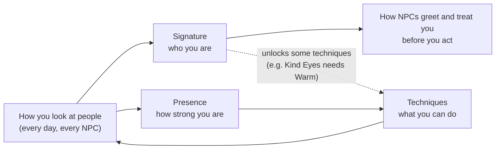

# TrueGaze™ — Expanded Play Gameplay Design Document (GDD)

**Feature name:** **Expanded Play** (a single *Enabled / Disabled* setting inside TrueGaze; no separate sub-brand)
**Project:** TrueGaze™ — Biological NPC Gaze & Biomechanical Kinematics Engine
**Author:** Antigravity (Design & Engineering), Kirk LaSalle (Director & Approver)
**Date:** 2026-11-18
**Status:** 🧠 Brainstorm, Lore & Engineering Architecture v0.3 (Core Decisions D1–D12 Approved; Phase G0–G3 technical spec written).
**Builds on:** [Region Map Specification — HCEP-02](Region%20Map%20Specification%20%E2%80%94%20HCEP-02%20Gaze%20Regions.md), [INCOMING_GAZE_PANEL_DESIGN.md](INCOMING_GAZE_PANEL_DESIGN.md), [HCEP_META_CONTROLLER_SPEC.md](HCEP_META_CONTROLLER_SPEC.md), [OAR_INTEGRATION.md](OAR_INTEGRATION.md)  
**Technical Spec & Plan:** [IMPLEMENTATION_PLAN_EXPANDED_PLAY_G0_G3.md](IMPLEMENTATION_PLAN_EXPANDED_PLAY_G0_G3.md)

> [!NOTE]
> This is a brainstorming document. It deliberately casts a wide net. Every idea
> has a tag. **[CORE]** means a candidate for the first playable release.
> **[EXT]** means a later expansion. **[WILD]** means out-of-the-box and worth
> prototyping before we commit. Section 16 tracks open questions for Kirk.

---

## 0. Director Decisions (2026-11-18)

| # | Topic | Kirk's decision | Where it's reflected |
|:--|:--|:--|:--|
| D1 | AI-NPC bridge, VR eye tracking, staring contest, eye-contact conversation start | **Yes, all four.** TrueGaze should lead this market. | §3.3, §6.1, §6.3, §13.4, §15 |
| D2 | Safety rules (Mature opt-in, children rule, gender-neutral) | **Agreed** as proposed | §11.3 |
| D3 | Name | **No sub-brand.** It is simply **TrueGaze**, with **Expanded Play: Enabled / Disabled**. | Whole document |
| D4 | Progression | **Asked for elaboration** of Presence, Signature, and Techniques | §9 (expanded) |
| D5 | Third-person control | **Both:** a Demeanor wheel **and** an optional automatic mode | §3.1 |
| D6 | ESP / ESL | **Asked for help.** Goal: small and accessible to all players. | §2.4 (recommendation) |
| D7 | First playable slice | **Agreed:** Riverwood and the Sleeping Giant Inn | §15 |
| D8 | Staged progression rollout (§9.3.4) | **Approved** (silent Signature + passive Presence in Riverwood demo; active Techniques in G6/G7) | §9.3.4, §15 |
| D9 | Two-layer packaging (DLL + optional ESL, §2.4) | **Approved** | §2.4 |
| D10 | Target hardware & AI-NPC mods | **Approved** (Mantella & CHIM; OpenXR / SteamVR / Tobii eye tracking) | §3.3, §13.4 |
| D11 | Lore foundation ("TrueGaze" of the Blind Moth Priests) + Introductory Quest | **Approved** — in-world name is **TrueGaze**, taught by a second, independent blind Moth Priest (separate from Dawnguard's Dexion Evicus) | §1.3, §15.1 |
| D12 | Quantified Book Reading ("Ocular Contemplation") | **Approved** — page-by-page dwell mechanic that adds to TrueGaze progression & RPG player stats; 100% read-only & complementary to existing book mods | §2.2, §9.5, §13.1, §13.5 |

---

## 1. Vision

> *In vanilla Skyrim, NPCs look at you. In TrueGaze, NPCs **see** you. With
> Expanded Play enabled, they **remember how you looked at them**.*

TrueGaze already gives Skyrim biologically correct eyes: saccades, the social
triangle, VOR, dwell distributions, and incoming-gaze panels. *Expanded Play* turns
gaze into **a gameplay channel of its own**. Where you look, how long you look,
and who you are to that person become a silent language. That language affects
trade, friendship, romance, crime, magic, combat, and reputation.

### 1.1 The dual-mod promise

| Mode | What the player gets | Who it's for |
|:--|:--|:--|
| **TrueGaze, Expanded Play: Disabled** (default) | Authentic visual eye contact and kinematics. No gameplay changes. Save-neutral. | Screenarchers, immersion purists, players with large load orders |
| **TrueGaze, Expanded Play: Enabled** (opt-in) | Everything in Classic, plus gaze as a social, economic, criminal, magical, and martial mechanic | Role-players who want Skyrim's people to feel alive |

### 1.2 Design pillars

1. **Context is the meaning.** The same look carries different meanings. A
   two-second gaze at the chest can be a leer, a glance at a wound, or a look
   at a guild emblem. Meaning comes from **region × dwell × relationship ×
   setting × culture × intent**, never from the region alone.
2. **Respond like a person, not a vending machine.** Responses climb a ladder.
   First the eyes react, then the face, then the body, then words, then
   behaviour, and finally the systems (disposition, price, crime).
3. **Remembered, not reset.** NPCs keep impressions. Towns gossip.
4. **Readable but subtle.** The player should always be able to *learn* why
   something happened, without a UI that turns people into health bars.
5. **Lore-first.** Every mechanic should have a reason in Tamriel. Nords value
   candour, Altmer see impertinence, Orcs see a challenge, and Hermaeus Mora
   *is* eyes.
6. **Respectful by design.** Mature reactions are about **boundaries and
   consent**, never titillation. Children are protected by a hard rule
   (§11.3).
7. **Zero cost when off.** Expanded Play disabled means Classic behaviour and zero
   gameplay side effects.

### 1.3 Lore Foundation — The First Canticle of the Ancestor Moth ("TrueGaze") [APPROVED (D11)]

To anchor every gameplay mechanic inside *The Elder Scrolls* canon without rewriting established quests, the mod adopts the in-world name **TrueGaze** from an order already built around eyes, blindness, and reading: the **Cult of the Ancestor Moth** (Moth Priests).

- **Canon baseline (*Effects of the Elder Scrolls*, *Divining the Elder Scrolls*, *An Accounting of the Scrolls*):**
  Moth Priests spend years in monastic preparation before attempting to read an Elder Scroll. Each reading leaves them closer to permanent blindness as the Scrolls' fragments of creation gradually dim physical vision—leaving senior Prelates wearing moth-silk blindfolds, yet strangely attuned to the world around them. In Skyrim, the player already meets **Dexion Evicus** during Dawnguard (`DLC1VQ03`) and **Septimus Signus** (`DA04` / `MQ205`); TrueGaze never alters either character or their quests.
- **Tasteful artistic license — The First Ocular Discipline (*TrueGaze*):**
  Before a novice of the Ancestor Moth is ever judged steady enough to open a Scroll—and long after a retired Prelate loses physical sight—they practice an ancient preparatory art called **TrueGaze**, taught in *The First Canticle of the Eye*:
  1. **Stilling the Tremor:** mastering micro-saccades, blink discipline, and cervical stillness so the mortal eye does not scatter under spiritual or social pressure.
  2. **Reading the Living Glyph:** perceiving truth, fear, deception, warmth, or threat by watching where another soul's gaze lands, lingers, or flees.
  3. **The Sight Beyond Sight:** why an elderly blind Moth Priest can sit quietly in a noisy Skyrim tavern with silk-bound eyes, feel the exact weight and vector of every gaze across the room, and hold a warlord steady without blinking.
- **The Dragonborn resonance:** Where the *Thu'um* projects the Dragonborn's soul outward through the **voice**, **TrueGaze** is its quiet twin—anchoring and reading the soul through the **eyes**. Because it belongs to an older Cyrodiilic monastic tradition rather than a Dragonborn-only gift, any character (warrior, thief, mage, or listener) can study it, while the Dragonborn's natural willpower lets them wield it with unusual force.

---

## 2. The Toggle and Modularity [CORE]

### 2.1 Master switch

| Surface | Control |
|:--|:--|
| `TrueGaze.ini` | `[ExpandedPlay] bEnabled = 0` (default: Disabled) |
| In-game console | `stgexpanded on` / `stgexpanded off` / `stgexpanded status` |
| TrueGaze Configurator | New "Expanded Play" category with an Enabled/Disabled switch and presets: **Subtle**, **Living World**, **Hardcore Social** |
| MCM (SkyUI / MCM Helper) | "Expanded Play" page with the master switch and per-module toggles. Only present when the optional content plugin is installed (§2.4), because an MCM requires a plugin quest. |

### 2.2 Per-module toggles

Each module can be switched on independently, so players can choose exactly the
depth they want:

`Social Reactions` · `Relationship Memory` · `Commerce` · `Speech & Persuasion` ·
`Crime & Witnesses` · `Guilds (Thieves / Dark Brotherhood / Companions / College)` ·
`Magic` · `Combat Stare-downs` · `Presence & Signature progression` ·
`Ocular Contemplation (Book Study)` · `Mature Social Reactions` (separate opt-in, default off) · `Gossip Propagation`

### 2.3 Save safety (non-negotiable)

- All Expanded Play state lives in the **SKSE co-save**, not in plugin records. No ESP
  is required for the core layer. An optional ESL-flagged plugin can add
  spells, books, and quests later.
- **Disable = freeze.** Turning Expanded Play off suspends all effects and keeps
  memories intact, so re-enabling resumes where you left off.
- **Uninstall = clean.** Any temporary changes (disposition modifiers, price
  multipliers, magnitude buffs) are applied as **reversible, tagged
  modifiers** and are removed when Expanded Play is disabled.
- Switching mid-conversation or mid-barter is deferred until the menu closes,
  reusing `DiagnosticMenuPolicy` semantics.

### 2.4 ESP / ESL recommendation (answers D6)

**Goal (Kirk):** small, and accessible to every player.

**Background, in plain terms:**

- **SKSE plugin (the DLL):** TrueGaze already is one. It can change behaviour,
  numbers, and visuals at runtime. It cannot easily *add new things to the game
  world*: new spells, books, quests, dialogue lines, or an MCM menu.
- **ESP:** a normal game plugin that adds those things. Skyrim has a hard limit
  of about 254 full plugins, and large load orders are always near it. An ESP
  would cost players a precious slot.
- **ESL (or an ESP with the "light" flag, called ESPFE):** the same as an ESP,
  but it does **not** use one of the 254 slots. Up to 4,096 light plugins can be
  loaded. The limit is roughly 2,048 new records per light plugin, far more than
  we need.

**Recommendation: two layers, with the second one optional.**

| Layer | File | Contains | Required? |
|:--|:--|:--|:--|
| **1. Core** | `TrueGaze.dll` (existing) | The whole engine: reticle, Demeanor, interpretation, reactions (eyes, face, body), Gaze Ledger, gossip, price / persuasion / detection / magic modifiers, Presence, Signature, the AI-NPC bridge, VR eye tracking, configuration via INI, console, and Configurator | **Yes** (already installed) |
| **2. Content** | `TrueGaze_ExpandedPlay.esp`, **ESL-flagged** | Spoken barks (new dialogue entries that **reuse vanilla voice files**, so no new voice acting), Technique tomes and trainers, eye spells, the staring-contest scene, small quests, and the MCM page | **No**. Recommended for the full experience. |

Why this is the right fit:

1. **Nobody is locked out.** Players with full load orders, players who don't
   want any plugin, and players with strict mod lists can still enjoy most of
   Expanded Play with the DLL alone.
2. **Zero load-order cost** for players who add the content plugin, because it
   is light-flagged.
3. **No master files beyond `Skyrim.esm`.** No DLC requirements in the core
   content. Dawnguard / Dragonborn hooks (vampires, Hermaeus Mora) are
   conditional, so the plugin still loads on a base game without them.
4. **Clean removal.** The DLL never depends on the plugin. If the plugin is
   missing, those features are simply hidden.

> [!WARNING]
> Platform notes:
> - **Skyrim VR** does not support ESL-flagged plugins out of the box. VR
>   players need the community **"Skyrim VR ESL Support"** SKSE plugin, or we
>   ship a non-flagged copy for VR. Decide during the content phase.
> - **Xbox and PlayStation** cannot run SKSE at all, so TrueGaze (and Expanded
>   Play) is PC-only. That is a platform limit, not a design choice.

---

## 3. Player Gaze Input — How the Player "Looks"

The current engine already resolves the player's gaze (`PlayerGazeResolver`)
and classifies regions (`ClassifyRegion` → `GazeRegion`). Expanded Play adds
**intent**, and the input differs by camera.

### 3.1 Third person: "you set the intent, your character performs it" [CORE]

In third person the player's eyes are automated, as Kirk specified. To keep the
player in control, the automation follows a **Demeanor** chosen by the player:

| Demeanor | Auto-gaze behaviour | Typical outcome |
|:--|:--|:--|
| **Courteous** (default) | Social triangle, ~3 s mutual dwell, polite breaks to the UL/UR peripheries | Safe, slowly builds respect |
| **Warm** | More mouth and eye time, softer saccades, frequent short reciprocal glances | Friendship, flirtation with partners |
| **Stern** | Long eye fixation, few breaks, slight forehead bias | Authority, negotiation leverage, intimidation |
| **Guarded / Evasive** | Low dwell, LR/LL aversion, avoids faces | Low profile; strangers forget you. Reads as shifty to guards |
| **Deferential** | Ground and chin bias, brief eye contact | Courts, Jarls, temples. Avoids offending elites |
| **Predatory** *(DB / vampire / unlocked)* | Unblinking fixation, slow tracking | Fear, intimidation, Dark Brotherhood techniques |

- Switch with a hotkey or a radial wheel (like a favourites menu). Controller:
  hold a button plus the D-pad.
- **Automation fidelity:** third-person outcomes are reliable but capped at
  about 80% of the maximum effect. Manual first-person mastery can reach 100%.
  This rewards first-person play without punishing third-person players.

#### 3.1.1 Control modes (answers D5: "both, with auto optional")

Setting: `[ExpandedPlay] sDemeanorMode = Hybrid` (`Manual` / `Auto` / `Hybrid`)

| Mode | How it works | Who it suits |
|:--|:--|:--|
| **Manual** | Demeanor only changes when you pick it from the wheel or press the hotkey | Deliberate role-players |
| **Auto** | TrueGaze picks the Demeanor from context (rules below). The wheel is hidden. | "Just let me play" players and controller users |
| **Hybrid** (default) | Auto runs in the background. Picking from the wheel **overrides** it until the situation changes (new location, combat ends, conversation ends) or a timeout of about 60 s, whichever comes first. A small lock icon shows when your choice is pinned. | Most players |

Auto-Demeanor rules (first match wins, all tunable):

| Context | Auto Demeanor |
|:--|:--|
| In a Jarl's court, temple, or speaking to a Superior while not Thane | Deferential |
| Weapon drawn, or a hostile within 15 m | Stern |
| Sneaking, or carrying stolen items near the owner or guards | Guarded / Evasive |
| Spouse, partner, or a Friend+ NPC is the focus | Warm |
| Wearing Dark Brotherhood armour while the Predatory technique is known | Predatory (never automatic around children or in towns unless allowed in settings) |
| Otherwise | Courteous |

In Auto mode a soft one-line notice ("Demeanor: Deferential") appears when the
Demeanor changes. It can be turned off.

### 3.2 First person: "you are the eyes" [CORE]

In first person, the crosshair **is** the gaze. Kirk's idea of a subtle cursor
glow becomes the **Gaze Reticle**:

- **Subtle glow** tinted by the region under the reticle, using the canonical
  HCEP-02 palette at low opacity (about 15–25%) with a soft bloom:

  | Region | Glow | Region | Glow |
  |:--|:--|:--|:--|
  | Left eye | Green `#33FF59` | Torso | Crimson `#FF2633` |
  | Right eye | Orange `#FF9926` | Ground | Blue `#2659E6` |
  | Mouth | Pink `#FF59BF` | UL periphery | Cyan `#33CCFF` |
  | Forehead | Purple `#D966FF` | UR periphery | Bright cyan `#66F2FF` |
  | Chin | Warm tan `#E6BF99` | LL / LR periphery | Silver / Slate |

- **Dwell ring:** a hairline arc fills around the reticle as dwell builds.
  Ticks mark the **Glance → Look → Gaze → Stare** thresholds (§4.2).
- **Reciprocity pulse:** a single soft pulse when the NPC **looks back** and
  mutual gaze is achieved. This is the most satisfying moment in the system
  and should feel like it.
- **Soft magnetism:** a slight aim assist toward the social-triangle vertices
  within about 2°, adjustable from 0 to 100%. It is strongest on controller.
- **Immersive mode:** the reticle is hidden. Feedback comes only from the NPC's
  eyes, face, and barks. This is the hardcore option and could carry a small
  bonus.
- **Accessibility:** colour-blind palettes (deuteranopia, protanopia,
  tritanopia), shape glyphs per region (◆ eyes, ● mouth, ▲ forehead, ■ torso),
  and a reduced-motion option.

### 3.3 VR and real eye tracking [APPROVED — Market-Leader Pillar (D1)]

TrueGaze already supports Skyrim VR (`VrController`). This is where Expanded Play
leads the market:

- **HMD gaze:** head direction acts as the reticle when there is no eye
  tracking.
- **True eye tracking** on Quest Pro, Pimax Crystal, Vive Pro Eye, Varjo, or a
  Tobii desktop tracker: the player's **real eyes** drive the in-game gaze. You
  literally must look the Jarl in the eye. The HCEP Meta-Controller already
  anticipates live player telemetry (gaze, face pose, blink), so the bridge
  exists conceptually.
- **Input path:** OpenXR (`XR_EXT_eye_gaze_interaction`), SteamVR, and desktop
  Tobii streams feed into `VrController` and the HCEP Meta-Controller plane as a
  unified gaze-ray source for `PlayerGazeResolver`.
- **Real blink mirroring** and **pupil-based arousal (optional and
  privacy-gated)** are out of scope for v1. Note them as research only.

> [!CAUTION]
> Real eye-tracking data is biometric. Process it **locally only**, never log
> raw streams by default, and present a clear opt-in. This needs its own short
> privacy note in the user guide.

### 3.4 Perception validity: the NPC must *see* your look

A look only counts if the target can perceive it:

- Line of sight, so no reading through walls.
- Distance: about 8 m or less for an eye-region read, and about 15 m or less
  for a "being looked at" sense.
- Light level, scaled by the NPC's race (Khajiit and vampires see in the dark).
- Occlusion: a full-face helmet or mask blurs your **eyes** (they can't read
  you, but they also can't bond with you). Hoods reduce the effect partially.
- Target awareness: asleep, unconscious, in combat, or in a scene means no
  social read. An NPC on a scripted scene package receives a reduced effect.

---

## 4. The Expanded Play Engine — From a Look to a Meaning

### 4.1 Pipeline



### 4.2 Dwell bands

Research on preferred mutual gaze puts the comfortable average at about 3.3 s
(Binetti et al., 2016, *Royal Society Open Science*), with a typical
comfortable range of about 2–5 s. Starting bands (tunable):

| Band | Duration on a face region | Social reading |
|:--|:--|:--|
| **Glance** | < 0.6 s | Acknowledgement. Neutral. |
| **Look** | 0.6 – 2.0 s | Interest, greeting, attention |
| **Gaze** | 2.0 – 4.5 s | Engagement. Warm if reciprocated, intense if not. |
| **Stare** | 4.5 – 9 s | Challenge, fascination, or intrusion |
| **Fixation** | > 9 s | Hostile, unsettling, or "do I know you?" |

Non-face regions (torso, hands, ground) use **shorter** thresholds for
intrusive readings. Peripheral regions are *aversions* that modulate the
current reading rather than create one.

### 4.3 Interpretations: the emotional vocabulary

| Interpretation | Typical triggers |
|:--|:--|
| **Respect** | Steady eye contact at Look/Gaze with polite breaks |
| **Warmth** | Mutual gaze, mouth/eye cycling, reciprocated glances |
| **Attraction** | Repeated returning glances plus warmth, only between eligible adults |
| **Challenge** | Unbroken Stare on the eyes with no aversion, especially with a weapon drawn |
| **Intrusion / Leer** | Lingering Torso/lower-body dwell on a non-intimate target (Mature module) |
| **Suspicion** | Watching hands, pockets, doors, or valuables. Evasive aversion when questioned. |
| **Deference** | Ground/chin bias toward a superior |
| **Contempt** | Glance → look away → glance with LL aversion (dismissive cycle) |
| **Compassion** | Brief torso or eye look during the NPC's distress (wounded, grieving, begging) |
| **Deceit** | LR aversion while making a claim (in persuasion or lie dialogue) |
| **Recognition** | First mutual gaze with someone you have history with |

> [!IMPORTANT]
> The **Torso region is not automatically a leer.** The engine already labels it
> HEART mode. With friends, grieving NPCs, wounded allies, or a guild emblem on
> armour, it reads as **Compassion** or **Recognition**. It only becomes
> **Intrusion** with dwell and context: a stranger or non-partner, Stare-band
> duration, no other reason to look.

### 4.4 The response ladder

Every interpretation resolves to one or more rungs. Lower rungs happen often;
higher rungs need repetition, strength, or memory.

| Rung | Example | Uses |
|:--|:--|:--|
| 1. **Eyes** | Returns gaze, breaks to the LR periphery, blinks, narrows eyes | The existing TrueGaze kinematics. Free and already biological. |
| 2. **Face** | Smile, frown, raised brow, flush | Expression modifiers through OAR / MFG |
| 3. **Body** | Turns away, crosses arms, covers chest, steps back, leans in | OAR conditions on `TrueGazeAPI` |
| 4. **Words** | Bark: "Something on my face?" / "Eyes up here." / "Always good to see you." | Vanilla voice lines first, new lines optional (§13.4) |
| 5. **Behaviour** | Walks away, approaches you, calls a guard, starts a brawl, offers a drink | AI package overrides and short scenes |
| 6. **Systems** | Disposition, prices, quest options, bounty, follower affinity | Reversible tagged modifiers |

---

## 5. Relationships — The Heart of the System [CORE]

Skyrim already defines relationship ranks from **−4 (Archnemesis) to +4
(Lover)**, plus marriage, followers, and faction membership. Expanded Play reads these
and adds its own **Gaze Ledger**.

### 5.1 Relationship tiers used by Expanded Play

`Stranger` · `Acquaintance` (met / spoken) · `Friend` (rank +1–2) · `Confidant` (+3, ally) ·
`Partner` (courting / Amulet of Mara acknowledged) · `Spouse` · `Follower` ·
`Rival` (−1–2) · `Enemy` (−3–4) · `Superior` (Jarl, steward, guildmaster) · `Subordinate` (housecarl, steward)

### 5.2 The relationship × look matrix (starter set)

| Look | Stranger | Friend | Partner / Spouse | Rival / Enemy | Superior (Jarl) |
|:--|:--|:--|:--|:--|:--|
| **Eyes, Glance** | Nod or ignore | Smile, "Hey." | Warm smile | Glare back | Neutral |
| **Eyes, Gaze (mutual)** | "Can I help you?" (polite) | Warm. Bond +. | Bond ++. Affectionate bark. | Tension builds | Respect + if Thane, impertinence − if not |
| **Eyes, Stare** | "What are you looking at?" Tension. Possible brawl in pubs. | "...What? Do I have something on my face?" (playful) | "You're staring again." (fond) | Challenge. May start a fight. | Guards step forward. Disposition −. |
| **Mouth, Gaze** | Mild discomfort | Neutral to warm | Attraction / Bond + | Contempt read | Impertinent |
| **Torso, Stare** *(Mature)* | Covers up, steps back, "Eyes up here, stranger." Disposition −, gossip. | "Hey. Eyes up." Disposition − (small). Friendship strain if repeated. | Playful or flattered. In public may be embarrassed: "Not here!" | Contempt. "Typical." | Serious offence. Possible guard intervention. |
| **Ground (in their presence)** | Unremarkable | "Something wrong?" (concern) | Comfort bark | Weakness read (enemies emboldened) | Deference + (correct etiquette) |
| **Evasive (LR aversion) in dialogue** | Suspicion + | "You're hiding something." | Worry / jealousy | Suspicion ++ | Distrust |
| **Ignoring them** (no look when they greet) | Neutral | Hurt: "Too busy for old friends?" | Hurt + | Satisfied | Offence |

### 5.3 Marriage and partners — special rules

- **The spouse is always watching.** If your spouse is present and you
  Gaze/Stare warmly at another eligible NPC, or leer, a **jealousy** reading is
  logged. You get a sideways glance (rung 1), then a comment ("Enjoying the
  view?"). Repeated incidents mean affinity −, colder greetings at home, and
  eventually a pointed conversation.
- **Shared glances:** in crowded places, mutual glances with your spouse across
  a room build **Bond** (comfort, home bonuses such as a stronger "Lover's
  Comfort" or a better home-cooked meal).
- **Courtship through the eyes [EXT]:** with the Amulet of Mara, repeated mutual
  gazes become a courtship meter that unlocks the marriage proposal or richer
  dialogue. At the wedding at the Temple of Mara, the vows **require mutual
  gaze** (a scripted cinematic moment).
- Followers and housecarls: a stare at Lydia gets "I am sworn to carry your
  burdens," and at higher affinity, a real smile.

### 5.4 The Gaze Ledger (per-NPC memory) [CORE]

Each NPC the player has meaningfully looked at stores a compact record in the
co-save:

```text
GazeLedgerEntry {
  formID, lastSeenGameTime,
  impressions: { respect, warmth, unease, suspicion, attraction, fear }   // -100..+100, decaying
  notableEvents: ring buffer of 8 { type, gameTime, location }          // e.g. LEER_PUBLIC, STAREDOWN_WON
  recognized: bool                                                        // has seen your face clearly
}
```

- **Decay:** impressions fade toward neutral over game days. Strong events
  (a stare-down, a public leer, a wedding) leave a permanent floor.
- **Budget:** cap at about 512 active entries with least-recently-used
  eviction. Strangers with neutral impressions are never stored.

### 5.5 Gossip propagation [EXT]

When an NPC records a notable event, they may share it with **friends,
co-workers, and spouse** (the `Associations` and faction graph) during sandbox
conversations. Within a few days the Riften market knows "the one with the
wandering eyes", or Whiterun knows "the Thane who looks you in the eye". This
feeds §9 Signature titles.

---

## 6. Everyday Life — Streets, Shops, Pubs [CORE]

### 6.1 Streets

- **The Nod:** a Glance with mutual gaze from an acquaintance produces a nod
  and a greeting. The player can **return** the nod (a Look-band gaze back)
  for a tiny warmth gain. This makes towns feel like communities.
- **Initiating conversation by eye contact [CORE — Approved (D1)]:** hold mutual gaze with an
  ambient NPC for about 2 s and they walk over: "You look like you want to
  ask something." This is an alternative to running up and pressing E.
- **Avoiding conversation:** Evasive demeanor or averted eyes make ambient
  "forcegreet" NPCs (couriers excluded) less likely to stop you.
- **Beggars:** meeting a beggar's eyes and walking past costs a bit of
  **Presence** (guilt). Giving after eye contact gives a bigger blessing. This
  is a small moral texture.
- **Guards:**
  - Calm eye contact with a minor bounty reduces the chance of being stopped,
    because confidence reads as innocence.
  - Evasive aversion while wanted raises it, because shifty eyes read as guilt.
  - Staring down a guard gets the vanilla line plus escalating responses:
    "Move along" → "Is there a problem?" → a hand on the hilt.

### 6.2 Shops and merchants (see §7 for barter)

- Merchants notice where you look. Watching their **counter, chest, or
  valuables** (hand regions and nearby items) for too long builds
  **Suspicion**. Merchants watch you more and steal-detection goes up.
- Polite eye contact while browsing builds **Rapport**, which carries into
  barter.

### 6.3 Pubs and inns

- **Catch the barkeep's eye:** a Look at the barkeep across the room brings
  them to you ("What'll it be?"). This feels alive.
- **The bard:** hold the bard's gaze to "request" a song (it opens the request
  dialogue). Warm gaze during a performance gives the bard a small tip-like
  disposition gain.
- **Drunk patrons:** a stare at a drunk can trigger the vanilla **brawl** path.
  The Companions-style fistfight remains non-lethal.
- **Strangers across the room [EXT]:** mutual gazes with eligible singles can
  spark a short flirt exchange. Some NPCs become "regulars" who remember you.
- **Staring Contest minigame [APPROVED (D1)]:** in a tavern, challenge a Nord to a
  staring contest. Sustain eye-region fixation while the screen frost-vignettes
  and your character's blink pressure builds. Hold blinks with a key, which
  ties into `EfmBlinkController`. Bet gold or mead. Winning raises **Presence**
  and Nord respect.

### 6.4 Temples, courts, and etiquette

- **Jarl's court:** the correct etiquette is a brief eye greeting, then the
  chin or ground while the Jarl speaks, then eyes when you speak. Following it
  gives respect; breaking it gives impertinence. Once you are Thane, direct gaze
  is permitted and even expected.
- **Temples:** a lowered gaze at shrines gives a slightly longer **blessing**
  duration [EXT].
- **Funerals and grieving NPCs:** the Compassion reading unlocks comforting
  dialogue variants.

---

## 7. Commerce — Buying and Selling [CORE]

### 7.1 Reading and being read

| Behaviour during barter (or the dialogue just before it) | Effect |
|:--|:--|
| Steady, polite eye contact with the merchant | **Rapport**: small price improvement (stacks with Speech) |
| Sustained Stern gaze while selling | **Leverage**: better sell price with timid merchants. Backfires with proud ones. |
| Looking too long at the item you want *(1st person: the item in the barter 3D view)* | **Tell**: the merchant spots your desire and buy prices rise slightly |
| Looking at your own gold purse or the merchant's chest | Suspicion; Khajiit caravans comment |
| Evasive aversion while selling stolen goods *(non-fence)* | Merchant may refuse ("Where did you get this?") |

### 7.2 Merchant tells — the player reads them [EXT]

With the right **Technique** (§9.3, "Merchant's Eye"), the player can see the
merchant's own gaze behaviour. TrueGaze already simulates it, and the incoming
panel can display it:

- The merchant glances at the LR periphery while quoting a price, meaning a
  **bluff**. A one-time **Haggle** option appears ("I think you can do better")
  that is a Speech check boosted by Presence.
- The merchant's gaze lingers on your item, meaning **they want it**. You can
  demand more.

### 7.3 Cultural merchant norms

- **Khajiit caravans:** prolonged eye contact is friendly ("Khajiit likes you,
  friend."). Looking at the moon-sugar gets an amused wink.
- **Altmer merchants:** a direct stare from non-Mer is impertinent and prices
  rise. Deferential demeanor helps.
- **Argonians:** they read posture and tail more than eyes, so Expanded Play effects
  are muted (a lore-friendly difference).
- **Fences:** eye contact means **trust**; an evasive player makes a fence
  nervous.

---

## 8. Speech, Persuasion, Lies [CORE]

- **Persuade:** eye contact at Gaze band during the persuade line gives a
  bonus. Ground or evasion gives a penalty.
- **Intimidate:** a Stare during the line gives a bonus. It stacks with
  Predatory or Stern demeanor and with armor and weapon level.
- **Bribe:** a brief glance at the purse and then the eyes gives "the knowing
  look" and a small bonus (the sly route).
- **Lie detection on NPCs [EXT]:** NPCs who are lying in quest dialogue
  (authorable through a keyword or list) show deception tells through their own
  TrueGaze kinematics. Players who learn to read them get optional dialogue.
  Examples: catch Mjoll's suspicion, see through Maven's courtesy, spot the
  Thalmor informant.
- **The player lying:** in first person, the Gaze Reticle drifting to the LR
  periphery during a lie line lowers success. You literally have to look them
  in the eye and lie.

> [!TIP]
> **Real-Time Re-Engineering Blueprint (TES IV Oblivion Persuasion & Bribe Analysis):** For the mathematical deconstruction of *Oblivion*'s Persuasion Wheel and non-linear Bribe GMST formulas (`fBribeCostCurve`, `fBribeCurve`, `fBribeSpeechcraftMult`) and their zero-menu 3D real-time expansion across 6 emotional/transactional archetypes (`WP-8A`–`WP-8D`), see [REALTIME_PERSUASION_AND_TRANSACTIONS_GDD.md](REALTIME_PERSUASION_AND_TRANSACTIONS_GDD.md).

---

## 9. Progression — Not a Skill, Something New: **Presence & Signature**

Kirk asked whether gaze should be a skill or something new. Here are the
options and a recommendation.

### 9.1 Options considered

| Option | Pros | Cons |
|:--|:--|:--|
| A. A new 19th skill, "Gaze" | Familiar | Skyrim can't natively add skills cleanly. Conflicts with leveling mods. Feels grindy ("stare at Lydia for 3 hours"). |
| B. Fold into Speech | Lore-plausible, simple | Invisible and boring. Doesn't feel new. |
| **C. Presence** (a new resource / attribute) | Fresh, visible, fuels active techniques | Needs UI |
| **D. Gaze Signature** (emergent personality) | Truly new, role-play gold, no grind | Harder to tune |
| **E. Techniques** (learned "eye arts", like Shout words) | Exploration and quest rewards. Lore-rich. | Content-heavy |

### 9.2 Recommendation: **C + D + E = "The Way of the Eye"**

1. **Presence** (0–100) is *how powerful* your gaze is.
   - Grows from **meaningful** events: winning stare-downs, holding the Jarl's
     eye as Thane, comforting a grieving widow, successful gaze-assisted
     persuasion, mastering a staring contest. Daily diminishing returns stop
     farming.
   - Shrinks from losing stare-downs, being caught leering, and averting from
     every challenge.
   - **Spent** to fuel Techniques (like Magicka for eyes) and regenerates
     slowly in social settings.
   - Shown subtly as a thin iris-coloured arc around the compass, or hidden in
     immersive mode.

2. **Gaze Signature** is *what kind* of gaze you have. It forms from your
   history along four axes:

   | Axis | Negative pole | Positive pole |
   |:--|:--|:--|
   | Warmth | Cold | Warm |
   | Dominance | Deferential | Commanding |
   | Candour | Guileful | Candid |
   | Restraint | Indulgent (wandering eyes) | Disciplined |

   - NPCs react to your **Signature** before you do anything. A
     Cold-Commanding Dragonborn walks into a tavern and conversations hush; a
     Warm-Candid one gets waved over.
   - Signature produces **titles** that spread by gossip: *Steady-Eyed*, *The
     Unblinking*, *Kind Eyes*, *Wandering Eyes*, *Shifty*, *Ice-Gaze*,
     *Mara's Own*. NPCs use them in barks.
   - It is a role-play mirror: the mod tells you who you have been.

3. **Techniques** are *what you can do* with your gaze. You learn them from
   trainers, books, Daedra, and guilds, each with three tiers (like Shout
   words), and they cost Presence:

   | Technique | Source (lore hook) | Effect |
   |:--|:--|:--|
   | **Steady Eye** | Companions (Kodlak) / Nord tradition | Win stare-downs more easily. Intimidation bonus. |
   | **Merchant's Eye** | A Khajiit caravan elder / Belethor (begrudgingly) | Read merchant tells (§7.2) |
   | **The Look Away** | Thieves Guild (Vex) | When you make a target look elsewhere, pickpocket and stealth get a window (§10.1) |
   | **Dead Eyes** | Dark Brotherhood (Babette / Nazir) | Targets feel dread. Witnesses forget your face. |
   | **Mesmer's Gaze** | College of Winterhold (Illusion / Drevis) | Eye contact amplifies Illusion spells (§10.4) |
   | **Kind Eyes** | Temple of Mara / Dinya Balu | Calm frightened NPCs and animals. Bonus to comfort dialogue. |
   | **Court Manners** | A Jarl's steward / a Proudspire Manor book | Etiquette mastery. No impertinence penalties. |
   | **Seeker's Sight** | **Hermaeus Mora** (Black Books / Apocrypha) | See *everyone's* gaze target at once for N seconds (the HCEP visualisation as a power) |
   | **Meridia's Glare** | Meridia (Dawnbreaker quest) | Undead flee a sustained stare |
   | **Hunter's Eye** | Aela | Predators and animals respond to eye dominance (bears back down) |

### 9.3 Deep dive: the three parts explained (answers D4)

A simple way to hold all three in your head:

| Part | Question it answers | Skyrim analogy | Visible to the player? |
|:--|:--|:--|:--|
| **Presence** | *How strong* is my gaze right now? | Like Magicka, but for your eyes | Yes, a thin arc (optional) |
| **Signature** | *What kind* of person do my eyes say I am? | Like your Bounty or Fame, but describing personality | Through NPC reactions, titles, and a journal page |
| **Techniques** | *What special things* can my eyes do? | Like Shouts: learned word by word, powered by a resource | Yes, in a Techniques list |



#### 9.3.1 Presence — "how strong is my gaze?"

**What it is.** A number from 0 to 100 with two parts:

- **Maximum Presence** grows slowly and permanently through meaningful
  social moments. This is your long-term growth, the "levelling" feel without
  being a skill.
- **Current Presence** is spent on Techniques and refills over time. It refills
  faster in social places (inns, markets, courts) and slower in dungeons.

**How Maximum Presence grows** (starting values, all tunable; each source has
daily diminishing returns and a per-NPC cooldown so it can't be farmed):

| Moment | Max Presence gain |
|:--|:--|
| First real mutual gaze with a new named NPC | +0.2 |
| Successful gaze-assisted persuade / intimidate | +0.5 |
| Winning a stare-down or staring contest | +1.0 |
| Holding a Jarl's eye correctly as Thane (once per Jarl) | +2.0 |
| Comforting a grieving NPC with a compassionate look | +1.0 |
| Major milestones (marriage vows with mutual gaze, becoming Harbinger / Listener / Guildmaster / Arch-Mage) | +3.0 each |

**How it falls:**

| Moment | Effect |
|:--|:--|
| Losing a stare-down | −1 Current, and −0.5 Max for 24 game hours (a "shaken" debuff) |
| Being caught leering (Mature module) | −2 Current, plus a Signature hit |
| Backing down from every challenge (averting at every stare in a day) | Refill slows ("timid" state) until you hold one gaze |

**What it does, passively** (without spending anything):

| Max Presence | Tier name | Passive effect |
|:--|:--|:--|
| 0–19 | *Unnoticed* | Baseline. Strangers rarely react to you. |
| 20–39 | *Noticed* | Mutual gazes are returned more often. The eye-contact conversation start works. |
| 40–59 | *Steady* | Small bonus to persuade / intimidate and stare-downs. Guards stop you less when calm. |
| 60–79 | *Commanding* | Rooms react when you enter (barks, glances). Weak bandits may flee on a stare-down. |
| 80–100 | *Legendary* | NPCs recognise you on sight across holds. Technique costs are lower. |

**UI:** a thin arc beside the compass in the iris colour of your Signature's
strongest axis. It can be hidden; the immersive alternative is your
character's audible breath steadying when Presence is high.

**Example.** In the Sleeping Giant Inn, you hold Orgnar's gaze as he slides you
a mead, win a staring contest against a farmhand, and comfort a lonely Sven
after Camilla rejects him. That evening your Max Presence rises from 18 to 20.
You become *Noticed*, and the next morning Faendal waves you over with a look
instead of waiting for you to walk up.

#### 9.3.2 Signature — "what do my eyes say about me?"

**What it is.** Four sliding scales from −100 to +100 that quietly record
*how* you habitually look at people. You never "buy" Signature; it emerges.

| Axis | Moves toward − when you... | Moves toward + when you... |
|:--|:--|:--|
| **Warmth** (Cold ↔ Warm) | Hold blank stares, ignore greetings, look away from beggars | Smile-gaze, return nods, look kindly at the distressed |
| **Dominance** (Deferential ↔ Commanding) | Look down, break eye contact first | Hold gazes, win stare-downs, look the powerful in the eye |
| **Candour** (Guileful ↔ Candid) | Avert while lying, scan valuables and exits, use the Look Away | Hold eye contact while speaking, especially when telling the truth |
| **Restraint** (Indulgent ↔ Disciplined) | Linger on bodies, stare at strangers, ogle at every passer-by | Keep gazes appropriate and well-timed |

Movement is slow (small steps per meaningful event, with a weekly cap) so one
bad moment never defines you, but a lifetime of habits does.

**What it does:**

1. **First impressions.** NPCs who have *never met you* react to your Signature.
   A Cold / Commanding character makes a tavern go quiet; a Warm / Candid one
   gets waved over.
2. **Titles.** When an axis passes ±60 and gossip has spread, you earn a title
   that NPCs use in barks and in their thoughts:

   | Axes | Example titles |
   |:--|:--|
   | Warm + Candid | *Kind Eyes*, *Mara's Own* |
   | Cold + Commanding | *Ice-Gaze*, *The Unblinking* |
   | Commanding + Candid | *Steady-Eyed* |
   | Guileful | *Shifty*, *Quick-Eyes* (respected by the Thieves Guild) |
   | Indulgent | *Wandering Eyes* (disliked, but ruefully funny in pubs) |
   | Deferential + Warm | *Gentle Soul* (the Temple and children like you) |

3. **Faction affinity.** The Thieves Guild warms to Guileful, the Companions to
   Commanding, the Temple to Warm, and the Dark Brotherhood to Cold. Your eyes
   become part of your guild path.
4. **Technique prerequisites.** Kind Eyes needs Warmth +30; Dead Eyes needs
   Warmth −30; Court Manners needs Restraint +20.
5. **The mirror.** A journal page, *The Book of Glances*, shows your four axes,
   your titles, and the three most memorable moments, written as short
   diary-style lines: "Day 12, Riverwood. You held Delphine's eyes as she lied
   to you. She noticed."

**Changing who you are.** Signature can always be changed by behaving
differently, slowly. A rare reset is a quest reward from a Daedric Prince:
Hermaeus Mora offers to "show you another face."

#### 9.3.3 Techniques — "what can my eyes do?"

**What they are.** Active abilities with three tiers each, like Shout words.
Using one costs Current Presence and has a cooldown.

**How you use them:**

- Equip one Technique at a time in a dedicated slot (like the Shout slot).
- Activate it with a hotkey **while looking at the target** (the reticle in
  first person, the focused NPC in third person, or your real eyes in VR).

**How you get them:** this is designed to work **with or without** the content
plugin (§2.4):

| With the content plugin (ESL) | DLL-only fallback |
|:--|:--|
| Trainers (Vex, Aela, Babette, Drevis), Technique tomes in the world, Daedric quests | Milestones unlock tier 1, e.g. "win 3 stare-downs → Steady Eye I", "reach Warmth +30 and comfort 5 NPCs → Kind Eyes I" |

**Example: Steady Eye (Companions)**

| Tier | Cost | Effect |
|:--|:--|:--|
| I | 15 | Your next stare-down within 30 s is 25% easier |
| II | 25 | Also: intimidation bonus for the next dialogue |
| III | 40 | Also: weaker enemies who meet your eyes hesitate for 1 s at the start of combat |

**Example: The Look Away (Thieves Guild)**

| Tier | Cost | Effect |
|:--|:--|:--|
| I | 20 | Look at an object; the target follows your gaze for 2 s. Pickpocket +15% during the window. |
| II | 30 | 3 s window. Works on 2 nearby NPCs. |
| III | 45 | 4 s window. The target forgets that you were nearby. |

**Example: Seeker's Sight (Hermaeus Mora)**

| Tier | Cost | Effect |
|:--|:--|:--|
| I | 30 | For 10 s, see faint lines showing where every nearby NPC is looking |
| II | 45 | 20 s, and reveals who is looking **at you** from hiding |
| III | 60 | 30 s, and reveals NPCs who are lying (deception tells glow) |

#### 9.3.4 Recommended rollout: start simple, grow into all three

| Phase | What players get | Why |
|:--|:--|:--|
| **Riverwood demo** | **Signature** recording silently. Basic **Presence** with passive tiers only. No Techniques yet. | Proves the core feel: NPCs remember and react. Very little UI. |
| **G6** | Presence spending, the Technique slot, the first 3 Techniques (Steady Eye, Kind Eyes, The Look Away) through milestones | Adds active play once the reactions feel right |
| **G7 + content plugin** | Trainers, tomes, Daedric Techniques, titles in voiced barks, *The Book of Glances* | The full fantasy |

### 9.4 Standing-stone and perk hooks [EXT]

- **The Lover Stone:** Warmth and Attraction readings get stronger.
- **The Lord Stone:** Stare-downs are harder to lose.
- **The Shadow Stone:** a free "Look Away" use per day.
- Optional cross-perks in Speech (e.g. "Eyes of Silver": +Rapport) and Illusion.

### 9.5 Quantified Book Reading — "Ocular Contemplation" [CORE — Approved (D12)]

In vanilla Skyrim, players open a book for 0.2 seconds to grab a skill point and close it unread. Under the **Cult of the Ancestor Moth** discipline, *how you read* is ocular training. Sitting down and holding steady attention on each page trains **TrueGaze progression** and improves **RPG player stats**, while staying 100% separate from and complementary to all existing book mods.

#### 9.5.1 Page-by-page dwell quantification

When the player opens `"Book Menu"`, `BookStudyTracker` inspects the currently viewed `RE::TESObjectBOOK*` and its text (`RE::BookMenu::GetDescription()`), splitting page spreads via `[pagebreak]` and Scaleform pagination and counting the words $W_p$ on each spread $p$:

$$\mathrm{MinDwell}(W_p) = \mathrm{clamp}\!\left(\frac{W_p}{6.5\text{ words/s}},\; 2.5\text{ s},\; 12.0\text{ s}\right)$$

*(Grounded at ~390 WPM upper reading speed, so short poems/notes require at least 2.5 s and dense lore pages require up to 12.0 s per spread.)*

**Anti-cheese & AFK safeguards:**
- **No speed-flipping:** turning past a spread in `< 1.5 s` awards `0` credit for that spread.
- **No AFK leaving a book open:** dwell accrual on a single spread caps at `45 s` until the player turns a page or moves the reticle/eye scan across the text.
- **One full-credit study per spread:** a compact per-book bitmask (`uint64_t pagesReadMask` keyed by book `FormID` in the SKSE co-save) guarantees each unique page spread yields full first-read credit once. Re-reading the same book after at least 7 in-game days grants a small diminishing *"refresh"* bonus (25% rate, capped daily).

#### 9.5.2 End-of-book summation & RPG player stat rewards

When `"Book Menu"` closes, newly credited spreads are summed cleanly in one batch:

| Reward channel | What scales with pages read | Details |
|:--|:--|:--|
| **Max Presence** | `+0.05` per newly credited spread (`+0.15` for Moth Canticles & rare lore tomes) | Plus a **`+0.25` Full-Study Bonus** if `>= 80%` of the book's spreads met `MinDwell` |
| **Gaze Signature** | Moves **Restraint** toward *Disciplined* and **Candour** toward *Candid* | Steady, patient readers develop visibly calmer, less twitchy eye kinematics |
| **RPG Stat — *Moth's Stillness* (Ocular Scholarship)** | Cumulative books genuinely read (`5 / 15 / 35 / 75 / 150` books) | Grants reversible, toggle-safe RPG buffs across 5 ranks: **+3% to +15% Magicka Regeneration**, **+5% to +20% Current Presence Regeneration**, and **+2 to +10 Speech & Illusion effectiveness** |
| **Skill Books (Complementary Hook)** | Reading `>= 80%` of a vanilla Skill Book's spreads | Does **not** touch vanilla's +1 skill-on-open; adds **+0.5 Max Presence** and a 2-hour *"Deep Craft"* blessing (**+10% learning rate in that book's specific skill**) |
| **Technique Treatises** | Brother Cassian's Canticles & Technique tomes | Must be read page-by-page to completion to unlock or advance their Technique tier (cannot be triggered by a 0.2 s open-and-close) |
| **1st-Person / VR Eye-Tracking Synergy** | Left-page → right-page gaze/reticle scan across the spread | Grants a **`1.15x` "True Reader"** multiplier on Presence gain from that spread |

---

## 10. Factions and Playstyles

### 10.1 Thieves [CORE → EXT]

TrueGaze knows **where every NPC is actually looking**. That is a stealth
revolution:

- **Gaze-true detection [WILD → strong candidate]:** stealth detection scales
  with the NPC's **actual gaze vector**, not a generic head cone. An NPC
  staring at a book is truly distracted, and a guard scanning the room is truly
  dangerous. Implement it as a detection multiplier hook that is easy to turn
  off for compatibility with stealth overhauls.
- **The Look Away (technique):** in 1st person, glance at an object (a door,
  a chest, the sky) while the target follows your gaze (joint attention). In
  that brief window, pickpocketing gets a bonus. This is real
  stage-magician misdirection.
- **Eye contact before pickpocketing** raises suspicion: "Why are you so
  interested in me?"
- **Thieves' cant of glances [EXT]:** Guild members exchange subtle glances.
  Meeting a stranger's eyes with a specific double-glance reveals a hidden
  Guild contact or fence in Solitude or Markarth. Can be tied to Shadow Marks.
- **Maven Black-Briar:** never break her gaze first.

### 10.2 Dark Brotherhood [CORE → EXT]

- **Witness Memory [strong candidate]:** a crime witness only **identifies
  you** if they got a facial read (mutual gaze, perception-valid). A hooded,
  masked assassin who never meets their eyes leaves "the witness saw *someone*"
  (a reduced or deferred bounty). This links naturally to the Brotherhood
  hood and armour.
- **Marking a contract [EXT]:** a lingering Predatory stare at your contract
  target "marks" them. You can feel their position faintly (a heartbeat
  vignette when they are near), like an assassin's tracking instinct.
- **Dead Eyes (technique):** targets who meet your eyes freeze for half a
  second, the window for a sneak kill. Civilians who meet them feel unease and
  move away.
- **Sanctuary norms:** at Dawnstar or Falkreath Sanctuary, Cicero *always*
  holds eye contact too long (he's Cicero). Babette's gaze reveals she's not a
  child. The Night Mother's coffin never looks at you; or does it? (an atmosphere
  easter egg).
- **"Being watched" sense:** with Expanded Play on, being **looked at by a hidden
  hostile** (a DB assassin, a Thalmor justiciar, a bandit archer) produces a
  faint "eyes on the back of your neck" cue: low audio and subtle vignette. It
  builds on `IncomingGaze`, which already computes who is looking at you.

### 10.3 Warriors, Companions, combat [CORE]

- **Stare-down (pre-combat):** when a hostile or bandit encounter starts at
  range, a mutual Stare triggers a brief **stare-down**. Presence, level,
  armour, and weapon decide it. Winning means weaker bandits **flee or
  surrender** (with vanilla flee behaviour). Losing gives the enemy a short
  morale buff.
- **Reading attacks [EXT]:** enemies already glance (TrueGaze combat tactical
  glances). Telegraph intent through gaze: looking at your legs means a sweep or
  bash, looking past you means flanking or an ally behind you, looking at the
  exit means they're about to flee. Skilled players read the eyes.
- **Feints [WILD]:** in first person, look one way to make a duellist overcommit.
- **Orc strongholds:** a stare at a chief or warrior is a challenge. It can
  start an honour duel (non-lethal) that earns Blood-Kin respect.
- **Companions:** Vilkas and Farkas respect a held stare. Aela's Hunter's Eye
  applies to beasts.
- **Dragons [WILD]:** look a dragon in the eye at close range during its
  landing roar to get a short "Dovah respects defiance" damage-taken
  reduction. Paarthurnax comments on your gaze ("Your eyes hold... *lok* — sky
  — and storm.").

### 10.4 Magic [CORE → EXT]

- **Eye-contact amplification:** Illusion spells (Calm, Fear, Fury, Courage,
  Pacify, Rout, Frenzy, Mayhem) get a magnitude bonus when cast while holding
  eye contact. Mesmer's Gaze increases it.
- **Gaze-aimed concentration [EXT]:** in 1st person (and VR eye tracking), the
  Gaze Reticle steers concentration-spell aim slightly toward your gaze.
- **New "eye spells" (optional ESL) [EXT]:**
  - *Evil Eye* (Alteration/Illusion hex): a target you stare at has its
    weapon skills reduced.
  - *Truthsight* (Illusion): see deception tells for 60 s.
  - *Second Sight* (Alteration): see NPC gaze lines through walls, a magical
    version of the debug beams.
  - *Eyes of Azura* (Daedric quest reward): read NPC intent icons.
- **Vampires:** **Vampire's Seduction** requires eye contact. Vampire Lords
  inspire terror by stare. Feeding on a sleeping NPC whose eyes open is a
  heart-stopping moment [WILD]. Red eyes are noticed in daylight conversations
  (combined with Stage 4 hunger it causes fear readings).
- **Werewolves:** in beast form, a stare is a dominance challenge to animals
  and NPCs.
- **College of Winterhold:** the **Eye of Magnus** questline could grant a
  temporary "all-seeing" Expanded Play surge.

### 10.5 Other guilds and quests (seeds) [EXT]

- **Blades (Delphine):** "Find the Thalmor agent in the crowd" — read the
  crowd's gazes (only the spy keeps watching you) at the Thalmor Embassy party.
- **Bards College:** stage presence. Holding audience eye contact during a
  performance quest raises the reward.
- **Civil War:** look a captured soldier in the eye before executing or
  freeing them, and the dialogue changes.
- **Helgen (MQ101):** Ulfric holds your gaze in the cart. With Expanded Play on, how
  you return it seeds an initial Stormcloak or Imperial lean. This is
  cinematic and memorable, and the engine is already hardened for MQ101.

---

## 11. Culture, Class, and Sensitivity

### 11.1 Racial norms (lore-flavoured multipliers)

| Race | Direct eye contact reads as | Notes |
|:--|:--|:--|
| Nord | Honesty, strength | Breaking eye contact first is weak |
| Imperial | Civility | Courteous demeanor is the sweet spot |
| Breton | Courtly attention | Flirt-sensitive |
| Redguard | Honour, but a stare is a challenge | Duel culture |
| Altmer | Impertinence from "lesser races" | Deference rewarded |
| Bosmer | Curiosity, a playful read | |
| Dunmer | Suspicion of outlanders | High suspicion baseline, especially in Windhelm |
| Orc | Challenge | Stare-downs lead to duels and respect |
| Khajiit | Friendliness | Long gazes are fine |
| Argonian | Muted | Eye reads are weak; posture matters more |

### 11.2 Social class

Beggars, labourers, merchants, nobles, and Jarls each have different tolerance
for direct gaze from an equal versus an outsider. The player's status (Thane,
Arch-Mage, Harbinger, Guildmaster, Listener) shifts what is "appropriate".
Being **Harbinger** makes Stares into respect among warriors.

### 11.3 Hard safety rules (non-negotiable)

> [!WARNING]
> - **Children:** no Attraction, Intrusion, or Leer interpretation **ever**
>   exists for child actors. Gaze at children produces only age-appropriate
>   shyness or curiosity. Body-region classifications are ignored for them.
> - **Mature Social Reactions** is a separate opt-in, off by default. Even when
>   on, reactions model **discomfort, boundaries, and social consequence**, and
>   are never rewarding or titillating.
> - Rules are **gender-neutral**. Any player and any NPC can be on either side
>   of any interaction.
> - No reaction ever forces intimacy, nudity, or non-consensual content. Expanded Play
>   will not provide hooks for that, and the API will refuse such use cases.

---

## 12. UI and Feedback Summary

| Element | When | Notes |
|:--|:--|:--|
| Gaze Reticle (glow + dwell ring + reciprocity pulse) | 1st person | Subtle, colour-blind safe, toggleable |
| Demeanor indicator | 3rd person | Small icon by the compass |
| Presence arc | Always (optional) | Hidden in immersive mode |
| Impression whisper | Rarely, on notable events | A one-line subtle notification ("Ysolda will remember that.") in Telltale style. Toggleable. |
| HCEP "Expanded Play" panel | Developer / diagnostic | Extends the existing panel: interpretation, dwell band, relationship tier, ledger values |
| Signature journal page | Journal / MCM | Your Signature axes, titles, notable memories ("The Book of Glances") |

---

## 13. Technical Architecture Notes

### 13.1 New modules (proposed)

```text
src/ExpandedPlay/
  ExpandedPlayConfig.hpp           // [ExpandedPlay] INI + MCM bridge, master + module toggles
  DemeanorController.hpp     // 3rd-person intent → auto-gaze parameters
  GazeReticle.hpp          // 1st-person glow, dwell ring, reciprocity pulse (Scaleform or ImGui overlay)
  PerceptionGate.hpp         // LOS, light, distance, occlusion, awareness
  ContextSampler.hpp         // relationship rank, spouse, faction, location keywords, culture, crime
  InterpretationEngine.hpp   // region × dwell × context → Interpretation + strength
  ResponseLadder.hpp         // dispatch to kinematics, OAR, barks, packages, modifiers
  GazeLedger.hpp             // per-NPC memory, decay, SKSE co-save serialization
  GossipNetwork.hpp          // propagation over associations & factions
  PresenceSignature.hpp      // progression, titles, techniques
  BookStudyTracker.hpp       // Read-only RE::BookMenu page dwell quantifier & RPG stat awards
  ExpandedPlayModifiers.hpp        // reversible, tagged system effects (price, disposition, magnitude)
```

### 13.2 Integration points (reuse first)

- `PlayerGazeResolver`, `ClassifyRegion`/`GazeRegion`, `IncomingGazeManager`,
  `SocialTriangle`, `SaccadeGenerator`, `EfmBlinkController`: inputs and
  rung-1 responses already exist.
- `OarConditions` / `TrueGazeAPI`: expose new conditions such as
  `TrueGaze_GetInterpretation`, `TrueGaze_GetImpression`, and
  `TrueGaze_GetDemeanor`. Animators can then author reactions without engine
  changes.
- **Papyrus API + ModEvents:** `OnGazeInterpreted(actor, interpretation,
  strength)`, `OnStareDownResolved`, `OnSignatureTitleGained`. This lets other
  modders build on Expanded Play.
- **HCEP named-pipe bridge:** stream interpretations for external tools.
- Candidate engine hooks (to be verified against CommonLibSSE-NG):
  relationship rank lookup, marriage faction / quest alias, barter price
  calculation, detection calculation, magic magnitude calculation.

#### 13.2.1 `BookStudyTracker` — Zero-Conflict C++ Architecture

To guarantee **zero interference** with book mods, **Ocular Contemplation** is built as a strictly **read-only observer** on top of CommonLibSSE-NG's `RE::BookMenu`:

- **Menu lifecycle:** listens to `RE::MenuOpenCloseEvent` for `RE::BookMenu::MENU_NAME` (`"Book Menu"`, already registered in `DiagnosticMenuPolicy::menus`).
- **Book & text inspection (read-only):** on open, reads `RE::BookMenu::GetTargetForm()` (`TESObjectBOOK*`), `RE::BookMenu::GetDescription()`, and `RE::BookMenu::GetTargetReference()` (to detect world vs. inventory reading). Never modifies `TESObjectBOOK` forms, flags, or spell-teaching/skill-book data.
- **Non-destructive page-turn tracking:** observes active spread transitions via `RE::BookMenu::GetRuntimeData().book` (`GFxMovieView::GetVariable` on Scaleform pagination state) and `BSAnimationGraphEvent` (`TurnPageLeft` / `TurnPageRight`) without hooking, patching, or replacing `Interface/book.swf`, and without intercepting `TESObjectBOOK::Read` or Papyrus `OnRead`.
- **Wall-clock pacing:** uses steady real-time monotonic clock deltas while `"Book Menu"` is open (`kPausesGame` freezes game time, so real elapsed reading time is measured accurately; pauses if Alt-Tabbed or overlay-occluded).

**Book-mod compatibility guarantees (separate & complementary):**

| Mod / Mod Family | How it works | Why TrueGaze stays 100% compatible & complementary |
|:--|:--|:--|
| **Spell Research / Reading Is Good** | Replaces or hooks `OnRead` / `TESObjectBOOK::Read` or awards timed spell/skill XP | TrueGaze never intercepts `Read()` or `OnRead` and leaves vanilla/modded skill grants untouched; both progress together naturally when you actually read |
| **Experience** | Awards character XP via SKSE hooks / `BookMenu` open | Reads give both Experience XP and TrueGaze Presence / *Moth's Stillness* without touching each other's pools |
| **Read Or Take / Sometimes Pick Up Books** | Intercepts world activation before `BookMenu` opens | `BookStudyTracker` only activates once `"Book Menu"` actually opens; picking up a book to read later simply defers credit until you read it |
| **Book Covers Skyrim / Books of Skyrim** | Alters book cover meshes, textures, or adds new books | `BookStudyTracker` tracks any `TESObjectBOOK*` dynamically via word count—custom and modded books work automatically |
| **Audible Books of Skyrim** | Plays audio narration while reading | Dwell accumulates while listening with the book open, rewarding relaxed in-game listening/reading |
| **Legacy of the Dragonborn** | Adds display tracking and unique lore volumes | Reading LotD display books genuinely feeds Ocular Scholarship & Signature |

### 13.3 Performance budget

- Interpretation runs only for the **focused target** at 10 Hz plus up to 4
  nearby "aware" NPCs at 2 Hz. It reuses the existing gaze raycasts with no new
  per-frame raycasts.
- Ledger writes are event-driven. Co-save size is under 64 KB at the cap.
- Target overhead: under 0.1 ms per frame on the main thread when enabled, and
  0 when disabled.

### 13.4 Voice, barks, and the AI-NPC Bridge

1. **Phase 1:** reuse **vanilla voice lines** (Skyrim has many fitting generic
   lines: "What are you looking at?", "Do you need something?", "Hmph.") through
   new dialogue conditions. No new VO is needed and there are no licensing
   risks.
2. **Phase 2:** subtitle-only barks plus expressions.
3. **Phase 3 [APPROVED — Market-Leader Pillar (D1)]:** optional integration with
   AI-NPC mods (Mantella / CHIM-style) via a dual integration surface:
   - **SKSE ModEvent:** `TrueGaze_OnGazeInterpreted(actor, region, interpretation, dwellMs, strength)` for direct Papyrus/SKSE listeners.
   - **HCEP named-pipe / file bridge:** emits concise, human-readable context sentences (for example, `"[TrueGaze] The Dragonborn held steady, warm eye contact with you for 4 seconds."` or `"[TrueGaze] The Dragonborn stared at your torso for 6 seconds."`) that Mantella and CHIM can inject directly into the LLM prompt.

   TrueGaze becomes the **non-verbal perception layer** that AI-driven NPC mods are missing.

### 13.5 Compatibility targets

SkyUI / MCM Helper · OAR · Relationship Dialogue Overhaul · Immersive Citizens ·
AI Overhaul · Inigo / Lucien and voiced followers · stealth overhauls (Sneak
Tools, Stealth Detection) with gaze-true detection toggleable · book mods
(Spell Research · Reading Is Good · Experience · Read Or Take · Book Covers
Skyrim · Audible Books of Skyrim · Legacy of the Dragonborn) · Skyrim VR
(VRIK, HIGGS) · Mantella / CHIM (optional bridge)

### 13.6 Anti-exploit and balance

- Daily diminishing returns per NPC and per interpretation type.
- No gains from sleeping, dead, or paralysed NPCs, or from NPCs in combat.
- Stare-downs have a cooldown per NPC.
- Presence gains are tied to **variety** (different people, places, and
  contexts), not repetition.
- Effect magnitudes stay modest. Expanded Play is **texture plus edge**, never a
  replacement for Speech, Sneak, or Illusion.

---

## 14. What Makes This Unmatched (positioning)

| Existing mods | What they do | What Expanded Play adds |
|:--|:--|:--|
| Look-at / headtracking mods | Heads turn toward targets | **Biological** eyes (already TrueGaze) **plus meaning** |
| Relationship / dialogue overhauls | More lines and affinity | A **non-verbal** relationship channel, available anywhere, all the time |
| Stealth overhauls | Better detection cones | **True gaze-vector** perception and witness memory |
| AI-NPC (LLM) mods | NPCs talk freely | NPCs that **perceive non-verbal behaviour** |

No known Skyrim mod treats **eye contact as a social, economic, criminal,
magical, and martial language**. The closest analogues outside Skyrim are
narrative games with gaze-driven choices and VR social titles; none combine
it with an open-world simulation.

---

## 15. Phased Roadmap (proposal)

```mermaid
flowchart LR
    G0["G0 Foundations<br/>Toggle, INI/MCM, co-save,<br/>modifiers framework"] --> G1["G1 Player Input<br/>Gaze Reticle (1st),<br/>Demeanor (3rd)"]
    G1 --> G2["G2 Interpretation<br/>Perception gate, dwell bands,<br/>rung 1-3 responses"]
    G2 --> G3["G3 Relationships<br/>Ledger, spouse rules,<br/>vanilla barks"]
    G3 --> G4["G4 Commerce & Speech<br/>Rapport, tells, persuasion"]
    G4 --> G5["G5 Crime & Guilds<br/>Witness memory, gaze-true<br/>detection, stare-downs"]
    G5 --> G6["G6 Magic & Techniques<br/>Illusion amplification,<br/>Presence, Signature"]
    G6 --> G7["G7 Content & Polish<br/>Quests, gossip, culture,<br/>VR eye tracking, AI bridge"]
```



**First playable slice (the "Riverwood demo") — Approved (D7):** G0–G3 limited to
Riverwood and the Sleeping Giant Inn. Sven, Camilla, Lucan, Faendal, and
Delphine (Delphine is suspicious of everyone, which makes her a perfect test).
Deliverables:
- Master & per-module toggles
- Gaze Reticle (1st person)
- Hybrid Demeanor (3rd person: Manual wheel + Auto mode)
- 5 core interpretations
- Gaze Ledger
- Eye-contact conversation start
- Passive Presence + silent Signature tracking (§9.3.4)
- Vanilla barks
- Sleeping Giant Inn staring contest prototype

### 15.1 Introductory Quest — "The Sight Beyond Sight" [APPROVED (D11)]

To introduce TrueGaze naturally inside Skyrim without breaking existing quests,
the optional content plugin adds a short introductory quest built around a
**second, independent blind Moth Priest**.

- **Strict lore separation:** Skyrim's Dawnguard DLC already features
  **Dexion Evicus** (*"Prophet"*, `DLC1VQ03`, rescued at Forebears' Holdout
  near Dragon Bridge), and the main quest features **Septimus Signus** (`DA04`
  / `MQ205`). TrueGaze introduces **Brother Cassian of the First Canticle**,
  an aged retired Prelate who lost his physical sight thirty years ago in
  Cyrodiil and walked north over Pale Pass on a final pilgrimage toward the
  **Ancestor Glade**, pausing to rest at the **Sleeping Giant Inn in
  Riverwood**. TrueGaze makes **zero** edits to `DLC1VQ03`, Dexion Evicus, or
  the Ancestor Glade. If Dawnguard is installed and Dexion has already been
  rescued, Cassian offers an optional conditional nod (*"Ah—so young Dexion
  still holds the Scroll-watch in the north..."*).
- **Hook:** Meet Brother Cassian at his corner table in the Sleeping Giant Inn,
  pick up his travel-worn primer (*"On the Stilling of the Eye"*), or hear an
  innkeeper rumor from Orgnar / Delphine about the blind Cyrodiilic monk who
  "watches people without eyes."
- **Gaze-triggered opening (no `E` prompt needed):** Sitting near Cassian and
  holding a **Look/Gaze (`> 2.0 s`)** on his moth-silk-bound eyes causes him to
  turn directly toward you and speak first—commenting on the exact region and
  steadiness of your look.
- **The Three Trials of the First Canticle (60-second diegetic tutorial):**
  1. *The Stillness:* hold mutual gaze with Cassian for `4.5 s` (teaches the
     1st-person Gaze Reticle dwell ring, the Reciprocity Pulse, and Presence).
  2. *The Four Winds of the Eye:* shift between Warm, Deferential, and Stern
     looks at him (teaches 3rd-person Demeanor switching and region meaning).
  3. *The Living Room & The Page:* observe another patron's gaze across the inn
     (Delphine's guarded glances or Sven watching Camilla) and contemplatively
     read the 3 pages of *"The First Canticle: On the TrueGaze"* (teaches
     **Ocular Contemplation** page-dwell book study, §9.5).
- **Reward & DLL-only fallback:** Awakens **TrueGaze** (**+5 Max Presence**,
  the *Initiate of the First Canticle* blessing, *The Book of Glances*, and
  Ocular Contemplation progression). In **DLL-only mode** (without the optional
  ESL), the awakening triggers seamlessly via a brief diegetic whisper upon the
  player's first completed book study or `4.5 s` mutual gaze inside the
  Sleeping Giant Inn.

---

## 16. Open Questions & Next Steps

All initial design, lore, packaging, progression, and architecture questions
(**D1–D12**) are now **Resolved**.

**Technical specification created:** See [IMPLEMENTATION_PLAN_EXPANDED_PLAY_G0_G3.md](IMPLEMENTATION_PLAN_EXPANDED_PLAY_G0_G3.md) for the **Phase G0–G3 ("Riverwood & Sleeping Giant Inn Demo")** C++ module tree (`src/ExpandedPlay/`), binary SKSE co-save schema (`'TGZE'`), zero-conflict `RE::BookMenu` architecture, OAR/console/bridge integration hooks, and Work Packages WP-1 through WP-7.

**Immediate next step:** Begin **WP-1 (G0 Core & Config)** (`ExpandedPlayTypes.hpp`, `ExpandedPlayConfig.hpp`, `ConfigManager` `[ExpandedPlay]` INI keys, and `stgexpanded` console commands) once Kirk approves starting implementation.

---

*Document history*

| Version | Date | Author | Notes |
|:--|:--|:--|:--|
| 0.1 | 2026-11-18 | Antigravity / Kirk LaSalle | Initial brainstorm from Kirk's direction: toggle, 1st vs 3rd person, cursor glow, commerce, everyday life, relationships (stranger / known / spouse), progression concept, Magic, Thieves, Dark Brotherhood, Warriors |
| 0.2 | 2026-11-18 | Antigravity / Kirk LaSalle | Recorded Director Decisions D1–D7; renamed to Expanded Play (Enabled/Disabled); added §2.4 DLL + optional ESL architecture, §3.1.1 Hybrid Demeanor (Manual wheel + Auto), and §9.3 deep dive on Presence, Signature, and Techniques |
| 0.3 | 2026-11-18 | Antigravity / Kirk LaSalle | Recorded D8–D12; added §1.3 Cult of the Ancestor Moth lore foundation, §9.5 & §13.2.1 Quantified Book Reading ("Ocular Contemplation") with zero-conflict C++ `RE::BookMenu` architecture, and §15.1 Introductory Quest "The Sight Beyond Sight" with Brother Cassian in the Sleeping Giant Inn |
