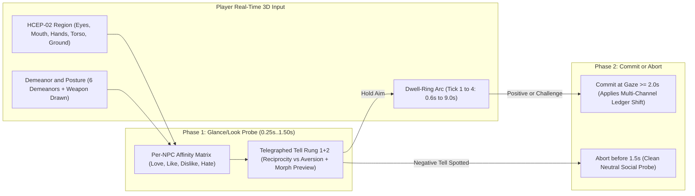
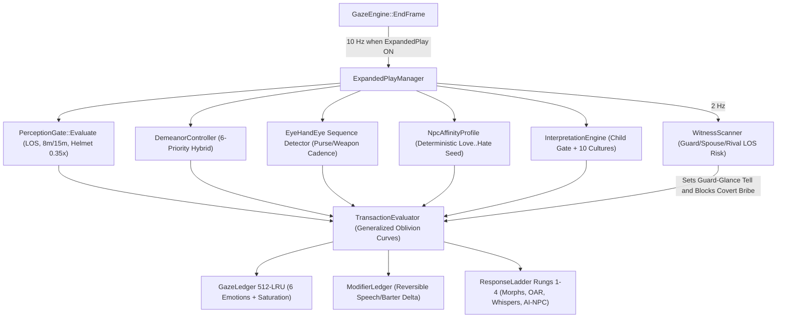

# TrueGaze™ — Real-Time Persuasion Wheel & Multi-Transaction Engineering Analysis

**Document ID:** TG-GDD-PERSUASION-01  
**Project:** TrueGaze™ — Biological Gaze & Expanded Play Gameplay Layer  
**Authors:** Antigravity (Analysis & Systems Engineering), Kirk LaSalle (Director & Approver)  
**Date:** 2026-11-19  
**Baseline Codebase:** `TrueGaze v1.1.0` Expanded Play (`WP-1` through `WP-7`)  
**Scope:** Architectural deconstruction of *The Elder Scrolls IV: Oblivion*'s Persuasion Wheel and Bribe function, re-engineered into zero-menu real-time 3D gaze gameplay across multiple emotions, relationships, and economic/social transactions in *Skyrim TrueGaze*.

---

## Executive Summary

In *The Elder Scrolls IV: Oblivion* (2006), Bethesda built one of RPG history's most ambitious non-combat social mechanics: an interactive **Persuasion Wheel** paired with a non-linear **Bribe** bypass. Despite clever underlying design—reading live FaceGen micro-expressions before committing to an approach—it suffered from modal UI freeze, abstract minigame repetition, and an un-witnessed disposition counter. Conversely, *The Elder Scrolls V: Skyrim* (2011) removed the wheel and live expression reading entirely, collapsing social negotiation into static `[Persuade]`, `[Intimidate]`, and `[Bribe]` text lines.

**TrueGaze already possesses every biological, perceptual, UI, memory, and reaction primitive needed to restore what Oblivion got right and transcend its limitations—in continuous, zero-menu 3D real time:**

1. **"The Face & Body Are the Wheel":** Oblivion's four abstract quadrants (`Admire`, `Joke`, `Coerce`, `Boast`) plus transactional cues (`Bribe`, `Plea`) map directly onto TrueGaze's **13 HCEP-02 anatomical gaze regions** and **6 3rd-person Demeanors**, while Oblivion's 1–4 bar "wedges" map directly onto the **4 dwell ticks of `TrueGazeReticle.swf`**.
2. **Pre-Commit Expression Telegraphing (`Rung 1` + `Rung 2`):** Instead of hovering a mouse over a pie slice, holding a brief `Glance -> Look` (`0.25s..1.50s`) probes the NPC's **hidden per-NPC Affinity Matrix** (`Love / Like / Dislike / Hate`). TrueGaze's `ResponseLadder` telegraphs receptivity visually via ocular reciprocity/aversion (`Rung 1`) and 25–40% non-dialogue FaceGen morph previews (`Rung 2`) *before* the player crosses the `Gaze` commitment threshold (`>= 2.0s`).
3. **Witness-Aware, Multi-Emotion Transactions:** Oblivion's non-linear bribe curve (`fBribeCostCurve = 1.50`, `fBribeCurve = 0.75`) is generalized into a continuous **Transaction Valuation Engine** fed by TrueGaze's `Presence`, 6-dimension `GazeLedger` (`respect`, `warmth`, `unease`, `suspicion`, `attraction`, `fear`), 4-axis `SignatureAxes`, `PerceptionGate` line-of-sight witnesses (`2 Hz`), and real-time **"Guard's Glance"** ocular tells.

---

## 1. Deconstruction of TES IV: Oblivion's Persuasion & Bribe Architecture

### 1.1 The Persuasion Wheel Loop

Oblivion's Persuasion system operates as a finite state machine inside a blocking UI modal manipulating a single scalar **Disposition (`0..100`)**:

1. **4 Social Quadrants:** Every round forces the player to execute each of four dialogue tactics exactly once: **Admire**, **Joke**, **Coerce**, and **Boast**.
2. **Per-NPC 4-Tier Preference Permutation:** Every NPC assigns a distinct affinity permutation across the four actions (**Love**, **Like**, **Dislike**, **Hate**) tied to personality/race/class seeds:
   - **Love:** Large positive disposition multiplier.
   - **Like:** Moderate positive disposition multiplier.
   - **Dislike:** Moderate negative disposition penalty.
   - **Hate:** Severe negative disposition penalty.
3. **Rotating Pie Wedges (Magnitude `1..4`):** Each quadrant displays `1` to `4` concentric segmented bars scaling the signed effect of that action. Clicking any quadrant rotates all wedge sizes **clockwise by 90 degrees** (`1 step`). Optimal play matches large wedges (`3–4`) to `Love`/`Like` quadrants and small wedges (`1–2`) to `Dislike`/`Hate` quadrants.
4. **Live Facial Expression Hover-Tells (The Genius Core):** Moving the cursor over any quadrant—prior to clicking—triggers an immediate FaceGen expression preview on the NPC's 3D portrait:
   - **Broad smile / raised eyebrows** $\rightarrow$ `Love`
   - **Slight smile / softened brow** $\rightarrow$ `Like`
   - **Mild frown / tight mouth** $\rightarrow$ `Dislike`
   - **Deep grimace / narrowed eyes / bared teeth** $\rightarrow$ `Hate`
5. **Time Pressure & Hesitation Decay:** While the Persuasion Wheel menu remains open without decisive input, the NPC's disposition **continuously ticks downward** every second, simulating real-world conversational impatience.
6. **Speechcraft Skill & Perk Gates:**
   - **Novice (`0–24`):** Baseline Persuasion Wheel & Bribery enabled; verbal disposition ceiling capped near Speechcraft skill limits.
   - **Apprentice (`25–49`):** Unlocks one **free rotation** per round to escape trapped wedge alignments.
   - **Journeyman (`50–74`):** Slows passive hesitation disposition decay by **50%**.
   - **Expert (`75–99`):** Caps/reduces penalties when forced to click a `Hate` quadrant (reduced penalty severity from `-150%` weight tier toward `-100%`).
   - **Master (`100`):** Halves all calculated gold **Bribe costs (`0.50x`)**.

### 1.2 Oblivion's Bribe Function & Construction Set GMST Parameters

When an NPC reaches the player's current Speechcraft persuasion ceiling—or when the player wants instant compliance without playing the wheel—Oblivion exposes **Bribe** as a non-linear economic bypass governed by Construction Set Game Settings (`GMSTs`):

| Oblivion GMST | Default Value | Mechanical Role in Oblivion Engine |
| :--- | :--- | :--- |
| `fBribeScale` | `1.0000` | Global scalar multiplier applied uniformly to final bribe gold cost (`2.0` doubles every bribe). |
| `fBribeCostCurve` | `1.5000` | Non-linear exponential steepness governing how fast bribe gold demands escalate relative to Speechcraft disparity (`1.0` = linear). |
| `fBribeSpeechcraftMult` | `0.0300` | Weight applied to `(NPC Speechcraft - Player Speechcraft)` disparity in cost calculation. |
| `fBribeNPCLevelMult` | `0.1000` | Weight scaling bribe demands by target NPC level relative to the player. |
| `fBribeCurve` | `0.7500` | Non-linear diminishing-returns exponent controlling how much **Disposition bonus** each successive bribe grants before hitting ceiling saturation. |

**Structural Rules of Oblivion Bribery:**
1. **Skill-Disparity Curve:** Higher-level or higher-Speechcraft NPCs cost disproportionately more (`fBribeCostCurve = 1.5`), whereas high player Speechcraft compresses cost and Master rank (`100`) halves final cost (`0.5x`).
2. **Diminishing Marginal Disposition (`fBribeCurve = 0.75`):** Each bribe raises disposition cleanly up to a per-relationship cap, after which further bribes yield negligible gain or flat refusal (`fBribeCurve` saturation) until disposition shifts via external quest/crime state.
3. **Blind Transaction Limitation:** Oblivion's bribe has **no spatial awareness** (guards next to a bribe target never witness the exchange), **no cultural or moral texture** (bribing a loyal Imperial legate uses the same scalar curve as bribing a crooked Riften dockhand—only NPC level/Speechcraft and liking/bribing temperament differ), and **only outputs a single flat currency (`Gold -> Disposition`)**.

### 1.3 Why Oblivion Failed in Flow & Why Skyrim Over-Corrected

| Dimension | TES IV: Oblivion | TES V: Skyrim | TrueGaze Expanded Play Goal |
| :--- | :--- | :--- | :--- |
| **Control Loop** | Modal 2D UI overlay; world freezes | Static text click (`[Persuade]` / `[Bribe]`) | **Continuous 3D real-time**; no modal overlay |
| **Facial Reading** | **Strong:** Must read FaceGen reaction on hover | **None:** Blind text RNG / fixed skill check | **Stronger:** Live ocular reciprocity, blink rate, aversion & `Rung 2` micro-expressions |
| **Action Selection** | Click 1 of 4 pie buttons | Click 1 dialogue line | **HCEP-02 region aim + 3rd-person Demeanor + weapon posture** |
| **Magnitude** | Rotating 1–4 wedge bars | Binary pass/fail threshold | **Dwell-arc ticks (`Glance -> Look -> Gaze -> Stare`)** controlled directly by the player |
| **Social Memory** | Single 1D `Disposition (0..100)` | Binary Friend / Enemy rank | **6-channel `GazeLedger`** (`respect`, `warmth`, `unease`, `suspicion`, `attraction`, `fear`) + 14-day decay & permanent floors |
| **Witnesses** | None during bribe/wheel | Only hardcoded felony crimes | **`2 Hz` `PerceptionGate` witnesses** trigger physical NPC glances away toward onlookers |

---

## 2. Re-Engineering Oblivion's Wheel into Real-Time 3D Gaze

### 2.1 "The Face & Body Are the Wheel" (Spatial Vector Mapping)

Instead of putting `Admire`, `Joke`, `Coerce`, and `Boast` on a floating pie chart, the player executes the exact same social vectors organically by **choosing *where* to look on the NPC (`HCEP-02` region)** paired with **posture (`Demeanor` / weapon drawn)**:

#### Table 1: Mapping Oblivion Actions + New Vectors onto TrueGaze Primitives

| Classic / Expanded Action | TrueGaze Spatial Input (`HCEP-02 Region` + `Demeanor`) | Dominant Psychological Channel | Real-Time World Equivalent |
| :--- | :--- | :--- | :--- |
| **Admire** *(Flattery / Rapport)* | `LeftEye` / `RightEye` or guild `Torso` (`emblemContext`) + `Courteous` or `Deferential` | `+respect`, `+warmth` | Appreciative appraisal, courteous posture; signals dignity and acknowledgment. |
| **Joke** *(Charm / Playfulness)* | `Mouth` / Eyes-to-Mouth Social Triangle + `Warm` | `+warmth`, optional `+attraction` | Inviting warmth and levity; breaks stiff formality with tavern regulars and merchants. |
| **Coerce** *(Intimidation / Threat)* | `LeftEye` / `RightEye` / `Forehead` + `Stern` or `Predatory` *(amplified if `playerWeaponDrawn`)* | `+fear`, `+respect` or `+unease` | Dominant stare-down; forces compliance from timid targets, triggers pushback from proud ones. |
| **Boast** *(Authority / Status)* | Steady `LeftEye` / `RightEye` + `Stern` *(with `playerIsThane` or high `PresenceTier`)* | `+respect` (if High Rank) / `+unease` (if Arrogant) | Sovereign composure; demands deference based on earned deeds and `Presence`. |
| **Sly Bribe** *(Expanded Transactional)* | Rapid scan **`RightHand` / `LeftHand` (Coin/Purse)** $\leftrightarrow$ **`LeftEye`/`RightEye` (< 1.5s)** while checking clear sightlines | Opens **Transaction Intent ("The Knowing Look")** | Non-verbal proposition: *"Let's settle this quietly"* without shouting a felony across a tavern. |
| **Plea / Empathy** *(Expanded Emotional)* | Soft `Eyes` $\leftrightarrow$ `Chin`/`Ground` cadence + `Warm` / `Deferential` (`compassionContext`) | `+warmth`, `-unease`, `-fear` | Comforts grieving NPCs (`NotableEventType::ComfortedGrief`), calms agitated merchants, earns temple grace. |

### 2.2 The 3-Phase Continuous Loop (Zero Modal Menus)

#### Phase 1 — Micro-Expression Probe (`Glance -> Look`: `0.25s .. 1.50s`)
The moment `ExpandedPlayManager` locks focus (`Evaluation @ 10 Hz`), TrueGaze queries the target's deterministic **`NpcAffinityProfile`** for the player's currently signaled social vector:
- Every NPC holds a seeded affinity rating (`Love = +2`, `Like = +1`, `Dislike = -1`, `Hate = -2`) across the 6 action archetypes, deterministically derived from their `ActorBase` FormID (`FNV-1a` seed) shifted by **Skyrim Racial Culture (`ObserverCulture`)**, **Class/Faction** (e.g., Thief vs Guard vs Priest), and **existing `GazeLedger` state**.
- **Pre-Commit Telegraph (Oblivion's FaceGen Hover Reimagined):** Between `0.35s` and `1.50s` of dwell—*before* any permanent reputation penalty is written—the NPC signals how they are taking your look:
  - **`Love` (+2):** Immediate **reciprocal eye lock (`Rung 1: AFFECT/HEART`)**, relaxed slow blink, `FaceExpressionMood::Happy` @ weight `0.35` (`Rung 2`), faint warm gold pulse in `TrueGazeReticle.swf`.
  - **`Like` (+1):** Gentle mutual eye glance, `Happy` @ weight `0.20`, steady pale reticle tone.
  - **`Dislike` (-1):** Brief blink-flutter and lateral `LRPeriph` saccade away (`Rung 1`), `Puzzled` or tight brow (`0.22`), reticle arc flickers slightly amber.
  - **`Hate` (-2):** Sharp head-turn aversion (`Rung 1 forceAversion`), `Anger` or `Disgusted` @ weight `0.38` (`Rung 2`), warning micro-whisper (`Rung 4`, e.g., *"Delphine's jaw tightens at your presumption"*).
- **Clean Escape:** Looking away before `1.75s` completes (`Glance`/`Look` only) cancels commitment cleanly—rewarding attentive players who watch the NPC's eyes and face instead of blindly staring!

#### Phase 2 — Dwell-Ring Wedge Commitment (`Gaze -> Stare`: `1.50s .. 9.00s`)
Instead of Oblivion's random rotating wedges, **the player's dwell restraint *is* the wedge magnitude ($W \in \{1, 2, 3, 4\}$)**:

| Reticle Dwell Tick | Elapsed Dwell | Equivalent Oblivion Wedge | Effect Magnitude Scalar | Gameplay Risk / Reward |
| :--- | :--- | :--- | :--- | :--- |
| **Tick 1 (`Glance->Look`)** | `0.60s .. 1.99s` | **1-Bar Probe** | `0.35x` *(Read-Only Probe)* | Safe reconnaissance: reads NPC facial affinity with near-zero negative blowback. |
| **Tick 2 (`Gaze`)** | `2.00s .. 4.49s` | **2-Bar Standard** | `1.00x` | Standard emotional commitment; safe sweet spot for `Like` interactions. |
| **Tick 3 (`Stare`)** | `4.50s .. 8.99s` | **3-Bar High-Stakes** | `1.65x` | Deepens `Love` gains or presses strong `Coerce`/`Intimidate`; severely penalizes `Hate`. |
| **Tick 4 (`Fixation`)** | `>= 9.00s` | **4-Bar Sovereign** | `2.25x` | Maximum emotional impact or intimidation dominance; risks `IntrusionLeer` / provocation if mismatched. |

#### Phase 3 — Conversational Patience Window & Hesitation Decay
Oblivion ticked disposition down while the player hesitated inside the wheel menu. In real-time Skyrim:
- Opening an active social probe starts an NPC **`PatienceTimer`** (default `6.0s`).
- Hesitating too long in indecisive darting scans (`SaccadeJitter` across mismatched regions without committing or disengaging) drains patience (`-1.0x/sec`).
- **Moth's Stillness & Presence Damping:** Just like Oblivion's *Journeyman* Speechcraft perk halves hesitation decay, higher **Scholarship Rank (`BookStudyTracker`)** and **Presence (`0..100`)** extend patience windows up to `1.5x` and steady micro-jitter (`fReticleMagnetismStrength`).
- **TrueGaze's Real-Time Adaptation vs. Oblivion Forced Rotation:** Because Skyrim is not turn-based, fatigue replaces artificial pie rotation via **Saturation / Novelty Decay**: repeating the exact same vector back-to-back within a `45s` window loses efficacy (`1.0x -> 0.5x -> 0.2x`), encouraging a natural multi-region **cadence** (*e.g., `Admire` eyes -> brief `Joke` smile at mouth -> `Sly` glance at hand -> steady eyes*).

---

## 3. Expanding the Bribe Function to Multi-Emotion & Multi-Transaction Gameplay

Oblivion limited bribery to a single input (`Gold`) and a single output (`Disposition`). By combining Oblivion's proven non-linear curve parameters with TrueGaze's `PerceptionGate`, `GazeLedger`, and `PresenceSignature`, the generalized transaction engine handles **currency, items, deference, secrets, intimidation, and romance** through one unified model.

### 3.1 The Generalized TrueGaze Cost & Outcome Equations

#### A. Cost / Resistance Equation (`TransactionCost`)
Adapting Oblivion's proven `fBribeScale`, `fBribeCostCurve = 1.50`, `fBribeSpeechcraftMult = 0.03`, and `fBribeNPCLevelMult = 0.10`:

$$C_{\text{tx}} = C_{\text{base}} \cdot f_{\text{Scale}} \cdot \Big(\max(0.25,\; 1.0 + f_{\text{NPCLevelMult}} \cdot \tfrac{L_{\text{npc}} - L_{\text{player}}}{10} + f_{\text{SpeechMult}} \cdot (S_{\text{npc}} - S_{\text{eff}}))\Big)^{f_{\text{CostCurve}}} \cdot \Phi_{\text{Rel}} \cdot \Phi_{\text{Risk}}$$

Where:
- **Effective Social Skill ($S_{\text{eff}}$):**

$$S_{\text{eff}} = \text{Speechcraft} + 0.35 \cdot \text{Presence} + \text{ScholarshipBonus}_{\text{Speech}}$$

  *(Note: Directly leverages `ComputeScholarshipBonus(ScholarshipRank).speechIllusionBonus` from `ExpandedPlayModifiers.hpp`!)*
- **Relationship & Impression Modifier ($\Phi_{\text{Rel}}$):**
  - Lowers cost/resistance when `warmth > 0` or `respect > 0` or `tier >= Friend`.
  - Raises cost/resistance—or flips into **moral outrage**—when `suspicion > 35` or `unease > 40`, unless overridden by high `fear` in a coercive transaction.
- **Witness Exposure Risk Factor ($\Phi_{\text{Risk}}$):**
  Computed live at `2 Hz` from `PerceptionGate::Evaluate` across nearby actors (`<= 15 m`):

$$\Phi_{\text{Risk}} = 1.0 + 0.50 \cdot N_{\text{neutral witnesses}} + 1.25 \cdot N_{\text{law/guard witnesses}}$$

  If the transaction is illegal/covert (bribing out of a crime, buying fenced intel) and a **law witness has clear LOS**, the NPC refuses outright and telegraphs why (see §3.2).

#### B. Emotional Yield & Saturation Curve (`TransactionYield`)
Adapting Oblivion's diminishing-returns `fBribeCurve = 0.75`:

$$\Delta E_k = \text{sign}_k \cdot \Delta_{\text{base}, k} \cdot \left(\frac{W_{\text{dwell}}}{2.0}\right)^{f_{\text{YieldCurve}}} \cdot \text{AffinityMult}(\text{Love}..\text{Hate}) \cdot \text{CultureMult} \cdot (1.0 - \text{Saturation}_{\text{tx}})$$

With default $f_{\text{YieldCurve}} = 0.75$, holding longer swells yield with smooth diminishing returns rather than infinite exploit stacking, and feeds directly into `GazeLedger`'s 6 emotional channels (`respect`, `warmth`, `unease`, `suspicion`, `attraction`, `fear`) and permanent floor clamping.

---

### 3.2 Witness-Aware Kinematic Tells ("The Guard's Glance")

In vanilla Oblivion and Skyrim, bribery happens inside a bubble. TrueGaze can leverage its **core biological saccade engine** to make witnesses physically visible in NPC behavior:

1. During an active `SlyBribe` or `Suspicious` eye-hand-eye sequence, `ExpandedPlayManager`'s **`2 Hz` Witness Scanner** checks surrounding actors using `PerceptionGate`.
2. If an unwanted witness (`Guard`, `Spouse`, `LoveTriangleRival`, `Merchant`) enters line of sight within `12 m`:
   - **Rung 1 Biological Tell:** The target NPC aborts mutual eye lock and executes a sharp **0.6s saccade toward the witness** (`overrideTarget = witnessActor`), then snaps back (`LRPeriph`) with elevated blink rate!
   - **Rung 2 Micro-Expression:** `FaceExpressionMood::Fear` or `Puzzled` (`0.30`).
   - **Rung 4 Whisper:** *"Orgnar's eyes flick sharply toward the door guard—not here."*
3. **Gameplay Payoff:** Players who read *their target's eyes* notice why the transaction stalled—and either walk around a pillar to break witness LOS, wait for patrol turnover, or lure the NPC outside. Even **NPCs using Oblivion's classic tell** gain 3D spatial meaning.

---

### 3.3 The 6 Expanded Real-Time Transactions Matrix

This expands Oblivion's single `Gold -> Disposition` bribe into **six distinct, non-modal and dialogue-bridged transaction archetypes**:

| # | Transaction Archetype | Real-Time Trigger Cadence | Core Resource Exchanged | Emotional Ledger Shift (`GazeLedger`) | Skyrim Gameplay Consequence & Mod-Layer Hook |
| :--- | :--- | :--- | :--- | :--- | :--- |
| **1** | **Sly Witness-Clear Bribe** *("Cross the Palm")* | **Purse/Hand (`0.4s..1.2s`) $\rightarrow$ Eye Lock (`>= 1.5s`)** while `W_witnesses == 0` *(Guard / Fence / Doorman)* | **Gold** (`C_tx` via `fBribeCostCurve`) -> **Compliance** | `+suspicion` *(minor mutual complicity)*, `-unease` *(if Affinity >= Like)* | Pre-arms a **Silent Bribe Discount** (`kSpeechcraftModifier` + `BribeCostScale` note) on the next dialogue activation & logs `AiNpcBridge` subtext for Mantella/CHIM (`"quietly accepts a glance at your coin purse"`). |
| **2** | **Pre-Barter Appraisal & Haggle** *("The Merchant's Tell")* | **`Eyes` (`>= 2.0s`, `Courteous`/`Warm`)** builds *Rapport*; staring at **counter/item too long** shows *Eagerness*; `Stern` presses *Timid* sellers | **Patience & Attitude** -> **Barter Margin** | `+warmth` / `+respect` (Rapport) or `+unease` (Eager/Stern push) | Applies temporary reversible `ActorValue` trade/speech bonus via `ModifierLedger` (`kSpeechcraftModifier` stripped cleanly on `kSaveGame` / menu close). |
| **3** | **Tavern / Informant Coin-Look** *("Loosen the Tongue")* | **`Hand/Mug` (`0.5s`) $\rightarrow$ `Mouth/Eyes` (`>= 1.8s`, `Warm`/`Stern`)** near tavern NPCs/bards | **Small Coin / Mead** -> **Rumors, AI Lore, Lower Dialogue Gate** | `+warmth` + `recognized = true` | Lowers `AcceptsFavor` / friendship threshold in dialogue, softens *Love Triangle* rival suspicion, or opens gossip prompts in AI-NPC dialogue. |
| **4** | **Threat-to-Compliance Coerce** *("Blood or Coin")* | **`playerWeaponDrawn`** + **`Stern`/`Predatory`** + **`Fixation` (`>= 3.0s`)**; sheathing mid-look triggers *"Stand-Down Grace"* | **Fear & Dominance** -> **Surrender / Confiscation / De-escalation** | `+fear`, `+respect` *(if `Presence` wins)* or `+unease` *(backfire if proud)* | Rewards intimidation checks when staring; **sheathing weapon while locked in mutual gaze** mirrors Oblivion's weapon-drawn disposition swing as a tense **"Mercy / De-escalation" bonus**. |
| **5** | **The Seen Gift & Mercy** *("Beggars, Bards & Temples")* | **Mutual Eye Lock (`>= 1.5s`)** before donating/tipping vs **Cold Aversion** past a begging/grieving NPC | **Charity / Sincere Attention** -> **Presence & Grace** | `+warmth`, `NotableEvent::ComfortedGrief` | Meeting eyes *then* acting grants amplified **Presence** & `Warmth` Signature; meeting eyes and coldly walking past costs Presence (`Contempt`/guilt penalty). |
| **6** | **Non-Monetary Emotional Exchange** *("Reading the Heart")* | **Eyes $\leftrightarrow$ Mouth Triangle** (`>= 2.0s`, `Warm`/`Courteous`) with eligible/affinitive NPC (`bModuleMatureReactions` separate for adult-only) | **Vulnerability & Sincerity** -> **Bond Depth** | `+warmth`, `+attraction` *(if reciprocal)*, Raises Permanent Floor | Drives courtship progression, **Spouse Jealousy** witness arcs, and **Riverwood Camilla / Sven / Faendal** dynamic social tension without a single forced menu. |

---

## 4. Factored C++23 Engineering Architecture (`WP-8` Blueprint)

Everything above integrates cleanly into `src/ExpandedPlay/` with **zero `.esp` dependencies**, preserving TrueGaze's SDK-free unit-testability, `10 Hz` / `2 Hz` budget discipline, `CoSaveSerializer` persistence, and `ModifierLedger` save safety.

### 4.1 Proposed Factored Modules (`src/ExpandedPlay/`)

| Module File | Type / Status | Core Responsibilities & Dependencies |
| :--- | :--- | :--- |
| **`PersuasionAffinity.hpp`** | New *(Pure SDK-Free Header)* | Defines `PersuasionVector` (`Admire`, `Joke`, `Coerce`, `Boast`, `SlyBribe`, `Plea`), `AffinityTier` (`Love`, `Like`, `Dislike`, `Hate`), deterministic `DeriveNpcAffinity(actorBaseFormId, ObserverCulture, factionFlags)`, and pre-commit `EvaluateProbeTell(...)` driving Rung 1/Rung 2 preview signals during `Glance`/`Look` (`0.25s..1.75s`). |
| **`TransactionEvaluator.hpp`** | New *(Pure SDK-Free Header)* | Implements the generalized Oblivion math (`fBribeCostCurve = 1.50`, `fBribeCurve = 0.75`, `fBribeSpeechcraftMult = 0.03`, `fBribeNPCLevelMult = 0.10`, `0.50x` Master/Candour cap), per-NPC **Novelty/Saturation decay tracker** (`45s` window), `EyeHandEye` sequence detector (`Hand -> Eye` within `1.8s` for `SlyBribe`), witness exposure block (`N_law_witnesses > 0`), and `ComputeTransactionOutcome(...)` returning signed deltas for `Impressions`, `Presence`, and temporary barter/speech buffs. |
| **`ExpandedPlayTypes.hpp`** | Extend | Add `PersuasionVector` enum, optional `float txSaturation` / `float lastTxGameHours` fields inside transient/session state (or co-save `'TXST'` chunk v2 with v1 backward compatibility), and `TransactionHint` struct for HUD/OAR readout. |
| **`ExpandedPlayModifiers.hpp/.cpp`** | Extend | Track reversible **`DialogueRapport` / `BribeCostScalar`** modifiers inside `ModifierLedger` so pre-dialogue eye rapport or sly briber intent boosts vanilla Speechcraft/barter checks cleanly when opening `DialogueMenu` or `BarterMenu`, and strips identically before `kSaveGame`. |
| **`ResponseLadder.hpp/.cpp`** | Extend | Add **Probe Tells** (distinct gentle `0.20..0.38` FaceGen morph weights before commit) and **Witness Glance Override** (`Rung 1` involuntary `0.6s` NPC saccade toward a nearby guard/spouse interrupting covert bribery), plus `FormatAiNpcBridgeContext(...)` tokens (`[probe:Love]`, `[tell:witness_glance]`, `[tx:SlyBribe_ready]`). |
| **`ExpandedPlayManager.cpp`** | Extend | Wire `PersuasionAffinity`, `EyeHandEye` cadence tracker, `TransactionEvaluator`, and `DialogueMenu`/`BarterMenu` onset hooks into the existing `10 Hz` focus / `2 Hz` witness cadence; expose a new optional `TrueGaze_GetAffinityTell` OAR V3 condition (`condition #8`). |
| **`ExpandedPlayConfig.hpp` & INI** | Extend | Add opt-in tuning toggles under `[ExpandedPlay]`: `bEnableRealtimePersuasion` (`true`), `bEnableWitnessBlocking` (`true`), `fPersuasionPatienceSec` (`6.0`), `fBribeCostCurve` (`1.50`), `fBribeYieldCurve` (`0.75`), keeping everything zero-cost when `[ExpandedPlay] bEnabled=false`. |

### 4.2 Guardrails & Non-Negotiable Constraints

1. **No Popup Minigame Clutter:** Oblivion's 4-quadrant pie graphic is **never recreated as a blocking UI menu**. The player reads the NPC's **actual 3D face, eyes, and posture** in-world, assisted only by subtle reticle color/arc feedback in `TrueGazeReticle.swf` (and optional whisper hints).
2. **Hard Child & Harassment Gate Preserved:** `InterpretationEngine`'s unconditional Line-1 `isChild` safety gate applies to all persuasion probes (`SlyBribe`, `Coerce`, `Attraction`, `IntrusionLeer` can never trigger against children; `Plea`/`Admire` remain benign mentorship/kindness only).
3. **Zero Forced Gold Theft Without Consent:** Looking at a coin purse + eyes *prepares and reveals* the `[Bribe / Quiet Arrangement]` edge, witness risk, and negotiated price discount in real time—actual gold transfer remains anchored cleanly inside Skyrim's dialogue/barter activation (or explicit key/dialogue confirmation), never silently draining gold from looking at someone's belt.
4. **Full Reversibility (`ModifierLedger` & `'TGZE'` Co-Save):** Zero ESP changes, zero Papyrus scripts, backward-compatible `'TGZE'` v1->v2 co-save loading, and instant strip-on-disable via **`stgexpanded`**.

---

## 5. Recommended Phased Rollout (`WP-8A` through `WP-8D`)

| Package | Scope | Key Verification Target |
| :--- | :--- | :--- |
| **`WP-8A`** | Pure C++23 `PersuasionAffinity.hpp` & `TransactionEvaluator.hpp` + Oblivion GMST math & `1..4` dwell wedge unit tests | `ExpandedPlayTests.exe` mathematical assertions (Oblivion curves, saturation decay, guard-witness block, child immunity) |
| **`WP-8B`** | `ResponseLadder` Pre-Commit Expression Probes (`0.25s..1.75s`) + `Rung 1` `"Guard's Glance"` witness-saccade override | Live Riverwood test: hover `Glance`/`Look` on Orgnar/Camilla/Sven and verify visible smile vs frown *before* commit |
| **`WP-8C`** | `EyeHandEye` cadence detector (`SlyBribe`) + `ModifierLedger` `BarterMenu`/`DialogueMenu` Speechcraft/Barter hook + `AiNpcBridge` tags | Verify pre-barter rapport/leverage changes merchant prices & reverses cleanly on `stgexpanded` off / `kSaveGame` |
| **`WP-8D`** | Optional `OAR` condition #8 (`TrueGaze_GetAffinityTell`), INI keys in `TrueGazeConfig.html`, docs & CI Gate parity | Full `Invoke-CiGate.ps1` + live Skyrim build & deploy check |
