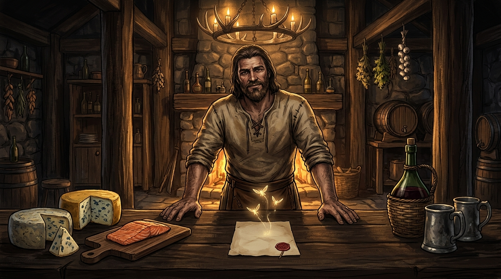
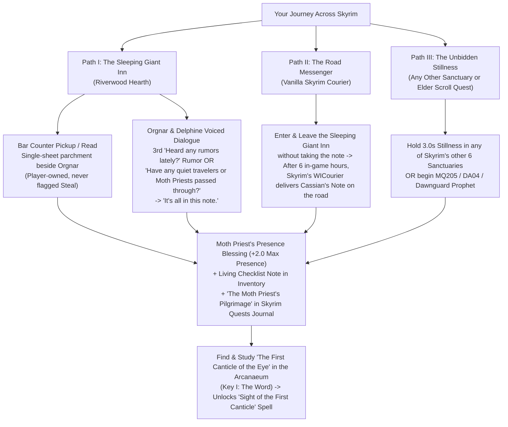
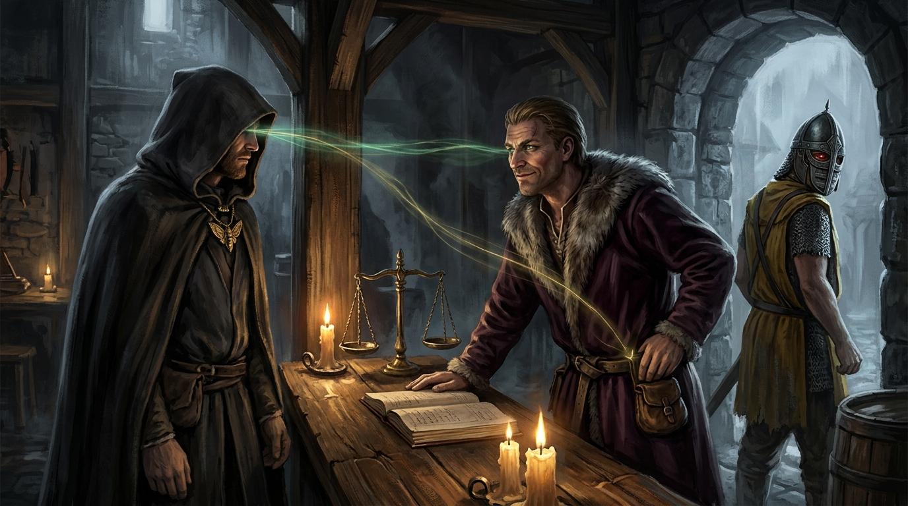
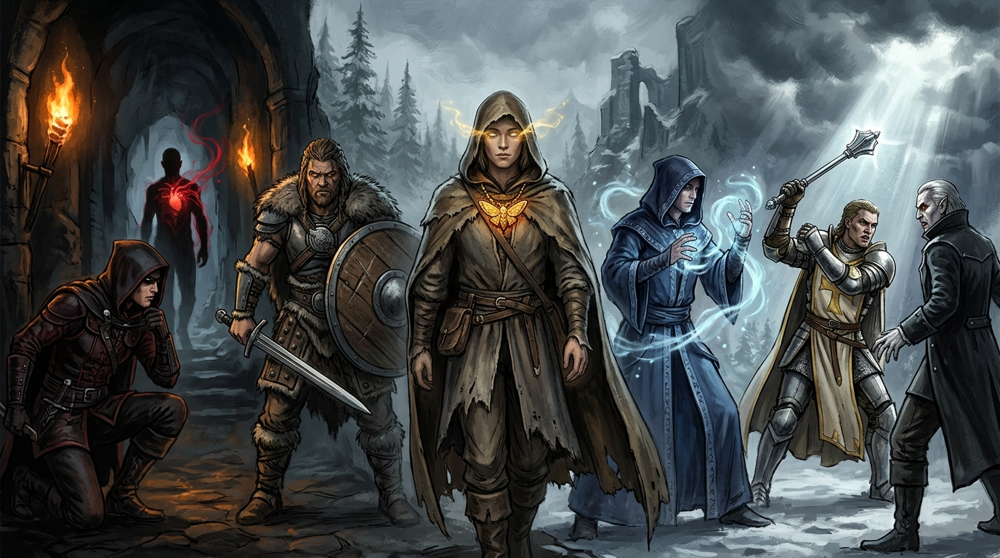

# The First Canticle of the Eye

## An Illustrated Graphic Chronicle of the Ancestor Moth Pilgrimage in Skyrim

**Product:** TrueGaze™ v2.1.0 — Biological Gaze Kinematics, Real-Time Persuasion, Faction Sight & Expanded Play  
**Author & Architect:** Kirk LaSalle (HCEP)  
**Optional Light Plugin:** `TrueGaze_ExpandedPlay.esp` + `TrueGaze_ExpandedPlay.seq` (ESL-flagged, `0` load-order slots, `Skyrim.esm` only, zero Papyrus scripts, zero vanilla `CELL` edits)

  
   
  <em>Chapter I — "Before an acolyte looks upon an Elder Scroll, they must learn to look upon a living soul without tremor." — Brother Cassian, Preface to The First Canticle of the Eye</em>

---

## Chapter I — The Sight Beside the Voice

In the White-Gold Tower of Cyrodiil, deep beneath the silk-hung vaults where Ancestor Moths beat their wings like ash on warm air, the **Cult of the Ancestor Moth** guarded a discipline older than the Third Empire and quieter than any war horn.

History remembers the Moth Priests for the terrible price of their highest office—the slow, luminous blindness that follows reading the *Kel*, the Elder Scrolls themselves. Yet few outside the monastery cloisters ever learn what a novice is taught *before* they are permitted near a Scroll case.

That first discipline is called **the First Canticle of the Eye**, or in the northern tongue, **the TrueGaze**.

Where Skyrim's ancient Tongues and the Greybeards of High Hrothgar shape the world through the **Voice**—hurling intent outward upon the mountain wind—the Moth Prelates discovered its quiet twin: **Sight**. Not the mere passing of light across a lens, nor a crude Illusion spell forced upon an unwilling mind, but the disciplined stillness of attention itself.

To a Prelate of the First Canticle, every living soul writes an unguarded confession in the micro-movements of their eyes:
- Where a merchant's gaze flickers half a breath before naming a price;
- How a swordsman's pupils drop toward a shield rim before a feint or a lunging strike;
- How an assassin in civilian wool betrays—or conceals—the cold cadence of the Void;
- Why a timber wolf freezes when met without fear, and why even a **Dov**—an immortal Dragon of Akatosh—pauses to weigh a mortal who holds its molten amber gaze without flinching.

> *"The restless eye begs, threatens, or hides. The still eye listens until the world answers."*  
> — From the Marginalia of the Temple of the Ancestor Moth, Fourth Era

When a traveler masters unhurried study (**Ocular Contemplation**), steadies their own bearing (**Moth's Stillness**), and learns to meet another soul's eyes without tremor, they awaken what even the Elder Scrolls cannot easily burn away: **a living dialogue between eyes**.

---

## Chapter II — The Chronicle of Brother Cassian's Northern Pilgrimage

In the fourth decade of the second century of the Fourth Era—when political fractures shook the Imperial City and senior archivists quietly dispersed north to keep the monastery's lesser primers out of Thalmor hands—an aging Moth Prelate named **Brother Cassian** crossed Pale Pass into Skyrim.

Cassian did not carry an Elder Scroll. He carried a burden far easier to lose in a snowdrift and far too subtle to entrust to a fortress garrison: **one illuminated primer of *The First Canticle of the Eye*, five consecrated Moth relics, and a wax-sealed ledger sheet summarizing the four keys of the discipline**.

As civil war gathered across Skyrim's nine holds, Cassian knew that locking all six treasures inside a single vault would invite blood—whether from bandits, zealous inquisitors, or collectors who mistook a monastic discipline for a trinket of power. Instead, he walked a slow pilgrimage from the pine valleys of Falkreath and Riverwood to the frozen cliffs of the Sea of Ghosts, entrusting **each relic to one of Skyrim's Seven Sanctuaries**—places where mortals still knew how to pause, listen, heal, or reflect.

  
   
  <em>Chapter II — Brother Cassian's Seven Sanctuaries across Skyrim: from the hearth of Riverwood's Sleeping Giant Inn and the healing dome of Whiterun to the cavern roots of Eldergleam, the shrines of Mara and the Divines, the quiet steps of High Hrothgar, and the stacked folios of Winterhold's Arcanaeum.</em>

Before Cassian vanished along the northern ice shelf beyond Winterhold, he bound his pilgrimage by a single monastic law:
- **No unearned mastery:** Merely stepping across a tavern threshold or pocketing an amulet teaches no spell. The right-hand invocation—**Sight of the First Canticle**—awakens **only** when a seeker finds and truly studies *The First Canticle of the Eye* (or an Elder Scroll treatise) from beginning to end (**Key I: The Word**).
- **Four order-independent Keys:** Only one who **reads with patience** (*The Word*), **wears a Vessel with restraint** (*The Vessel*), **shares Sight freely with a companion** (*Shared Sight*), and **walks Skyrim's Sanctuaries in stillness** (*The Pilgrimage*) will see all four tumblers align for the Final Turning.

---

## Chapter III — The Whisper at the Hearth: Three Paths to the Pilgrimage

Brother Cassian spent his first night in Skyrim warming his hands by the hearth of the **Sleeping Giant Inn** in Riverwood. Observing the gruff steadiness of the barkeep **Orgnar**—and the watchful, road-hardened eyes of **Delphine**—Cassian left behind a single folded parchment stamped with red wax: **`Innkeeper's Note: The Moth Priest's Passage`**.

Even after Cassian departed north toward Whiterun and Winterhold, the lingering stillness of an Ancestor Moth Prelate clung to the tavern rafters. When you first receive Cassian's note, that residual stillness washes over you as the **Moth Priest's Presence Blessing (`+2.0` Permanent Max Presence)** and opens the native Skyrim Journal Quest **`The Moth Priest's Pilgrimage`**.

  
   
  <em>Chapter III — The Hearth of Riverwood: On the rough-hewn counter of the Sleeping Giant Inn—between Orgnar's salmon cutting board and the wicker wine carafe—rests Brother Cassian's wax-sealed parchment note, shimmering with the lingering blessing of the Ancestor Moths.</em>

Because every traveler walks Skyrim differently, TrueGaze provides **three seamless, lore-authentic paths** to receive Brother Cassian's note and begin **`The Moth Priest's Pilgrimage`**:

### 1. Path I — The Sleeping Giant Inn (The Bar Note or Orgnar's Voiced Testimony)
- **The Note on the Bar Counter:** Step into the Sleeping Giant Inn and look directly at the wooden counter in front of Orgnar—right between the wooden salmon platter (`Y = 38.3`) and the wicker-wrapped wine carafe (`Y = 65.8`). Because Brother Cassian left the note expressly for an attentive traveler, it carries **your ownership (`0` gold value, never flagged `Steal`)** and opens in Skyrim's `BookMenu` as a **single-sheet parchment Note** (never a bound book). Reading or taking it bestows the **Moth Priest's Presence Blessing** and starts **`The Moth Priest's Pilgrimage`**.
- **Orgnar & Delphine's Voiced Rumor & Direct Inquiry:** Speak with **Orgnar** (or **Delphine**). You may either:
  1. Ask **"Heard any rumors lately?"** through his local rumors until his **3rd rumor** turns to the quiet Moth Priest from Cyrodiil; **or**
  2. Ask directly: **"Have any quiet travelers or Moth Priests passed through?"**
  In both cases, Orgnar answers in his native voice, offering the follow-up **"A Moth Priest? May I see the note?"** → *"It's all in this note."* He hands the parchment directly into your inventory and removes the spare copy from the bar.

### 2. Path II — The Road Messenger (Vanilla Skyrim Courier Within One Day)
- If you pass through the Sleeping Giant Inn in haste—warming yourself by the fire or renting a room—and walk back out into Riverwood without noticing the parchment on the bar or asking Orgnar about travelers, Orgnar does not let the Prelate's message gather dust.
- Once **six in-game hours (`0.25` Skyrim days)** pass outside the Inn, Orgnar dispatches Skyrim's **Provincial Courier (`WICourier`)**. Within a single Skyrim day, the Courier tracks you down along the road or at the gates of the next town with **`Innkeeper's Note: The Moth Priest's Passage`**, triggering the **Moth Priest's Presence Blessing** and starting **`The Moth Priest's Pilgrimage`**.

### 3. Path III — The Unbidden Stillness (Sanctuary Contemplation or the *Kel* Quests)
- For travelers whose road never passes through Riverwood:
  - Holding **`3.0` seconds of peaceful stillness** inside any of Skyrim's other six Sanctuaries (*Temple of Kynareth*, *Eldergleam Sanctuary*, *Temple of Mara*, *Temple of the Divines*, *High Hrothgar*, or *The Arcanaeum*), **or**
  - Embarking upon any of Skyrim's canonical Elder Scroll quests (*Elder Knowledge* `MQ205`, *Discerning the Transmundane* `DA04`, or Dawnguard's *Prophet* `DLC1VQ03*`)
  awakens the **Moth Priest's Presence Blessing**, places Brother Cassian's Living Note in your satchel, and opens **`The Moth Priest's Pilgrimage`** in your Quest Journal.

> [!TIP]
> **A Living Parchment Ledger & Native Quest Journal:**  
> You never need to equip or cast a spell just to check what remains on your pilgrimage. **`Innkeeper's Note: The Moth Priest's Passage`** is a **Living Note**: every time you open it from your inventory (`Books` tab), its parchment dynamically updates with `[X]` and `[ ]` markers for your current Awakening Stage, all four Keys, your Sanctuary visits, and your Final Ceremony readiness—mirrored 1:1 in Skyrim's **Quests Journal (`J` → *The Moth Priest's Pilgrimage*)**.

---

## Chapter IV — The Six Consecrated Relics & Where They Rest

When **`TrueGaze_ExpandedPlay.esp`** is active, TrueGaze maintains **100% compatibility with every town, temple, and interior overhaul mod** (`zero` vanilla `CELL` edits). Holding **`1.5` seconds of calm stillness** inside a Sanctuary reveals its consecrated relic cleanly before you once per save—owned by you and never marked as theft. Players running a DLL-only setup without the ESL can complete the entire pilgrimage using vanilla `Skyrim.esm` equivalents.

  
   
  <em>Chapter IV — The Treasures of Brother Cassian: The First Canticle of the Eye (Arcanaeum), Amulet of the Ancestor Moth (Temple of Kynareth), Moth-Silk Browband (Eldergleam), Ring of Quiet Sight (Temple of Mara), Silver Moth Medallion (Temple of the Divines), and Moth-Silk Ribbon (High Hrothgar).</em>

| Artifact & FormID | Role in the Awakening | Sanctuary Location | Why Brother Cassian Entrusted It There | Vanilla DLL-Only Equivalent |
| :--- | :--- | :--- | :--- | :--- |
| **Innkeeper's Note: The Moth Priest's Passage** *(Living Single-Sheet Note, `0x01000809`)* | **Pilgrimage Map, Living `[X]`/`[ ]` Checklist & Quest Starter** | **Sleeping Giant Inn** *(Riverwood Bar / Orgnar / Courier)* | Left on Orgnar's counter on Cassian's first night north of Pale Pass for any traveler patient enough to ask—or look—before marching to war. | Automatic HUD milestone & co-save tracker |
| **The First Canticle of the Eye** *(Illuminated Tome, `0x01000803`)* | **Key I — The Word** *(Study `>= 80%` to learn the Canticle Spell)* | **The Arcanaeum** *(College of Winterhold)* | Shelved among Urag gro-Shub's vaults where scholars already guard treatises on the Elder Scrolls. **Studying this tome is the sole path to learning the *Sight of the First Canticle* spell.** | *Effects of the Elder Scrolls*, *Ruminations on the Elder Scrolls*, *Book of the Dragonborn*, or *Ancestor Moth* lore books |
| **Amulet of the Ancestor Moth** *(Gold & Amber Amulet, `0x01000804`)* | **Key II — The Vessel** *(Wear for `3.0 s` mutual gaze + Diegetic Toggle)* | **Temple of Kynareth** *(Whiterun)* | Kynareth (Kyne) governs breath, wind, and the still center of the storm. Cassian laid his golden Moth amulet where healers watch the breath of the wounded without flinching. | *Amulet of Kynareth*, *Julianos*, *Mara*, *Akatosh*, or *Dibella* |
| **Moth-Silk Browband** *(Gold-Threaded Circlet, `0x01000805`)* | **Key II — The Vessel** *(Wear for `3.0 s` mutual gaze + Diegetic Toggle)* | **Eldergleam Sanctuary** *(Eastmarch)* | Beneath cavern roots where golden Sap-light filters through living moss, wild moths gather at dusk. Cassian hid this woven browband for pilgrims who seek stillness far from city walls. | Any vanilla **Circlet** |
| **Ring of Quiet Sight** *(Inscribed Silver Ring, `0x01000806`)* | **Key III — Shared Sight** *(Trade or drop beside an ally)* | **Temple of Mara** *(Riften)* | Mara blesses fellowship and the unspoken bond between two souls who truly see one another. Cassian consecrated this ring in Riften so it would be *given away*, awakening **Kindred Sight**. | Any vanilla Divine Amulet or Circlet traded to a follower |
| **Silver Moth Medallion** *(Hammered Amulet, `0x01000807`)* | **Key III — Shared Sight** *(Trade or drop beside an ally)* | **Temple of the Divines** *(Solitude)* | Brought from Cyrodiil's Imperial Cult and left beneath Solitude's pantheon dome, meant for a shield-companion who watches your flanks in the dark. | Any vanilla Divine Amulet or Circlet traded to a follower |
| **Moth-Silk Ribbon** *(Pocket Talisman, `0x01000808`)* | **Key III — Shared Sight** *(Trade or drop beside any friendly NPC)* | **High Hrothgar** *(Throat of the World)* | Cassian climbed the Seven Thousand Steps to lay a humble silk ribbon before the Greybeards—honoring the kinship between Cyrodiil's **Sight** and Skyrim's **Voice**. Requires no equipment slot. | Any vanilla Divine Amulet or Circlet traded to a follower |
| **Sight of the First Canticle** *(Right-Hand Illusion Spell, `0` Magicka, `0x01000802`)* | **Sanctuary Ceremony Focus, Checklist Notice & Diegetic Veil Toggle** | **Taught ONLY upon completing Key I (The Word)** | Channeling the spell visibly suspends the open *First Canticle* above your left hand (1st & 3rd person) while your right hand gathers warm golden-white Moth light. | Passive `4.5 s` unarmed Sanctuary stillness completion when playing DLL-only |

---

## Chapter V — The Four Keys & The Final Sanctuary Turning

TrueGaze Expanded Play advances you from **Stage 0 (Dormant)** to **Stage 4 (Canticle Awakened)** through **four order-independent Keys** and a **Final Sanctuary Ceremony**. Every step is tracked automatically in your **Quests Journal (`The Moth Priest's Pilgrimage`)**, inside **`Innkeeper's Note: The Moth Priest's Passage`**, and on the **Sight of the First Canticle** spell notice.

### 1. The Four Keys of the First Canticle (Any Order)

- **Key I — The Word (*Unhurried Study*):**
  Travel to **The Arcanaeum** in the College of Winterhold (or acquire a canonical Elder Scroll treatise) and open ***The First Canticle of the Eye***. Read each spread without speed-flipping (`>= 2.5 s`–`12.0 s` per spread, scaled to word count). Absorbing `>= 80%` of the spreads lights **Key I**, marks Objective `10` complete in your Quest Journal, and **teaches you the right-hand spell *Sight of the First Canticle***.
- **Key II — The Vessel (*Attuned Focus*):**
  Equip your **Amulet of the Ancestor Moth**, **Moth-Silk Browband**, or a vanilla Divine Amulet/Circlet, and hold peaceful mutual eye contact with any adult NPC for **three quiet breaths (`>= 3.0 s`)** to light **Key II** (Objective `20`).
- **Key III — Shared Sight (*Kindred Gaze*):**
  Share a **Ring of Quiet Sight**, **Silver Moth Medallion**, or **Moth-Silk Ribbon** with a companion—either by trading it to a follower **or by dropping the relic on the ground beside any friendly adult NPC** and meeting their eyes for `1.5 s`. They accept the token into their keeping, lighting **Key III** (Objective `30`) and awakening **Kindred Sight** (deepened mutual warmth and, from Stage 3 onward, live flank warnings in combat).
- **Key IV — The Pilgrimage (*Stillness Across Skyrim*):**
  Hold `3.0` seconds of calm, unarmed stillness inside at least **two of Skyrim's Seven Sanctuaries** (*Sleeping Giant Inn*, *Temple of Kynareth*, *Eldergleam Sanctuary*, *Temple of Mara*, *Temple of the Divines*, *High Hrothgar*, or *The Arcanaeum*) to light **Key IV** (Objective `40`).

### 2. The Five Awakening Stages (`Stage 0 → Stage 4`)

| Stage | Title | Requirement | Presence Cap | Scholarship Cap | Awakened Ocular Powers |
| :---: | :--- | :--- | :---: | :---: | :--- |
| **0** | **Dormant** | `0` Keys lit | `20` | Novice | Pure Layer 1 biological head/eye kinematics (`TrueGaze` classic visual parity). |
| **1** | **First Glimmer** | **Any 1 Key** lit | `39` | Novice | 1st-person **HCEP-02 Gaze Reticle**, **512-NPC GazeLedger** social memory, **Ocular Contemplation** book study & *Moth's Stillness*, basic Demeanors (`Courteous`, `Warm`, `Deferential`), **Prey *Gentle Sight***. |
| **2** | **Steady Sight** | **Any 2 Keys** lit | `59` | Acolyte | **Real-Time Oblivion Persuasion Probes** (`0.35 s–1.99 s` color-coded reticle tells), **Restraint-Driven Native NPC Voice Responses**, **Eye-Contact Greeting**, `"Guard's Glance"` witness detection, `Stern` & `Evasive` Demeanors, **Faction Sight**, **Combat Sight**, **Predator *Kyne's Stillness*** & **Dragon *Dov's Weight***. |
| **3** | **Living Glyph** | **3 or 4 Keys** lit *(pre-ceremony)* | `79` | Prelate | Full **Real-Time Multi-Transactions** (pre-barter Speechcraft rapport, `"Knowing Look"` *Sly Bribe*, *Stand-Down Grace*), **3-Round Tavern Staring Contests**, and **Kindred Sight** companion flank warnings. |
| **4** | **Canticle Awakened** | **All 4 Keys + Final Sanctuary Ceremony** | **`100`** | **Canticle** | Full mastery: **`+5.0` Max Presence**, `Predatory` Demeanor, full **4-Axis Signature Resonance** titles, maximum *Moth's Stillness* bonuses, and **Diegetic Veil / Unveil Toggle** (cast *Sight of the First Canticle* or equip/unequip your Moth Vessel anytime to veil or unveil Expanded Play). |

### 3. The Final Sanctuary Ceremony

  
   
  <em>Chapter V — The Final Turning: Standing upon the mosaic of Whiterun's Temple of Kynareth with all four Keys lit, the open First Canticle suspended above the left hand while golden Ancestor Moth light gathers in the right.</em>

When all four Keys stand lit (`Stage 50` in **`The Moth Priest's Pilgrimage`**):
1. Enter **any of Skyrim's Seven Sanctuaries**.
2. Wear your **Vessel** (*Amulet of the Ancestor Moth*, *Moth-Silk Browband*, or vanilla Divine Amulet/Circlet) and carry your studied **Canticle tome**.
3. Equip **Sight of the First Canticle** in your right hand—watching the open *First Canticle* float above your left palm in 1st and 3rd person—and **cast** to complete the Awakening Ceremony (`Stage 100 — Quest Completed: The Moth Priest's Pilgrimage`).

---

## Chapter VI — The Silent Wheel & The Voice of Restraint

In the imperial courts of Cyrodiil, novice diplomats once treated persuasion as a noisy parlor game of boasts and jests. The Moth Prelates replaced chatter with **the Silent Wheel**—reading a person's disposition in the first heartbeat of eye contact before a single coin or syllable is spent.

  
   
  <em>Chapter VI — The Silent Wheel: Across a candlelit counter, a brief dip of the eye toward a merchant's coin pouch seals a covert "Knowing Look" Sly Bribe—while in the stone archway behind them, a Hold Guard's helmet turns with the crimson glint of a "Guard's Glance."</em>

### 1. Real-Time Oblivion Persuasion Probes (`0.35 s – 1.99 s`)
Before you hold an NPC's gaze for a full `2.0 s` commitment, the **HCEP-02 Gaze Reticle** acts as a live ocular compass across six unspoken social vectors (**`Admire`**, **`Joke`**, **`Boast`**, **`Coerce`**, **`Plea`**, and **`Sly Bribe`**), shifting its subtle glow to mirror the NPC's immediate facial tell:
- **Emerald Glow (`#5CE68A` — *Love*):** Deep resonance; committing your gaze (`>= 2.0 s`) yields maximum Warmth, Trust, or Barter rapport.
- **Sky-Blue Glow (`#66CCFF` — *Like*):** Receptive posture; steady eye contact builds positive disposition.
- **Amber Glow (`#FFB84D` — *Dislike*):** Guarded tension; break off early (`< 2.0 s`) to avoid social friction.
- **Crimson Glow (`#FF4D4D` — *Hate*):** Hostile rejection of your current demeanor or drawn steel.
- **The `"Knowing Look"` (*Sly Bribe*) & `"Guard's Glance"` (`#FF5555`):** Dipping your focus briefly to a merchant's **hand or belt (`0.4 s–1.2 s`)** and returning to their **eyes** proposes an unspoken under-the-table transaction. Yet if a patrolling guard has line-of-sight within `12 m` (`18 m` for Thieves Guild initiates), the reticle flashes **Warning Red (`#FF5555` — `[Guard's Glance!]`)**, warning you to avert your eyes before a bribe becomes a crime.

### 2. Restraint-Driven Native Voice Responses (`WP-11B`)
Skyrim's citizens are not silent statues. When an unspoken exchange reaches a meaningful threshold—a warm `2.0 s` rapport commit, an intrusive stare, a `"Guard's Glance"`, or a **Stand-Down Grace** when you sheathe drawn steel while holding their eyes—NPCs answer aloud using **100% native vanilla voice lines** matched to their voice type. True to Moth Priest restraint, strict anti-chatter discipline (`18 s` global cooldown, `60 s` per-NPC cooldown, and total silence while you are sneaking, in combat, or in dialogue) ensures every spoken reaction feels earned and natural.

---

## Chapter VII — Steel, Fang & Thu'um: Combat & Creature Sight

Brother Cassian wrote that a Prelate's eye does not close when blades leave their scabbards. Whether facing a bandit's war axe, a circling timber wolf, or an ancient Dragon descending upon a mountain spire, **stillness reads motion before motion becomes a blow**.

  
   
  <em>Chapter VII — Dov's Weight: Beneath the northern aurora, where the world-shaking Voice of the Dragon meets the unbroken Stillness of the Eye.</em>

- **Smart Brandishing (*Light Is Not a Blade*):** TrueGaze distinguishes lethal threat (drawn swords, daggers, bows, and Destruction magic) from peaceful illumination and healing (torches, *Candlelight*, Restoration spells, and the open *First Canticle* itself). Carrying a torch or casting *Sight of the First Canticle* in a crowded tavern never triggers weapon-drawn hostility.
- **Tactical Combat Sight (`Stage 2+`, reversible `3.5 s` reflexes):**
  - **Weapon Wind-Up** (*focus on attacking enemy's hands/weapon*): `+15 Block`, `+25 Armor Rating`.
  - **Spell Charge** (*focus on casting mage's hands/head*): `+15% Magic Resistance`.
  - **Shield Rhythm** (*focus on blocking enemy's torso/shield*): `+12% Weapon Offense` to strike through the gap.
  - **Footwork Lunge** (*focus on sprinting charger's ground/stance*): `+25 Armor Rating`, `+15% Stamina Regen`.
- **Creature Sight (`Stage 1+` & `Stage 2+`):**
  - **Prey — *Gentle Sight* (`Stage 1+`):** Meeting an elk, deer, fox, or hare unarmed in `Deferential` or `Warm` stillness calms the wild (`+12 Sneak`).
  - **Predators — *Kyne's Stillness* (`Stage 2+`):** Holding a wolf, bear, or sabre cat's gaze unarmed for `1.5 s` without flinching awards a **`+0.15` Presence milestone** and braces your footing.
  - **Dragons — *Dov's Weight* (`Stage 2+`):** Locking eyes with a living Dragon for `2.0 s` without turning away earns a permanent **`+0.50` Presence milestone** and weaves a `5.0 s` **`+18% Magic Resistance` ward** against the fury of the Thu'um.

---

## Chapter VIII — The Seven Allegiances: Faction Sight & The Mask of Stillness

As you rise through Skyrim's guilds, orders, and bloodlines, your eyes begin to carry the habits of your oaths. An assassin does not look at a throat the way a Bard looks at an audience; a werewolf of the Circle does not hold a townsman's gaze the way a College scholar reads a rival mage.

In **TrueGaze v2.1.0 (`WP-11C`)**, membership in Skyrim's **Seven Major Factions** grants distinct **Ocular Strengths** while introducing lore-faithful **Social Drawbacks** whenever you wear faction colors or project an aggressive demeanor—balanced by the Moth Prelate art of **Civilian Masking**.

  
   
  <em>Chapter VIII — The Seven Allegiances & The Mask of Stillness: At the center walks the initiate in civilian cloak and golden Moth Vessel, flanked by the shadowed mark-sight of the Dark Brotherhood, the wolf-eyed poise of the Companions, the arcane focus of Winterhold, and the sunlit confrontation between a Vigilant of Stendarr and an unblinking vampire.</em>

| Skyrim Allegiance | Ocular Strength (*The Gift of the Oath*) | Social Drawback (*The Tell of the Blood or Uniform*) | How Civilian Masking Veils Your Tell |
| :--- | :--- | :--- | :--- |
| **The Dark Brotherhood** | ***The Sithis Mark*:** Studying a target's torso or eyes from stealth sharpens lethal focus (`+12 Sneak`, `+10% Weapon Offense`). | ***The Shadow's Dread*:** Holding a guard's or citizen's gaze while wearing Shrouded armor—or using a `Predatory`/`Stern` stare—stirs cold dread (`+Suspicion`, guard scrutiny voice lines). | Wear civilian attire and maintain a `Courteous`, `Deferential`, or `Warm` demeanor to walk among guards unseen. |
| **The Thieves Guild** | ***Cutpurse's Measure*:** Glancing at a merchant's hands or belt grants `+15 Pickpocket`, extends `"Guard's Glance"` warning range to **`18 m`**, and cuts `"Knowing Look"` *Sly Bribe* costs to **`0.80x`**. | ***Shopkeeper's Watch*:** Lingering on a merchant's counter while clad in Thieves Guild or Nightingale leather raises immediate shopkeeper suspicion. | Shed Guild leathers in town shops and approach merchants with `Courteous` or `Warm` poise. |
| **The Companions & The Circle** | ***Jorrvaskr's Measure*:** Direct `Stern` or `Warm` eye contact with shield-siblings builds rapid Respect and grants **`1.25x` melee *Combat Sight*** efficacy. | ***Warrior's Scorn & Beast-Blood*:** Looking away with an `Evasive` demeanor costs Respect among Companions, while Circle werewolves unsettle nervous townsfolk during long stares. | Meet fellow warriors with direct `Courteous`/`Warm` eyes and soften your gaze around civilians. |
| **College of Winterhold** | ***Magnus's Focus*:** Channeling sight in combat accelerates spell recovery (`+18% Magicka Regen`) and deepens *Ocular Contemplation* book-study speed by **`1.20x`**. | ***Nordic Distrust*:** Fixing traditionalist Nords with a `Stern` gaze while wearing College robes provokes old Winterhold unease. | Adopt a `Courteous` or `Deferential` demeanor when speaking with hold locals outside the College. |
| **Imperial Legion & Stormcloaks** | ***Soldier's Bearing*:** Mutual gaze with allied soldiers and commanders builds instant garrison Trust and steadies battle morale. | ***Rival Colors*:** Wearing Imperial armor before Stormcloak patrols (or Stormcloak cuirasses in Imperial holds) sparks immediate suspicion on eye contact. | Travel through rival holds in neutral armor or civilian clothing to avoid patrol hostility. |
| **The Bards College** | ***Verse & Cadence*:** Trained stage presence amplifies `Warm` and `Courteous` barter and persuasion gains by **`1.30x`**. | ***Poet's Softness*:** Citizens accustomed to your silver tongue take `Coerce` intimidation less seriously (`0.70x` authority). | Lean on `Admire`, `Joke`, and pre-barter rapport rather than brute intimidation. |
| **Vampires vs. Vigilants & Dawnguard** | ***Immortal Fixation*:** Unblinking nocturnal magnetism (`0.60x` blink frequency) commands uncanny allure after sundown. | ***The Sunlit Tell*:** Holding the gaze of a Priest, Vigilant of Stendarr, or Dawnguard hunter in broad daylight betrays the hunger behind your eyes (`+2.5 Suspicion`). | Travel by night, keep exchanges with Priests and Vigilants brief in daylight, and hold `Deferential` restraint. |

---

## Chapter IX — Playing Your Way: Ritual Mode, Sandbox Mode & Quick Commands

- **Ritual Mode (`sUnlockMode=Ritual`, default):** Experience the complete Staged Lore Awakening across Skyrim's Seven Sanctuaries (`Stage 0 → Stage 4`), receiving **`Innkeeper's Note: The Moth Priest's Passage`** via the Sleeping Giant Inn bar, Orgnar/Delphine's voiced dialogue, the Skyrim Courier, or Sanctuary stillness, and earning ***Sight of the First Canticle*** by studying *The First Canticle of the Eye* in the Arcanaeum.
- **Sandbox Mode (`sUnlockMode=Sandbox` or console `player.stgexpanded`):** Unlocks **Stage 4: Canticle Awakened** immediately for instant full-power exploration, custom roleplay builds, or testing.
- **Developer Relic Testing (`stgitems`):** Spawns all consecrated Canticle artifacts (player-owned) in a clean arc before you and teaches *Sight of the First Canticle* so you can inspect every stage and interaction in minutes.

---

*See also: [Expanded Play Guide](EXPANDED_PLAY_GUIDE.md) · [User Guide](USER_GUIDE.md) · [Real-Time Persuasion GDD](REALTIME_PERSUASION_AND_TRANSACTIONS_GDD.md) · [Console Commands Card](CONSOLE_COMMANDS_CARD.md)*
