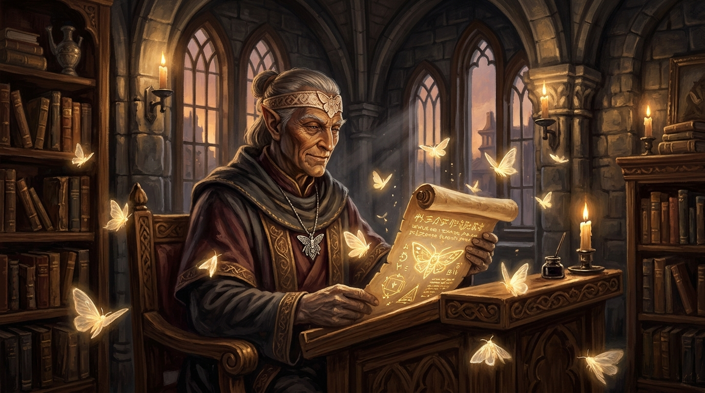
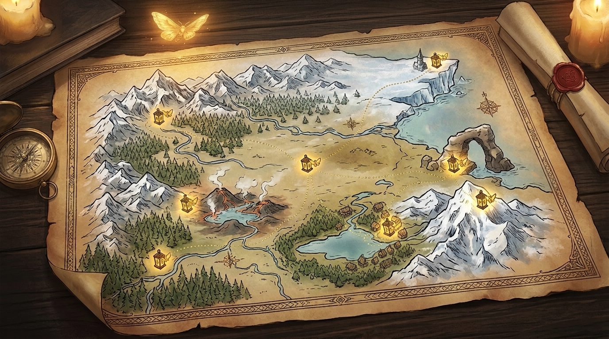
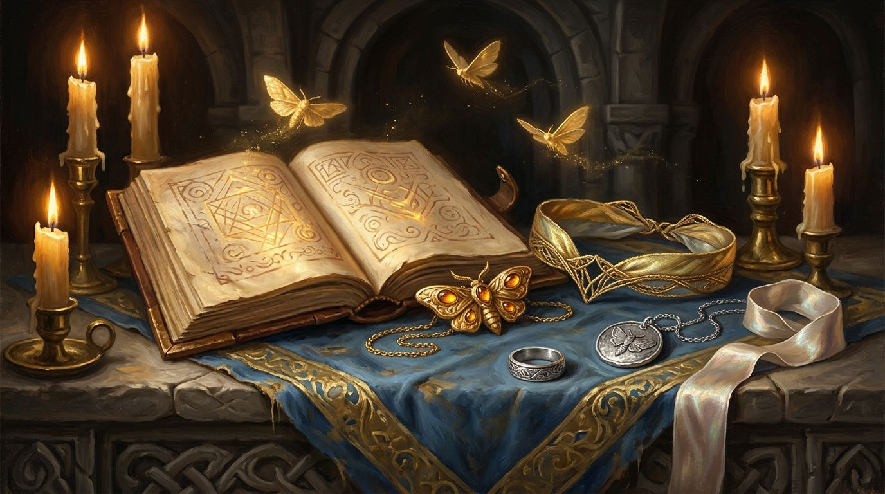
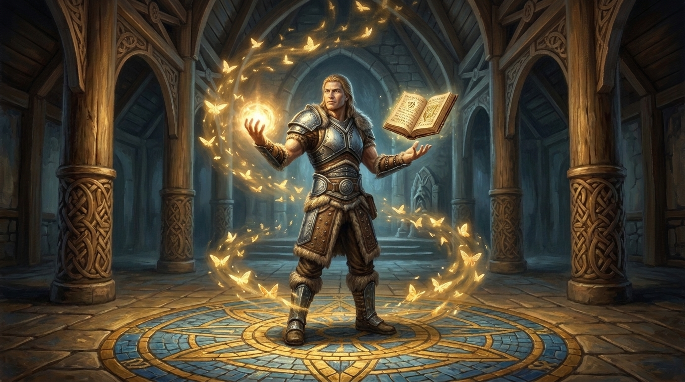
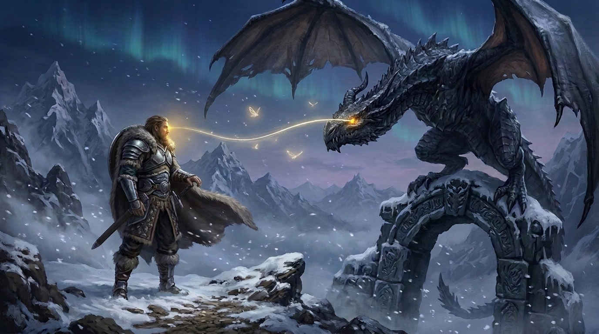

# The First Canticle of the Eye

## Origins, Lore, Artifacts & The Pilgrimage of TrueGaze™ Expanded Play

**Product:** TrueGaze™ v2.0.0 — Biological Gaze, Real-Time Persuasion & Expanded Play  
**Lore Companion & Gameplay Chronicle:** The Cult of the Ancestor Moth in Skyrim  
**Optional Light Plugin:** `TrueGaze_ExpandedPlay.esp` (ESL-flagged, `Skyrim.esm` only, zero Papyrus scripts, zero world-cell edits)

  
   
  <em>"Before an acolyte looks upon an Elder Scroll, they must learn to look upon a living soul without tremor." — Brother Cassian, Preface to The First Canticle of the Eye</em>

---

## 1. Origins: The Sight Beside the Voice

In the White-Gold Tower of Cyrodiil, the **Cult of the Ancestor Moth** long guarded a discipline older than the Third Empire and quieter than any battle cry. History remembers the Moth Priests for the tragic price of their highest office—the slow blindness that follows reading the *Kel*, the Elder Scrolls themselves. Yet few outside the monastery cloisters know what an acolyte is taught *before* they are ever permitted near a Scroll.

That first discipline is called **the First Canticle**, or simply **the TrueGaze**.

Where Skyrim's ancient Tongues and the Greybeards of High Hrothgar shape the world through the **Voice**—projecting intent outward upon the wind—the Moth Prelates discovered its quiet twin: **Sight**. Not the mere passing of light across an eye, nor a vulgar Illusion charm forced upon an unwilling mind, but the disciplined stillness of attention itself.

To the Prelates, every mortal carries a silent language in the micro-movements of their eyes:
- Where a merchant's gaze flickers when gold is unspoken;
- How a warrior's eyes drop half a heartbeat before a lunge or a shield feint;
- Why a wolf freezes when met without fear, and why even a **Dov**—an ancient Dragon—weighs a mortal who meets its amber gaze without flinching.

> *"The restless eye begs, threatens, or hides. The still eye listens until the world answers."*  
> — From the Marginalia of the Temple of the Ancestor Moth, Fourth Era

When an acolyte masters unhurried reading (**Ocular Contemplation**), steadies their own presence (**Moth's Stillness**), and learns to hold another soul's eyes without tremor, they awaken what the Scrolls cannot easily burn away: **a living dialogue between eyes**.

---

## 2. The Chronicle of Brother Cassian's Northern Pilgrimage

In the turbulent years after the Great War—when the White-Gold Concordat shook the Imperial City and Moth Priests scattered north to safeguard fragments of the monastery's lesser primers—a senior archivist named **Brother Cassian** crossed Pale Pass into Skyrim.

Cassian did not carry an Elder Scroll. He carried something far easier to lose and far more dangerous to leave in the wrong hands: **a single primer of the First Canticle and five consecrated Moth relics**, each crafted to anchor one facet of the Awakened Sight.

As civil war gathered across Skyrim's nine holds, Cassian feared that keeping all six treasures beneath a single roof would invite plunder by bandits, Thalmor agents, or careless collectors who would mistake a discipline of stillness for a parlor trick. Instead, he walked a long pilgrimage across the province, entrusting **one relic to each of Skyrim's quietest Sanctuaries**—places where mortals already knew how to pause, listen, heal, or reflect.

  
   
  <em>Brother Cassian's Seven Sanctuaries across Skyrim: from the hearth of Riverwood and the healing dome of Whiterun to the roots of Eldergleam, the shrines of Mara and the Divines, the quiet steps of High Hrothgar, and the stacked folios of the Arcanaeum.</em>

Before Cassian vanished along the northern coast past Winterhold, he left a short cipher in his primer: no thief could seize the TrueGaze by looting a single chest, and no warlord could command it by force. Only a traveler who **read with patience**, **wore a Vessel with restraint**, **shared Sight freely with a companion**, and **walked Skyrim's Sanctuaries in stillness** would see all four keys turn as one.

---

## 3. Why Each Artifact Rests Where It Does

When the optional ESL plugin **`TrueGaze_ExpandedPlay.esp`** is active, TrueGaze preserves **100% compatibility with every interior and city overhaul mod** (zero vanilla `CELL` edits) by revealing each relic cleanly before the player upon holding a brief moment of quiet stillness (`1.5 s`) inside its lore Sanctuary—once per save, owned by you (never flagged *Steal*). Players running the zero-ESP DLL-only build can complete the exact same pilgrimage using vanilla `Skyrim.esm` equivalents.

  
   
  <em>The six Relics of the First Canticle: The First Canticle of the Eye, Amulet of the Ancestor Moth, Moth-Silk Browband, Ring of Quiet Sight, Silver Moth Medallion, and Moth-Silk Ribbon.</em>

| Artifact | Role in the Awakening | Sanctuary Location | Why Brother Cassian Left It There | Vanilla DLL-Only Equivalent |
| :--- | :--- | :--- | :--- | :--- |
| **The First Canticle of the Eye** *(Book)* | **Key I — The Word** *(Study start-to-finish)* | **Sleeping Giant Inn** *(Riverwood)* & **The Arcanaeum** *(Winterhold)* | Cassian lodged first at Riverwood's hearth on his road north from Helgen, leaving his pocket primer where an observant traveler—not a grand lord—would find it first. A second archivist's copy was shelved in Winterhold's Arcanaeum beside Urag gro-Shub's Elder Scroll treatises. | Any canon Elder Scroll / Moth book (*Effects of the Elder Scrolls*, *Accounting of the Scrolls*, *Book of the Dragonborn*, *Ancestor Moth* lore) |
| **Amulet of the Ancestor Moth** *(Amulet)* | **Key II — The Vessel** *(Wear + Diegetic Toggle)* | **Temple of Kynareth** *(Whiterun)* | Kynareth (Kyne) is the goddess of breath, wind, and the calm eye of the storm. Cassian entrusted his golden Moth amulet to the temple where healers watch the breath of the wounded without flinching. | *Amulet of Kynareth*, *Amulet of Julianos*, *Amulet of Mara*, *Amulet of Akatosh*, or *Amulet of Dibella* |
| **Moth-Silk Browband** *(Circlet)* | **Key II — The Vessel** *(Wear + Diegetic Toggle)* | **Eldergleam Sanctuary** *(Eastmarch)* | Deep beneath the cavern roots where ancient Sap-light filters through moss, wild moths gather at dusk. Cassian hid this gold-threaded browband beneath the Eldergleam's boughs for pilgrims who seek living stillness far from city walls. | Any vanilla **Circlet** |
| **Ring of Quiet Sight** *(Ring)* | **Key III — Shared Sight** *(Give/Drop to Ally)* | **Temple of Mara** *(Riften)* | Mara governs devotion, fellowship, and the bond between two souls who truly see one another. Cassian consecrated the silver ring in Riften's shrine so it would be given away—not hoarded—awakening **Kindred Sight** in a companion. | Any vanilla Divine Amulet/Circlet traded to a follower |
| **Silver Moth Medallion** *(Amulet)* | **Key III — Shared Sight** *(Give/Drop to Ally)* | **Temple of the Divines** *(Solitude)* | Brought directly from Cyrodiil as a diplomatic token of the Imperial Cult, the hammered silver medallion rests beneath Solitude's pantheon dome, meant for a steadfast comrade who watches your flanks in the dark. | Any vanilla Divine Amulet/Circlet traded to a follower |
| **Moth-Silk Ribbon** *(Pocket Talisman)* | **Key III — Shared Sight** *(Give/Drop to Ally)* | **High Hrothgar** *(Throat of the World)* | Cassian climbed the Seven Thousand Steps to lay a humble silk token before the Greybeards—honoring the quiet kinship between Cyrodiil's **Sight** and Skyrim's **Voice**. Because it requires no jewelry slot, even a modest townsfolk ally can carry it in a pocket. | Any vanilla Divine Amulet/Circlet traded to a follower |
| **Sight of the First Canticle** *(Right-Hand Spell, `0` Magicka)* | **Ritual Focus, Checklist & Diegetic Toggle** | **Learned automatically** *(upon discovering a Sanctuary relic or lighting Key I)* | Not an object of metal or vellum, but a discipline of light: equipping it visibly suspends the open *First Canticle* above your left hand (1st & 3rd person) while your right hand channels golden-white Moth light. | Passive `4.5 s` Sanctuary stillness completion when playing DLL-only |

---

## 4. The Complete Path to Full TrueGaze Power (Quests, Keys & Stages)

TrueGaze Expanded Play does not interrupt your game with artificial quest markers or Papyrus scripts. Instead, its **Staged Lore Awakening (`WP-9`)** unfolds organically through **four order-independent Keys** and a **Final Sanctuary Ceremony**, advancing you cleanly from **Stage 0** to **Stage 4**.

### 4.1 The Four Keys (Complete in Any Order)

1. **Key I — The Word (Unhurried Study):**
   - Open *The First Canticle of the Eye* (or an Elder Scroll / Ancestor Moth lore book).
   - Read each spread without rushing (`>= 2.5 s`–`12.0 s` depending on word count). Watch for the gentle top-left study whisper and crystalline absorption chime on each spread.
   - Reaching `>= 80%` of the book's spreads lights **The Word** and begins your **Moth's Stillness** scholarship path.
2. **Key II — The Vessel (Attuned Focus):**
   - Equip a Vessel relic (*Amulet of the Ancestor Moth*, *Moth-Silk Browband*, or a vanilla Divine Amulet / Circlet).
   - Meet any adult NPC's eyes peacefully for **three quiet breaths (`>= 3.0 s`)** to light **The Vessel**.
3. **Key III — Shared Sight (Kindred Gaze):**
   - Share a **Ring of Quiet Sight**, **Silver Moth Medallion**, or **Moth-Silk Ribbon** with a companion—either by trading it to a follower **or by dropping the relic at the feet of any friendly adult NPC** (no follower required!) and holding their eyes for `1.5 s`.
   - The ally accepts the relic, lighting **Shared Sight** and awakening **Kindred Sight** (giving them stronger mutual warmth and, from Stage 3 onward, live flank warnings during combat).
4. **Key IV — The Pilgrimage (Stillness Across Skyrim):**
   - Visit at least **two of Skyrim's Seven Sanctuaries** (*Sleeping Giant Inn*, *Temple of Kynareth*, *Eldergleam Sanctuary*, *Temple of Mara*, *Temple of the Divines*, *High Hrothgar*, or *The Arcanaeum*) and hold calm, unarmed stillness for `3.0 s` in each.

> [!TIP]
> **Inspect Your Progress Anytime:** Equip **Sight of the First Canticle** in your right hand (under *Magic → Illusion*, `0` Magicka) and cast it anywhere before Stage 4. A classic Skyrim parchment checklist opens showing `[X]` for every completed Key and `[ ]` for every remaining requirement—plus your Final Sanctuary Ceremony readiness.

### 4.2 The Five Awakening Stages (`Stage 0 → Stage 4`)

| Stage | Name | Requirement | Presence Cap | Scholarship Cap | Unlocked Gameplay Powers |
| :---: | :--- | :--- | :---: | :---: | :--- |
| **0** | **Dormant** | `0` Keys lit *(classic mode)* | `20` | Novice | Pure Layer 1 biological gaze kinematics only (`TrueGaze` classic parity). |
| **1** | **First Glimmer** | **Any 1 Key** lit | `39` | Novice | 1st-person **HCEP-02 Gaze Reticle**, **512-NPC GazeLedger** memory, **Ocular Contemplation** book study & *Moth's Stillness*, basic Demeanors (`Courteous`, `Warm`, `Deferential`), **Prey *Gentle Sight***. |
| **2** | **Steady Sight** | **Any 2 Keys** lit | `59` | Acolyte | **Real-Time Oblivion Persuasion Probes** (`0.35 s–1.99 s` facial tells), **Eye-Contact Conversation Start**, `"Guard's Glance"` witness tells, `Stern` & `Evasive` Demeanors, **Combat Sight** (*Weapon Wind-Up*, *Spell Charge*, *Shield Rhythm*, *Footwork Lunge*), **Predator *Kyne's Stillness*** & **Dragon *Dov's Weight***. |
| **3** | **Living Glyph** | **3 or 4 Keys** lit *(pre-ceremony)* | `79` | Prelate | Full **Real-Time Multi-Transactions** (pre-barter Speechcraft rapport, `"Knowing Look"` *Sly Bribe*, *Stand-Down Grace*), **3-Round Tavern Staring Contests**, and **Kindred Sight** companion combat flank warnings. |
| **4** | **Canticle Awakened** | **All 4 Keys + Final Sanctuary Ceremony** | **`100`** | **Canticle** | Full mastery: **`+5.0` Max Presence**, `Predatory` Demeanor, full **4-Axis Signature Resonance** titles, maximum *Moth's Stillness* buffs, and **Diegetic Veil / Unveil Toggle** (cast *Sight of the First Canticle* or equip/unequip your Moth Vessel anytime to toggle Expanded Play without touching the console). |

### 4.3 The Final Sanctuary Ceremony

  
   
  <em>The Final Turning: standing inside a Sanctuary with all four Keys aligned, the open First Canticle hovering above the left hand and golden Ancestor Moth light gathered in the right.</em>

Once all four Keys are lit:
1. Step inside **any of Skyrim's Seven Sanctuaries** (such as the mosaic floor of Whiterun's Temple of Kynareth).
2. Wear your **Vessel** (*Amulet of the Ancestor Moth*, *Moth-Silk Browband*, or vanilla Divine Amulet/Circlet) and carry your studied **Canticle book** in your inventory.
3. Equip **Sight of the First Canticle** in your right hand—watch the open *First Canticle* tome rise cleanly above your left hand in both 1st and 3rd person—and **hold & release** to complete the ceremony. *(DLL-only players without the ESL simply hold `4.5 s` of unarmed stillness inside the Sanctuary.)*

The four keys lock into resonance, awarding **Stage 4: Canticle Awakened**.

---

## 5. The Living Sight in Action: Speech, Steel & Wild Beasts

TrueGaze's lore does not stop at tavern conversation. Brother Cassian taught that the eye reads *all* living intent—whether across a merchant's counter, across crossed blades, or beneath the shadow of a dragon's wings:

- **The Silent Wheel (Real-Time Oblivion Persuasion & Barter):**  
  Before committing a full `2.0 s` gaze, a brief `0.35 s–1.99 s` glance lets you read an NPC's immediate facial tell (*Love*, *Like*, *Dislike*, or *Hate*) across six unspoken vectors (`Admire`, `Joke`, `Boast`, `Coerce`, `Plea`, `SlyBribe`). A quick dip from an NPC's **belt/hand up to their eyes** signals a covert `"Knowing Look"` bribe—unless a patrolling guard catches sight (`"Guard's Glance"`). Drawing real steel invokes *Coerce*, while sheathing your blade while holding their eyes earns **Stand-Down Grace** (*"Blood or Coin"*).
- **Smart Brandishing (Light Is Not a Blade):**  
  TrueGaze distinguishes lethal arms (drawn swords, axes, bows, Destruction spells) from peaceful tools (torches, *Candlelight*, *Healing*, and the open *First Canticle* itself). Carrying light through a tavern or temple will never provoke guards or frighten townsfolk.
- **Combat Sight (`Stage 2+`):**  
  When blades are drawn, your trained eye shifts effortlessly from social rapport to tactical reading—granting brief, reversible `3.5 s` combat reflexes when you read an enemy's **Weapon Wind-Up** (`+Block` & `+Armor`), **Spell Charge** (`+Magic Resist`), **Shield Rhythm** (`+Weapon Offense`), or **Footwork Lunge** (`+Armor` & `+Stamina Regen`).
- **Creature Sight (`Stage 1+` & `Stage 2+`):**  
  - *Gentle Sight (Prey, Stage 1+):* Meeting an elk, deer, rabbit, or fox unarmed with soft demeanor calms the wild (`+Sneak` grace).
  - *Kyne's Stillness (Predators, Stage 2+):* Holding a wolf, bear, or sabre cat's gaze unarmed without flinching steels your footing (`+0.15 Presence` milestone + armor/stamina brace).
  - *Dov's Weight (Dragons, Stage 2+):* Meeting a Dragon's eyes for two steady seconds without turning away earns a permanent `+0.50 Presence` milestone and a `5.0 s` Magic Ward brace against the Thu'um.

  
   
  <em>Dov's Weight: where the Voice of the Dragon meets the unbroken Stillness of the Eye.</em>

---

## 6. Playing Your Way: Ritual Mode vs. Sandbox Mode

- **Ritual Mode (`sUnlockMode=Ritual`, default):** Experience the complete Staged Lore Awakening across Skyrim's Seven Sanctuaries (`Stage 0 → Stage 4`), discovering relics organically or via vanilla Skyrim equivalents.
- **Sandbox Mode (`sUnlockMode=Sandbox` or console `player.stgexpanded`):** Unlocks **Stage 4: Canticle Awakened** immediately for instant full-power exploration, roleplay builds, or testing.
- **Developer Relic Testing (`stgitems`):** Drops all 6 Canticle artifacts (owned by the player) cleanly in an arc before you and teaches *Sight of the First Canticle* so you can inspect every stage and interaction in minutes.

---

*See also: [Expanded Play Guide](EXPANDED_PLAY_GUIDE.md) · [User Guide](USER_GUIDE.md) · [Real-Time Persuasion GDD](REALTIME_PERSUASION_AND_TRANSACTIONS_GDD.md) · [Console Commands Card](CONSOLE_COMMANDS_CARD.md)*
