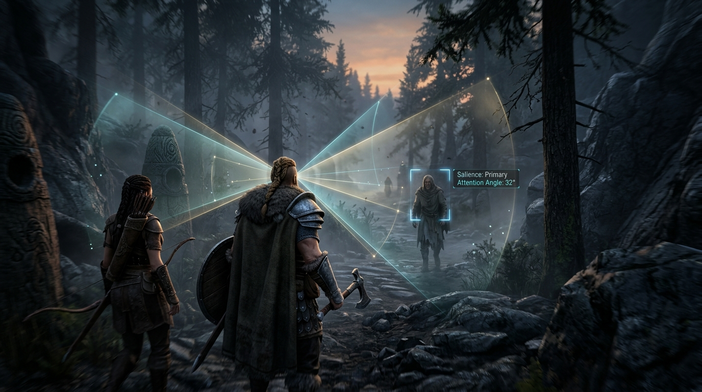
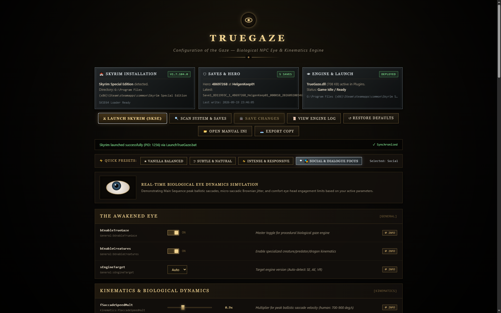
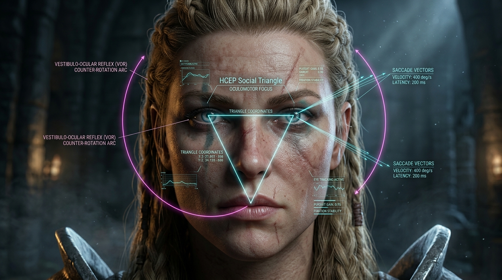
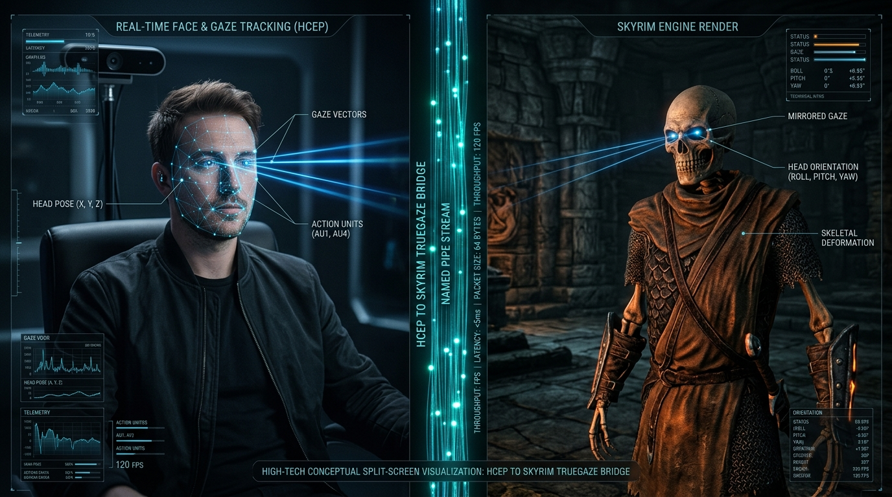
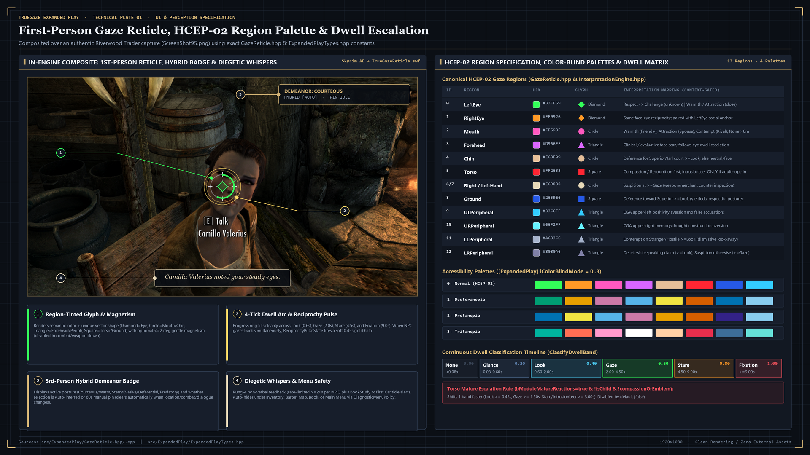
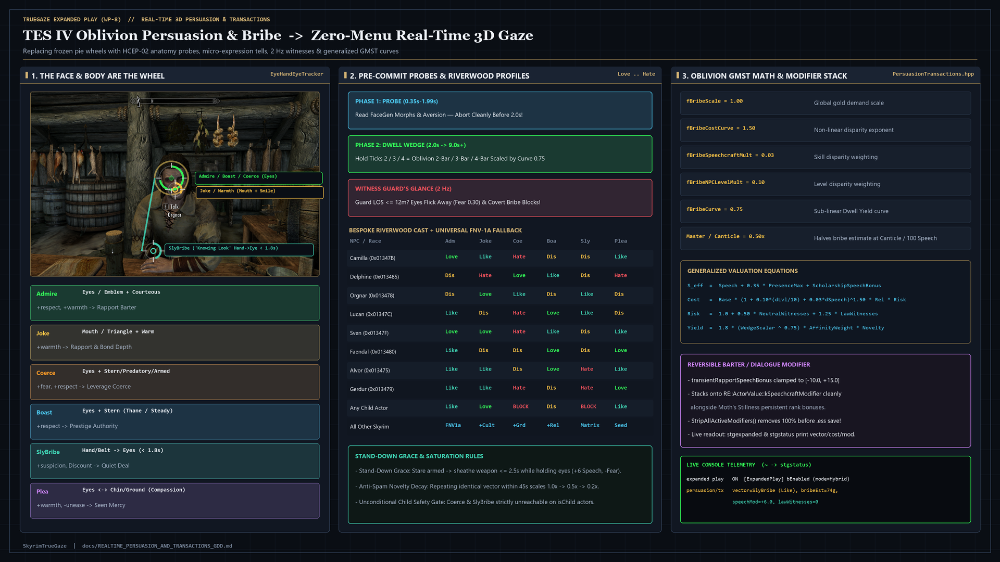
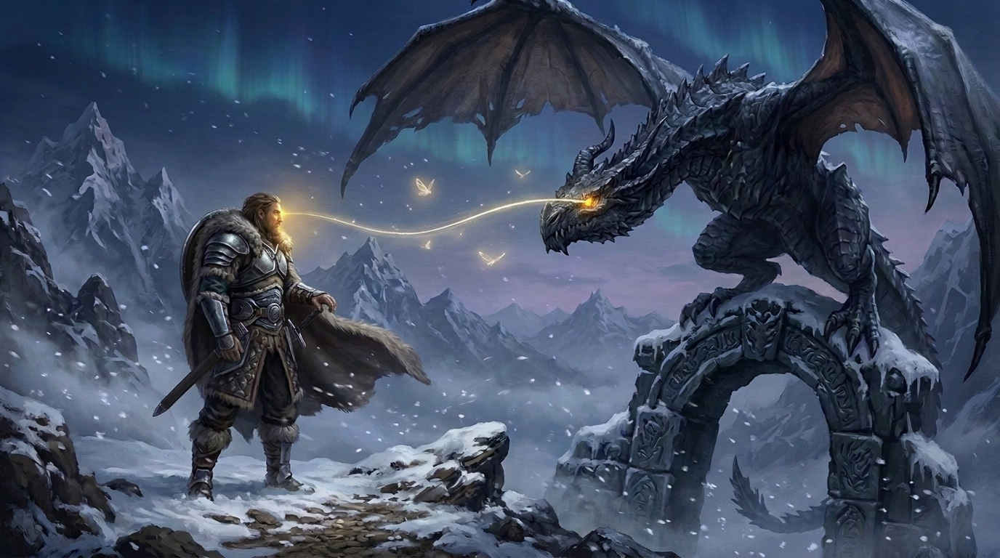

# TrueGaze User Guide

**Product:** TrueGaze™ v2.0.0 — Biological NPC Gaze, Biomechanical Kinematics Engine & Expanded Play  
**Audience:** Skyrim SE/AE/VR players, mod testers, and development partners  
**Status date:** November 22, 2026

**Current release line:** 2.0.0 ([GitHub — kirklasalle/SkyrimTrueGaze](https://github.com/kirklasalle/SkyrimTrueGaze))

> TrueGaze™ v2.0.0 is a two-layer SKSE runtime engine across Skyrim SE (`1.5.97`), AE (`1.6.318–1.7.104.0+`), and Skyrim VR (`1.4.15` / "Mad God VR"). **Layer 1** drives biological oculomotor kinematics (VOR decoupling, Main Sequence ballistic saccades, Brownian micro-drift, Argyle & Cook social triangle cycling, FaceGen pupil anchors, 3rd-person player conversational gaze, and optional developer visual diagnostics). **Layer 2 (Expanded Play, opt-in)** transforms eye contact, reading stillness, and held posture into rich diegetic RPG gameplay—featuring Real-Time Oblivion-style Persuasion & Multi-Transactions, a 4-Key Staged Ancestor Moth Awakening pilgrimage across Skyrim's Seven Sanctuaries, optional ESL relics & hand-cast open-book spell (`TrueGaze_ExpandedPlay.esp`), Smart Brandishing, Combat Sight, and Creature Sight.

> **New Lore Chronicle:** Read **[The First Canticle of the Eye — Origins, Lore & Pilgrimage Story](TRUEGAZE_LORE_AND_STORY.md)** for the full story behind Brother Cassian's relics and Skyrim's Seven Sanctuaries.

## 1. What TrueGaze Does

### Unreleased receiving diagnostics

Cards are **development-only diagnostics**, enabled/disabled through the console,
not a normal gameplay HUD. Use `stgoff` for ordinary play and enable the desired
diagnostic channels for testing. Their saved settings are never changed by menus.

Each panel shows **other actors looking at its owner**, not its owner's outgoing
gaze. `stgpanel` toggles the front panel B; `stgpanela` toggles above-head panel A;
`stghud` toggles the first-person player HUD; `stgintext` toggles detailed telemetry
in addition to the human descriptions.
`stginanatomy` and `stginpanels` independently toggle approximate anatomical and
physical-quad measurements. `stgstatus` reports the current switches.

Mapped anatomy uses `o`; actual quad hits use `+`; identifiers distinguish
observers. Both are diagnostic measurements with **unverified visibility**.
Panels/HUD identify their owner by name (the player is "You") and show a distinct
observer count or "No incoming gaze matches detected". Descriptions distinguish
"Your view" from an NPC's gaze, estimated anatomical areas from physical panel
crossings, and always warn that visibility has not been checked. Duplicate names
include IDs so identically named guards or animals remain distinguishable.
The observer count is not the measurement count: one observer can make several
matches. `stgintext` retains raw IDs, coordinates, measurement type and quality.
Receiving information now uses one compact, dark-backed card per actor, with
colored observer/region rows. Cards avoid each other and reserved gameplay areas;
hit markers remain at their original positions. A notice explicitly counts cards
that cannot fit. Enable `stgintext` to open the complete live inspection panel.
`stginnext` and `stginprev` move through text pages, then target/observer entries;
they wrap at the ends. Long/offscreen/overflow observations are available there.
These commands use the console; the overlay does not capture movement or clicks.
`stgstatus` reports card overflow and last-256 active-frame median/p95/window-peak
CPU timings alongside session-wide peaks. This does not measure total game FPS.
All diagnostic cards, rays, panels and lights temporarily disappear during
radial/skills/inventory/magic/map and related full-screen menus. After closing
the final menu, only your enabled channels return, with fresh frame data.
The console and dialogue remain usable; menu changes do not toggle diagnostics on.
Kirk's successive tavern screenshots confirm readable cards and a populated
inspector; this is presentation evidence, not anatomical accuracy certification.
Close-panel placement, nested menus and broader lifecycle/performance tests
remain acceptance gates. See [the contract](INCOMING_GAZE_PANEL_DESIGN.md).

TrueGaze is an SKSE plugin that drives live actor gaze kinematics from Skyrim's actor update path. It combines target salience, saccadic movement, eye/head coordination, micro-saccadic drift, social attention, and optional HCEP telemetry.

The current runtime can:

- Track eligible living actors across SE, AE, and VR.
- Resolve a target from dialogue, combat, proximity, crosshair attention, or ambient interest.
- Apply hierarchical gaze motion through the available skeleton nodes.
- Use configurable saccade, VOR, comfort, jitter, social, and LOD parameters.
- Provide Option 1 (Superman laser eyes) and Option 2 (HCEP floating ocular diagram panel) developer visual overlays.
- Receive optional HCEP telemetry through a Windows named pipe.
- Report actor, target, skeleton, visual, and performance diagnostics through the Skyrim log and `stgstatus`.

The optional Visuals subsystem is an opt-in developer diagnostic. It is not required for the gaze kinematics engine itself.

<p align="center">
  
  <br>
  <em>Figure 1: In-engine target salience and perception field-of-view cones tracking environmental focal points and conversational targets in third-person view.</em>
</p>

## 2. Requirements

### Skyrim and runtime

- **Skyrim Special Edition (SE):** 1.5.97
- **Skyrim Anniversary Edition (AE):** 1.6.318 through 1.6.1170+ (including 1.7.104.0+)
- **Skyrim VR:** 1.4.15 (including Wabbajack modlists like "Mad God VR")
- Matching SKSE runtime (`skse64_loader.exe` / `sksevr_loader.exe`)
- Matching Address Library for SKSE Plugins (`.bin` for SE/AE, `.csv` for VR)
- Windows x64

### Plugin prerequisites

- SKSE64 / SKSEVR.
- Address Library for SKSE Plugins.
- Microsoft Visual C++ 2015-2022 x64 runtime.
- A working Skyrim Data directory.

TrueGaze does not require SkyUI, MCM Helper, an ESP/ESL plugin, Papyrus scripts, or an in-game MCM menu. Configuration is intentionally vanilla-UI and INI-based.

## 3. Installation Layout

A normal installation (via MO2, Vortex, or manual) places files at:

```text
Data\SKSE\Plugins\TrueGaze.dll
Data\SKSE\Plugins\TrueGaze.ini
Data\Interface\TrueGazeIncoming.swf
Data\Interface\TrueGazeReticle.swf
Data\meshes\TrueGaze\GazeBeam.nif
Data\meshes\TrueGaze\GazeRegionPanel.nif
Data\textures\TrueGaze\GazeRegionPanel.dds
Data\meshes\actors\character\animations\OpenAnimationReplacer\TrueGaze\config.json
Data\TrueGaze_ExpandedPlay.esp          (OPTIONAL ESL-flagged light plugin: 0 slots, Skyrim.esm only, zero Papyrus)
```

The release package also contains the standalone configurator suite and guide:

```text
TrueGazeConfig.html
Launch-TrueGazeConfig.cmd
TrueGaze_Configurator_Guide.txt
tools\TrueGazeConfig\
```

Do not place the DLL beside `SkyrimSE.exe`. SKSE plugins belong under `Data\SKSE\Plugins`.

## 4. First Launch

1. Install SKSE and the matching Address Library.
2. Install `TrueGaze.dll` and `TrueGaze.ini`.
3. Start Skyrim through the SKSE loader.
4. Load an existing save or start a new game. A new game is not required.
5. Load into a cell containing a living humanoid NPC.
6. Switch to third-person view when testing player-attached visuals.
7. Wait several seconds for actor updates.
8. Open the vanilla console with `~`.
9. Run `stgstatus` if console commands are enabled.

A save reload or cell transition can rebuild actor 3D nodes, but neither is normally required. A new game does not solve a missing asset, a bad deployment, or an incorrect resource path.

## 5. Configurator Workflow

Launch `Launch-TrueGazeConfig.cmd` or open `TrueGazeConfig.html` through the repository's launcher.

The configurator can:

- Detect the Skyrim installation.
- Inspect saves and the current hero.
- Read and edit `TrueGaze.ini`.
- Apply quick presets.
- Show the selected preset with a silver active state.
- Display the current deployment and engine status.
- Save changes back to the live INI through the local automation bridge.

The top status cards use a classic Skyrim silver treatment. This is visual configurator styling only; it does not alter in-game rendering.

The eye-dynamics preview displays **both eyes**, labeled by the subject's
anatomical side (right eye on your left). Each turns toward one shared target at
a fixed virtual depth, so the eyes converge inward when the pointer is between
them. A held pointer gives steady fixation; small shared jitter runs only in
autonomous mode. Head motion and blinking are shared. Saccade speed, head tracking, micro-jitter and comfort
angle follow the current tuning controls. This is an illustrative canvas
simulation with geometric vergence, not live game telemetry or clinically
calibrated eye tracking. Convergence depends on target distance; 2D mouse
position alone does not measure that distance.

<p align="center">
  
  <br>
  <em>Figure 2: Live screenshot of the standalone TrueGaze Configurator & Launcher—featuring automated Skyrim AE / SE installation detection, save game inspector, hero profile tracking, silver active presets, and real-time biological eye kinematics preview.</em>
</p>

### Presets

The built-in presets are tuning starting points, not separate engines:

- **Vanilla Balanced:** baseline saccade, jitter, head speed, social triangle, and crosshair gaze.
- **Subtle and Natural:** lower movement amplitude and slower head response.
- **Intense and Responsive:** faster saccades and head response with reduced aversion.
- **Social and Dialogue Focus:** dialogue-friendly tuning with a wider crosshair tolerance.

After selecting a preset, save the INI and restart Skyrim or use the supported reload path. The selected-preset indicator only identifies the last preset applied in the configurator; it does not prove that the game has loaded unsaved changes.

## 6. Important INI Settings

### General

```ini
[General]
bEnableTrueGaze=true
bEnableCreatures=true
sEngineTarget=Auto
```

`bEnableTrueGaze` is the master kinematics engine switch. `bEnableCreatures` determines whether non-humanoid actors may enter the biological gaze path.

### Kinematics

```ini
[Kinematics]
fSaccadeSpeedMult=1.5
fVelocitySaturation=18.0
fMicroJitterAmp=0.28
fMicroJitterIntervalMin=0.20
fMicroJitterIntervalMax=0.45
fHeadTrackingSpeed=5.2
fMaxComfortEyeAngle=35.0
```

Higher saccade speed produces faster ballistic eye transitions. Higher jitter is more visibly active but can become distracting. The comfort angle controls when the head/neck chain carries more of the turn.

### Social and crosshair attention

```ini
[Social]
bEnableGazeAversion=true
bEnableSocialTriangle=true
fTriangleFixationDuration=0.35
fMutualGazeThreshold=2.0

[Crosshair]
bEnableCrosshairGaze=true
fCrosshairToleranceDeg=4.0
fCrosshairMaxRangeMeters=25.0
fCrosshairPointBlankMeters=1.5
```

Crosshair gaze is the player-attention signal used for mutual-gaze behavior. It does not mean that every NPC is always selected as a target.

<p align="center">
  
  <br>
  <em>Figure 3: Biomechanical diagnostic overlay illustrating the facial Social Triangle scanning pattern and VOR counter-rotation arc.</em>
</p>

### HCEP bridge

The HCEP Desktop bridge client is now part of the HCEP application. See [`HCEP_TRUEGAZE_BRIDGE_CLIENT.md`](HCEP_TRUEGAZE_BRIDGE_CLIENT.md) for its build, publish, connection, and troubleshooting procedure.

```ini
[Bridge]
bConnectHcepBridge=true
sPipeName=\\.\pipe\TrueGazeBridge
fAutoReconnectIntervalSec=3.0
```

The bridge is optional. When unavailable, TrueGaze uses autonomous Skyrim-side attention. When enabled, HCEP telemetry is received locally through a named pipe. Biometric data should only be collected with informed consent from everyone in front of the sensor.

<p align="center">
  
  <br>
  <em>Figure 4: Real-world face/eye tracking streamed through the local named pipe into Skyrim's skeletal transform pipeline.</em>
</p>

### LOD

```ini
[LOD]
fTier1DistanceMeters=5.0
fTier2DistanceMeters=15.0
```

Tier 1 is the full close-range biological kinematics. Tier 2 reduces fine detail at distance. Actors beyond the configured range may be culled from the expensive gaze path.

### Developer visuals (Option 1 & Option 2)

TrueGaze includes two in-engine developer visual diagnostic systems (opt-in, disabled by default for organic gameplay):

```ini
[Visuals]
; Developer diagnostics - disabled by default for pure organic gameplay
; Toggle in-game via console: 'stgvisuals' or 'stgv'
bEnableInGameVisuals=false
bGazeRaysEnabled=true
iRayRenderMode=0
fGazeRayLengthMeters=2.5
fGazeRayOpacity=0.85
bGazeRaysOnPlayer=true
bGazeRaysOnNPCs=true
bGazeRaysOnCreatures=true
bGazeRaysAttachHead=true
bGazeRaysTerminus=true
fPupilForwardOffsetCm=10.8
fPupilUpOffsetCm=5.4
fPupilGlowIntensity=0.35

; Option 2: HCEP Floating Ocular Diagram Panel
bShowHcepPanel=true
bHcepPanelAllActors=true
fHcepPanelScale=27.5
fHcepPanelForwardOffsetCm=10.0
fArrowCrossSectionMm=24.0
```

Visual subsystems:

- **Option 1: Directional Gaze Rays / Marker Arrows**:
  - Gaze origins prefer the loaded FaceGen eye shader's left/right globe centres. Eye-node or configurable socket fallbacks are used only when those centres cannot be resolved. Shader centres are globe centres, not measured pupil-surface vertices.
  - Dynamically scaled in length based on actual target distance or `fGazeRayLengthMeters`.
  - Oriented dynamically to track computed saccadic/fixation eye line of sight (not head rotation).
- **Option 2: HCEP Floating Diagram Panel**:
  - A 3D planar quad rendering the chroma-keyed HCEP-02 ocular diagram (`GazeRegionPanel.nif` / `GazeRegionPanel.dds`).
  - Front panel B follows the actor's head basis, with a default 10 cm clearance ahead of resolved eyes (creatures: cranial anchor); it is not camera-facing.
  - Shows incoming observations from others. Approximate anatomy (`o`) and physical panel crossings (`+`) remain separate; this is not the owner's outgoing cognitive-region display.
  - Text cards remain collision-aware and independent of the physical panel position.
- **Visual Modes (`iRayRenderMode`)**:
  - `0`: Geometry plus point light emitters (`TrueGaze_PupilLight`, `TrueGaze_TerminusLight`).
  - `1`: Light emitters only (subtle gold ambient eye/terminus glow without geometry).
  - `2`: Geometry only (pure 3D mesh rays and panel quad).

Use `stgoff` for normal gameplay. `stgvisuals` and `stgv` have different
multi-switch behavior; see the full library below.

### Expanded Play gameplay layer (Optional — Default OFF)

TrueGaze ships `[ExpandedPlay] bEnabled=false` by default so classic kinematics users experience zero gameplay HUD or stat changes until opting in. See [`docs/EXPANDED_PLAY_GUIDE.md`](EXPANDED_PLAY_GUIDE.md) for illustrated diagrams and full rules.

```ini
[ExpandedPlay]
bEnabled=false
sDemeanorMode=Hybrid
iActiveDemeanor=0
bModuleSocialReactions=true
bModuleRelationshipMemory=true
bModuleBookStudy=true
bModuleMatureReactions=false
bModulePresenceProgression=true
bEnableReticle=true
fReticleOpacity=0.22
fReticleMagnetismStrength=0.35
iColorBlindMode=0
bImmersiveHideReticle=false
bEnableEyeContactInitiate=true
bEnableImpressionWhispers=true
fThirdPersonEfficacy=0.80
bEmitAiNpcBridgeEvents=true
```

- **How to enable/disable at runtime:** Open the console (`~`) and type **`stgexpanded`** (with nothing targeted) to toggle `bEnabled`, persist `TrueGaze.ini`, and revert or sync *Moth's Stillness* RPG buffs immediately. Or use **`TrueGazeConfig.html`** (`Launch-TrueGazeConfig.cmd`).
- **Modular toggles:** Any individual pillar (Social Reactions, 512-LRU Relationship Memory, `BookStudyTracker`, Presence Progression, or adult-only Torso rules) can be turned ON or OFF independently in `[ExpandedPlay]`. Children can **never** trigger `Attraction` or `IntrusionLeer`.

### Console commands

```ini
[Console]
bEnableConsoleCommands=true
```

Console commands are enabled when `bEnableConsoleCommands = true` in `TrueGaze.ini`. To avoid name collisions with vanilla Skyrim commands or other mods, TrueGaze registers commands with the `stg` prefix:

## 7. Console Commands

The current registered in-game console commands are:

| Command | Purpose |
| --- | --- |
| `stg` | Toggle the master gaze kinematics engine on/off. |
| `stghelp` | Print all 29 commands and descriptions. |
| `stgvisuals` | Toggle visual master; enabling arms rays and B, retaining other channel flags. |
| `stgv` | Toggle master + rays + B together; all ON -> OFF, otherwise all ON. Not rays-only. |
| `stgpanel` | Toggle receiving front B; enabling also arms visual master. |
| `stgpanela` | Toggle receiving above-head A; enabling also arms visual master. |
| `stghud` | Toggle first-person incoming HUD; enabling also arms visual master. |
| `stgintext` | Toggle non-modal full incoming inspector; enabling also arms visual master. |
| `stginnext` | Next inspector text page, then observation; wraps. |
| `stginprev` | Previous inspector text page, then observation; wraps. |
| `stginanatomy` | Toggle approximate anatomy measurements; enabling arms visual master. |
| `stginpanels` | Toggle physical receiving-quad measurements; enabling arms visual master. |
| `stgon` | Enable master, rays, A/B, HUD, inspector and measurement channels; retain actor filters. |
| `stgoff` | Disable master, rays, A/B, HUD and inspector; retain measurement preferences and kinematics. |
| `stgmode` | Cycle render mode: `0` (Both) / `1` (Light only) / `2` (Geometry only). |
| `stgradius` | Toggle the gaze terminus landing glow. |
| `stgverbose` | Dynamically switch logging threshold between `Debug` and `Info` live without restarting. |
| `stgstatus` | Print effective runtime state, tracked actors, ray deflections, and telemetry counters. |
| `stgpreset` | Cycle vanilla/subtle/intense/social/developer (first call vanilla); write INI and reload. |
| `stgreload` | Reload effective INI and refresh tuning; command registration still requires restart. |
| `stgtrace` | Start trace, or report/flush an active trace; does not stop it. |
| `stgtraceoff` | Stop trace and flush pending events. |
| `stgtraceflush` | Flush active trace without stopping. |
| `stgcal` | Step 11 angular deflections for selected actor or all tracked actors. |
| `stgcalsweep` | Sweep 11 angular deflections, holding each for 2 seconds. |
| `stgcaloff` | Stop calibration and restore autonomous gaze. |
| `stgcalaxes` | Print head-axis convention and selected actor's 3D availability; not accuracy proof. |
| `stgexpanded` | Toggle Expanded Play (`[ExpandedPlay] bEnabled`), print status, unlock Stage 4 (`player.stgexpanded`), or start/abort a Staring Contest when an NPC ref is selected. |
| `stgdemeanor` | Cycle active third-person Expanded Play Demeanor (`Courteous`..`Predatory`) and pin in Hybrid mode. |
| `stgitems` | Drop all TrueGaze Expanded Play relics & Canticle book in front of the player (plus Lesser Power if optional ESL is loaded) for progression testing. |

All commands take no arguments. Settings toggles attempt to persist to the live
INI. Paging, traces and calibration are session actions; calibration step/sweep
requires `bEnableCalibrationCommands=true`. Select an actor before starting a
trace to filter it, or deselect to trace all. Presets replace only their listed
keys; the developer preset uses player-only panels. Menus never rewrite settings.
For a printable reference and safe sequence, use the
[Console Commands Card](CONSOLE_COMMANDS_CARD.md).

The webpage schema, offline defaults and compiled fallback now match all **126 INI/web keys** in the shipped INI (`[ExpandedPlay]` inclusive). It includes trace/calibration, arrow-width, and Expanded Play controls and persists new keys when editing older files. Missing keys retain compiled defaults until explicitly
saved. Web saves do not automatically refresh the running plugin: use
`stgreload` for tuning, restart for command registration/bridge startup changes,
and stop/start a trace for changed trace filters/limits. Do not edit the same
configuration simultaneously through stale web and console sessions.

### Reading `stgstatus`

The most important fields are:

- `tracked actors`: actors with runtime gaze state.
- `tick calls`: actor update hook calls received by TrueGaze.
- `eligible ticks`: calls that passed actor eligibility checks.
- `LOD culled`: eligible calls stopped by distance LOD.
- `target resolves`: target selector executions.
- `visual emitters`: actors and attached light count.
- `visual updates`: visual subsystem calls.
- `anchors failed`: inability to find an attachment anchor.
- `light creates failed`: failed `NiPointLight` allocation.
- `beam geometry`: visible geometry attachment count and load attempts.

A healthy diagnostic example is:

```text
tracked actors   1
target resolves  119 (none 0)
visual emitters  1 actors, 2 lights
visual updates   119, anchors failed 0, light creates failed 0
beam geometry    0 attached / 119 attempts
```

The example proves execution and lights, but not a visible beam. For a visible geometry test, `beam geometry` must report an attached count greater than zero and the log must contain a successful attachment message.

## 8. Log Locations

At startup, the log now includes a runtime identity block containing the plugin build timestamp, detected Skyrim runtime, and effective INI path. Include this block in support reports.

TrueGaze log:

```text
Documents\My Games\Skyrim Special Edition\SKSE\TrueGaze.log
```

Companion logs:

```text
Documents\My Games\Skyrim Special Edition\SKSE\skse64.log
Documents\My Games\Skyrim Special Edition\SKSE\skse64_loader.log
Documents\My Games\Skyrim Special Edition\SKSE\MCMHelper.log
```

The MCMHelper log may contain unrelated warnings. Those warnings do not automatically indicate a TrueGaze failure.

## 9. Troubleshooting

### The plugin does not load

Check:

1. The DLL is under `Data\SKSE\Plugins`.
2. SKSE matches the Skyrim runtime.
3. Address Library matches the runtime.
4. The VC++ runtime is installed.
5. `skse64.log` contains `plugin TrueGaze.dll ... loaded correctly`.
6. The DLL hash matches the intended build.

### `stgstatus` is not recognized

Check `bEnableConsoleCommands=true` in the live deployed INI, then fully restart Skyrim. The command table is modified during plugin initialization; changing the INI while the game is open does not retroactively register commands.

### Actors are tracked but no visible effect appears

Read the visual counters:

- `2 lights` and `beam geometry 0 attached`: the light path is active, but no visible beam mesh was attached.
- `visual updates 0`: the gaze tick has not reached the visual subsystem.
- `anchors failed > 0`: the actor 3D or attachment anchor is unavailable.
- `light creates failed > 0`: scene-graph light allocation failed.

Do not start a new game to solve an asset lookup failure. Existing saves are supported.

### No target is reported

Check whether actor ticks and target resolutions are increasing. A zero target count can mean no active tick, eligibility rejection, LOD culling, or an actual selector result. The counters distinguish these cases.

### The configuration appears ignored

Confirm the path printed in `TrueGaze.log` after `Configuration loaded`. Deployment intentionally preserves the existing live INI unless explicitly forced to replace it.

### The game crashes

Stop testing and collect:

- `TrueGaze.log`
- `skse64.log`
- `skse64_loader.log`
- the exact DLL hash
- the exact save/cell and camera mode
- the last command entered

Do not continue changing multiple INI values before preserving the evidence.

## 10. Safe Test Procedure

For a repeatable test:

1. Exit Skyrim completely.
2. Deploy and verify the intended DLL.
3. Confirm the live INI values.
4. Launch through SKSE.
5. Load an existing save.
6. Enter third person.
7. Stand near a living humanoid NPC.
8. Wait 10 seconds.
9. Run `stgstatus`.
10. Exit Skyrim normally.
11. Save the complete logs before the next change.

## 11. Current Limitations

- Vanilla humanoid rigs commonly expose no separate eye bones; TrueGaze reads the loaded FaceGen eye shader centres instead. If a heavily modified custom race cannot be resolved, the skeleton probe reports `GeometricHeadSocket` and logs a warning so you can tune fallback offsets in `TrueGaze.ini`.
- All 7 OAR conditions (`TrueGaze_IsMode`, `TrueGaze_IsMutualGaze`, `TrueGaze_GetGazeRegion`, `TrueGaze_GetInterpretation`, `TrueGaze_GetDemeanor`, `TrueGaze_GetPresenceTier`, `TrueGaze_GetImpression`) are registered via OAR Conditions API V3 during `kPostLoad`; third-party `.hkx` animation submods remain an opt-in content extension.
- The HCEP desktop telemetry bridge is local-only (protected by a fail-closed `TokenUser` pipe DACL and per-session token on `TrueGazeBridgeServer.ps1`); it is not intended as a remote network transport.
- Skyrim VR HMD-specific edge cases and exhaustive high-crowd incoming-panel occlusion/performance telemetry remain ongoing field-acceptance items.

---

## 12. TrueGaze Expanded Play — Complete Gameplay, Quests & Awakening Stages (`v2.0.0`)

TrueGaze Expanded Play (`[ExpandedPlay] bEnabled=false` by default) is a complete opt-in gameplay layer built inside `TrueGaze.dll` (zero Papyrus scripts, zero SkyUI/MCM) with an optional ESL-flagged light plugin **`TrueGaze_ExpandedPlay.esp`** (`0` load-order slots, `Skyrim.esm` only, zero vanilla cell edits).

### 12.1 How to Enable & Play

- **Quick Enable:** Open the console (`~`) and type **`stgexpanded`**, or enable `[ExpandedPlay] bEnabled=true` in `TrueGazeConfig.html` (`Launch-TrueGazeConfig.cmd`) or `TrueGaze.ini`.
- **Two Progression Modes (`sUnlockMode`):**
  - **`Ritual` (Default):** Begin at **Stage 0 (Dormant)** and awaken your TrueGaze organically across **4 order-independent Keys** and **Skyrim's 7 Sanctuaries** (`Stage 0 → Stage 4`).
  - **`Sandbox` (Instant Full Power):** Set `sUnlockMode=Sandbox` in INI/Configurator, or run **`player.stgexpanded`** in the console (`~`), to unlock **Stage 4: Canticle Awakened** immediately.
- **Developer Testing Drop (`stgitems`):** Run **`stgitems`** in the console (`~`) to drop all 6 Canticle artifacts cleanly in front of you (Player-owned, never flagged *Steal*) and learn **Sight of the First Canticle** immediately.
- **Safe Mid-Save Disable:** Every RPG stat buff (*Moth's Stillness*, pre-barter Speechcraft, Combat/Creature Sight) is tracked by `ModifierLedger` and stripped automatically on save (`kSaveGame`) or disable. All persistent state lives solely in SKSE's `'TGZE'` co-save.

<p align="center">
  
  <br>
  <em>First-person TrueGazeReticle.swf with HCEP-02 region colors, 4-tick Dwell Arc (Look -> Gaze -> Stare -> Fixation), reciprocity pulse, color-blind palettes, and Telltale-style whispers.</em>
</p>

### 12.2 The Awakening Pilgrimage — Quests, Relics & Stages (`Stage 0 → Stage 4`)

TrueGaze uses zero scripted quest spam—your pilgrimage unfolds naturally through **Four Keys** (completed in any order) and a **Final Sanctuary Ceremony**. For the complete in-universe chronicle of Brother Cassian and why each relic rests in its Sanctuary, read **[The First Canticle of the Eye — Lore & Story](TRUEGAZE_LORE_AND_STORY.md)**.

<p align="center">
  
  <br>
  <em>The six Ancestor Moth relics from TrueGaze_ExpandedPlay.esp (discovered automatically on first stillness inside their matching Sanctuaries, or via vanilla Skyrim.esm equivalents in DLL-only mode).</em>
</p>

1. **Key I — The Word (Ocular Contemplation):**
   - Discover *The First Canticle of the Eye* at Riverwood's **Sleeping Giant Inn** or Winterhold's **Arcanaeum** (or read any vanilla Elder Scroll / Moth book).
   - Read each spread unhurriedly (`2.5 s–12.0 s` depending on word count). Watch for the gentle top-left absorption notices and crystalline study chimes; studying `>= 80%` of spreads lights **The Word** and grows your **Moth's Stillness** scholarship bonuses (`Magicka Regen`, `Speechcraft`, `Illusion`, `Presence Regen`).
2. **Key II — The Vessel (Attuned Relic):**
   - Equip the **Amulet of the Ancestor Moth** (*Temple of Kynareth*, Whiterun), **Moth-Silk Browband** (*Eldergleam Sanctuary*, Eastmarch), or any vanilla Divine Amulet / Circlet.
   - Hold peaceful eye contact with any adult NPC for **3 breaths (`>= 3.0 s`)**.
3. **Key III — Shared Sight (Kindred Gaze):**
   - Obtain the **Ring of Quiet Sight** (*Temple of Mara*, Riften), **Silver Moth Medallion** (*Temple of the Divines*, Solitude), or **Moth-Silk Ribbon** (*High Hrothgar*).
   - **Trade it to a follower OR simply drop it at the feet of any friendly adult NPC** (no follower required!) and meet their eyes for `1.5 s`. They receive the relic, lighting **Shared Sight** and awakening **Kindred Sight**.
4. **Key IV — The Pilgrimage (Two Sanctuaries):**
   - Hold calm, unarmed stillness (`3.0 s`) inside any **2 of Skyrim's 7 Sanctuaries**: *Sleeping Giant Inn*, *Temple of Kynareth*, *Eldergleam Sanctuary*, *Temple of Mara*, *Temple of the Divines*, *High Hrothgar*, or *The Arcanaeum*.
5. **The Final Sanctuary Ceremony & *Sight of the First Canticle*:**
   - Upon discovering your first Sanctuary relic or lighting Key I with the optional ESL active, you automatically learn **Sight of the First Canticle** (*Magic → Illusion*, Right-Hand Spell, `0` Magicka).
   - Equip it with hands raised to see the open *First Canticle* book hovering cleanly above your left hand (1st & 3rd person) while your right hand glows with golden Moth light.
   - **Cast before Stage 4** to inspect a classic Skyrim parchment `[X]`/`[ ]` checklist of your remaining requirements.
   - **Cast inside any Sanctuary with all 4 Keys lit, wearing your Vessel, and carrying your studied Canticle tome** (or hold `4.5 s` stillness in DLL-only mode) to complete **Stage 4: Canticle Awakened** (`+5.0` Max Presence, full mastery, and diegetic veil/unveil toggle on future casts).

<p align="center">
  
  <br>
  <em>The Final Sanctuary Ceremony: casting Sight of the First Canticle inside sacred walls with all four keys aligned.</em>
</p>

| Stage | Name | Requirement | Presence Cap | Key Unlocks |
| :---: | :--- | :--- | :---: | :--- |
| **0** | **Dormant** | `0` Keys | `20` | Classic Layer 1 biological gaze only |
| **1** | **First Glimmer** | Any `1` Key | `39` | 1st-person Reticle, 512-NPC GazeLedger, Book Study & *Moth's Stillness*, basic Demeanors, Prey *Gentle Sight* |
| **2** | **Steady Sight** | Any `2` Keys | `59` | Real-Time Oblivion Persuasion Probes (`0.35 s–1.99 s`), Eye-Contact Greeting, `"Guard's Glance"`, `Stern`/`Evasive`, **Combat Sight**, Predator *Kyne's Stillness*, Dragon *Dov's Weight* |
| **3** | **Living Glyph** | `3–4` Keys | `79` | Full Multi-Transactions (Pre-Barter Speechcraft, `"Knowing Look"` *Sly Bribe*, *Stand-Down Grace*), 3-Round Staring Contests, *Kindred Sight* Flank Warnings |
| **4** | **Canticle Awakened** | `4` Keys + Sanctuary Ceremony | **`100`** | `+5.0` Max Presence, `Predatory` Demeanor, full 4-Axis Signature Resonance, maximum *Moth's Stillness*, Diegetic Veil/Unveil Toggle |

### 12.3 Real-Time Oblivion Persuasion & Multi-Transactions (`WP-8`)

<p align="center">
  
  <br>
  <em>Zero-menu 3D Persuasion Wheel: read 0.35 s–1.99 s micro-expressions before committing at 2.0 s, signal covert bribes with a Hand/Belt -> Eyes glance, or earn Stand-Down Grace by sheathing steel mid-gaze.</em>
</p>

- **Phase 1 Facial Probes (`0.35 s–1.99 s`):** Before crossing the `2.0 s` commit tick, watch the NPC's immediate eye contact & FaceGen expression (*Love* / *Like* = soft gaze + smile; *Dislike* / *Hate* = frown + aversion) so you can shift demeanor (`stgdemeanor`) or look away before offending them.
- **Six Live Gaze Vectors:** `Admire` (`Warm`/`Courteous` eyes), `Joke` (`Warm` mouth/smile), `Boast` (`Stern` + Presence), `Coerce` (drawn lethal weapon + `Stern` eyes — blocked unconditionally on children), `Plea` (`Deferential` eyes), and `SlyBribe` (`Belt/Hand → Eyes` `"Knowing Look"` cadence within `1.8 s`).
- **`"Guard's Glance"` Witnesses & Stand-Down Grace:** If a guard has line-of-sight within `12 m`, covert bribery is interrupted with an eye-flick warning; sheathing a drawn weapon while still holding an NPC's eyes triggers **Stand-Down Grace** (`+Respect`, `-Fear`, `+Speechcraft`).
- **Pre-Barter Rapport:** Building rapport with a merchant right before trading raises reversible `kSpeechcraftModifier` for better prices.

### 12.4 Smart Brandishing, Combat Sight & Creature Sight (`WP-10`)

<p align="center">
  
  <br>
  <em>WP-10 Combat Sight & Creature Sight: reading enemy attacks, wards, and lunges in combat, and holding unbroken stillness before wolves and Dragons.</em>
</p>

- **Smart Brandishing:** Carrying a **torch**, **open Canticle book**, *Healing*, *Candlelight*, or *Sight of the First Canticle* is recognized as peaceful utility and never triggers armed coercion; drawing actual steel or Destruction magic still activates `Coerce` and `Stand-Down Grace`.
- **Combat Sight (`Stage 2+`):** Reading an enemy's hands, stance, or footing in combat awards reversible `3.5 s` tactical reflexes:
  - *Weapon Wind-Up* (`RightHand`/`Torso` while enemy swings) → `+BlockModifier` & `+DamageResist`
  - *Spell Charge* (enemy casting hostile magic) → `+ResistMagic` ward brace
  - *Shield Rhythm* (`LeftHand` on blocking foe) → `+OneHanded`/`+TwoHanded`/`+Marksman` opening bonus
  - *Footwork Lunge* (`Ground` on sprinting/lunging foe) → `+DamageResist` & `+StaminaRateMult`
  - *Kindred Sight Flank Warning (`Stage 3+`):* Relic-bearing followers/allies warn you when a hostile closes on your flank.
- **Creature Sight:** Target tracking covers creature jaws, claws, paws, wings, and hooves—unlocking **Prey *Gentle Sight*** (Stage 1+, unarmed calm `+Sneak`), **Predator *Kyne's Stillness*** (Stage 2+, `+0.15 Presence` milestone + armor/stamina brace), and **Dragon *Dov's Weight*** (Stage 2+, `2 s` eye lock for `+0.50 Presence` milestone + `5 s` Magic Ward brace).

See [Expanded Play Guide](EXPANDED_PLAY_GUIDE.md) and [Console Commands Card](CONSOLE_COMMANDS_CARD.md) for the complete 19-key INI table and 30-command reference.

---

### Cart/tavern eye-lock verification

Use `stgon` for a short test, with Debug logging (`iLogLevel=1`; toggle `stgverbose`
only if Debug logging is not already active). In `TrueGaze.log`, a resolved
vanilla eye head part should report `origin=FaceGenEyeCenters`, followed by
`FaceGen centres` in head-local coordinates. Do not adjust the legacy pupil offsets
to correct such a rig: those offsets apply only to fallback origins.

`TrueGaze::Aim` reports the actual posed-head ocular residual, target form ID,
tracking error, and saturation. During a settled eye hold, expect a stable target,
`eyeContact=true`, `saturated=false`, and tracking error at or below 2.5 degrees.
Weighted conversational glances last at most 1.2 seconds before selecting an eye
again; eye-hold duration still follows configured cadence and eye dwell.
Thinking/extended-mode scanpaths retain their separate timing.

Verify visually that both arrows emerge through the eyes and meet the partner's
eye line, first during a cart conversation, then an NPC-to-NPC tavern exchange,
and finally first- and third-person player dialogue. Shader globe centres and
the gaze solver have numerical coverage; pupil-surface placement was verified in
game on 2026-10-16 in the Whiterun tavern and the Helgen opening cart scene.
FaceGen morph response calibration has not been separately measured.

The player's own gaze rays and HCEP panel are drawn only in third person. In
first person they are hidden by design, because the player's head rig is offset
from the first-person camera and attached rays would appear detached. TrueGaze
still drives the player's eyes in first person, and NPC rays remain visible.

## 13. Support Report Template

For visible asset and beam troubleshooting, use the dedicated [TrueGaze Support Knowledge Base](TRUEGAZE_SUPPORT_KNOWLEDGE_BASE.md). It includes the BSA extraction, NifSkope inspection, runtime loading, and redistribution decision tree.

When reporting a problem, include:

```text
Skyrim runtime:
SKSE runtime:
Address Library version:
TrueGaze DLL SHA-256:
Save/new game:
Cell/location:
First- or third-person:
Live INI visual settings:
Exact console command:
TrueGaze stgstatus output:
TrueGaze.log:
skse64.log:
```

This information makes the issue reproducible and prevents configuration, deployment, and runtime symptoms from being conflated.
